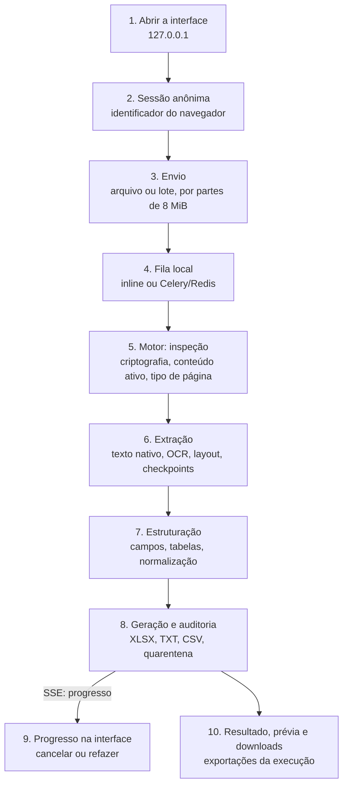
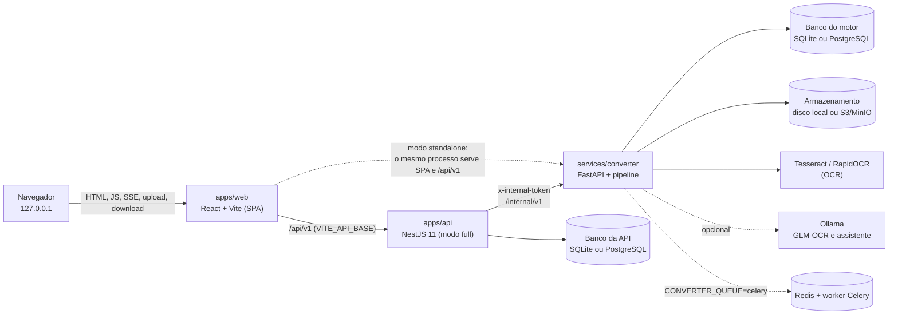

# Conversor Generator

[](https://github.com/vit-gusmao/Conversor-Generator/actions/workflows/ci.yml)


> Converta PDFs e imagens em planilhas e textos, com a origem de cada célula
> registrada até a página, a região e o motor que a produziu.

**Conversor Generator** é uma plataforma de conversão documental auditável. Ela
transforma o texto recuperável de um documento em artefatos organizados: campos
viram colunas, registros viram linhas, tabelas viram abas e o restante vira
arquivos TXT/CSV. Para cada valor, a auditoria guarda de onde ele veio e para
onde foi.

> **Projeto 100% local.** Tudo roda na sua máquina:
>
> - Não há hospedagem em nuvem, túnel, conta de usuário nem telemetria.
> - Por padrão, todos os serviços escutam em `127.0.0.1` (somente sua máquina).
> - Os arquivos, o banco e os resultados ficam em pastas locais (veja
>   [Onde ficam seus arquivos](#onde-ficam-seus-arquivos)).
> - O OCR (Ollama, Tesseract, RapidOCR) e o assistente rodam localmente. Nada é
>   enviado a serviços externos para converter um documento.
> - Não há limite de páginas por documento. O limite de tamanho do upload é
>   configurável (padrão de 50 MiB).

---

## Sumário

- [Visão geral](#visão-geral)
  - [Principais recursos](#principais-recursos)
  - [Limitações conhecidas](#limitações-conhecidas)
- [Como funciona](#como-funciona)
- [Onde ficam seus arquivos](#onde-ficam-seus-arquivos)
- [Arquitetura](#arquitetura)
- [Estrutura do repositório](#estrutura-do-repositório)
- [Requisitos](#requisitos)
- [Início rápido](#início-rápido)
- [Variáveis de ambiente](#variáveis-de-ambiente)
- [Testes](#testes)
- [Execução com Docker](#execução-com-docker)
- [Repositório e CI](#repositório-e-ci)
- [Documentação](#documentação)
- [Licença](#licença)

---

## Visão geral

### Principais recursos

- **Entradas:** PDF nativo, PDF digitalizado, PDF híbrido (texto e imagem) e
  imagens (PNG, JPEG, BMP, WebP, TIFF, GIF, entre outros codecs suportados).
- **Lotes:** envie vários arquivos por vez; cada um vira uma conversão
  independente. O envio é retomável por partes de 8 MiB, e os lotes são
  persistentes (`/batches`), com itens idempotentes por `client_item_id`.
- **Sem teto de páginas:** o documento inteiro é processado, com checkpoint por
  página e retomada sem repetir OCR quando a execução é interrompida.
- **Servidor MCP próprio** (`apps/mcp`): um cliente LLM envia vários documentos,
  acompanha o lote e baixa os artefatos sem usar a interface web. Veja
  [apps/mcp/README.md](apps/mcp/README.md).
- **Saídas:** XLSX, TXT e CSV, geradas a partir de um mesmo modelo intermediário
  (o OCR roda uma vez por execução).
- **Extração de campos:** pares `Rótulo: valor` viram colunas, sem dicionário
  fixo de rótulos. Valores em várias linhas permanecem em uma única célula.
- **Tabelas:** detecção por bordas (lattice), por alinhamento (stream), híbrida
  e, opcionalmente, via Docling. Tabelas transpostas viram registros e tabelas
  continuadas entre páginas são unificadas quando há evidência suficiente.
- **Normalização:** datas, moedas com `Decimal` (o símbolo do documento é
  preservado), percentuais, identificadores (CPF, CNPJ, CEP etc.) como texto e
  zeros à esquerda preservados. Texto iniciado por `=` nunca vira fórmula.
- **Aba consolidada `Todos os dados`:** quando há duas ou mais abas estruturais,
  uma aba extra reúne todas as linhas com a união das colunas e as colunas
  `Aba` e `Página` de origem. O download continua sendo um único `.xlsx`.
- **Robustez:** texto invisível (`3 Tr`/`7 Tr`) é detectado, valores de AcroForm
  viram dados, tabelas sem bordas são reconstruídas pelo padrão do texto, o
  separador decimal é decidido por valor e o OCR testa a orientação da página
  nas duas direções.
- **Auditoria:** eventos encadeados por hash, manifesto com SHA-256, cobertura
  por página e proveniência célula a célula. A interface exibe a auditoria em
  12 abas.
- **Publicação com quarentena:** o auditor reabre o XLSX e reprova imagens,
  fórmulas ou divergências em relação ao plano. Falha fatal bloqueia o download
  do artefato; o diagnóstico continua acessível.
- **Progresso em tempo real:** eventos por SSE com retomada por `Last-Event-ID`.
  É possível cancelar e refazer uma conversão.
- **OCR com degradação explícita:** GLM-OCR via Ollama (opcional, local),
  Tesseract e RapidOCR (conforme o extra instalado). Sem motor de OCR, páginas
  digitalizadas falham de forma explícita; nenhum texto é inventado.
- **Assistente local (opcional):** RAG sobre conversões do próprio usuário, com
  respostas que citam fontes, usando Qwen3.5-4B via Ollama. Vem desativado por
  padrão (`ASSISTANT_ENABLED=false`). Conversões funcionam sem ele.
- **Sessão local, sem conta:** cada navegador tem uma identidade própria e vê
  apenas as próprias conversões. Não há cadastro, login nem senha.

### Limitações conhecidas

O projeto detalha suas limitações em [docs/CONVERSION.md](docs/CONVERSION.md),
[docs/AUDIT.md](docs/AUDIT.md) e [docs/OPERATIONS.md](docs/OPERATIONS.md). Pontos
principais:

**Qualidade e escopo**

- Não há garantia de acerto de 100%. A auditoria mede **cobertura** (texto
  recuperado com destino) e não **precisão**, que só é medida contra um gabarito.
- O estado `REVIEW_REQUIRED` e o endpoint de revisão humana **não existem**. Veja
  [docs/API.md](docs/FLOW.md#limitações-e-divergências-conhecidas).
- O GLM-OCR devolve texto, não coordenadas por palavra. A geometria é
  reconstruída de forma determinística e a confiança é constante; ambas ficam
  registradas na auditoria.
- `ocr.languages` e `ocr.strategy` são aceitos, mas não são aplicados.
- O OCR por célula ou linha existe no componente, mas o pipeline ainda não o aciona.

**Armazenamento e limpeza**

- Os prazos de retenção (`RETENTION_*`, informados em `/settings`) **não são
  aplicados**: nada é apagado automaticamente. A limpeza é manual; veja
  [docs/OPERATIONS.md](docs/OPERATIONS.md).
- As partes de upload são mantidas após a conclusão do envio.
- Excluir uma conversão remove apenas `output.xlsx` e `audit.json.gz`. O original,
  os checkpoints e as demais saídas permanecem em disco.

**Limites e modos**

- No modo `standalone`, cada item de lote e cada envio simples têm no máximo `UPLOAD_MAX_BYTES` (50 MiB por padrão). No NestJS, o teto por item de lote é `UPLOAD_MAX_FILE_BYTES`, que vem vazio (sem teto).
- `MAX_FILES_PER_BATCH` existe na configuração, mas não é aplicada.
- No modo Celery (Docker Compose), não há retomada por checkpoint.

**Segurança e implantação**

- Os segredos padrão (`JWT_SECRET`, `CONVERTER_INTERNAL_TOKEN`) são strings
  públicas de desenvolvimento. Para uso local estrito, funcionam; se a porta for
  exposta fora da máquina, troque os valores.
- A execução com Docker Compose **não foi executada** no ambiente em que o
  projeto foi construído. Os modos sem container foram executados e testados.

---

## Como funciona

Visão resumida de uma conversão, do navegador até os arquivos gerados. O fluxo
detalhado, com estados e eventos, está em [docs/FLOW.md](docs/FLOW.md).

1. **Abra a interface.** No modo `standalone`, use `http://127.0.0.1:8000`. No
   modo `full` ou no Docker Compose, use o endereço indicado na
   [seção de início rápido](#início-rápido).
2. **Sessão anônima.** O navegador recebe um identificador de dispositivo
   (cookie `pdf2x_device_id` e `localStorage`). Todas as conversões ficam
   associadas a ele; outro navegador não vê essas conversões.
3. **Envio.** Você escolhe um arquivo ou um lote. O tipo e o tamanho são validados
   no navegador e no servidor. Arquivos enviados por partes de 8 MiB são
   retomáveis: cada parte tem seu hash, e o documento inteiro é verificado ao
   concluir o envio.
4. **Fila local.** Cada arquivo vira uma conversão na fila do próprio computador:
   pool de threads (`CONVERTER_QUEUE=inline`, padrão) ou Celery com Redis, no
   Docker Compose.
5. **Inspeção.** O motor verifica criptografia, conteúdo ativo e limites, e
   classifica cada página como nativa, digitalizada ou híbrida.
6. **Extração.** Texto nativo é lido direto do PDF. Páginas digitalizadas passam
   por OCR (GLM-OCR via Ollama, RapidOCR ou Tesseract). Layout e ordem de leitura
   são reconstruídos, e cada página grava um checkpoint.
7. **Estruturação.** O motor extrai campos `Rótulo: valor`, detecta tabelas,
   reconcilia tabelas que continuam entre páginas e normaliza datas, moedas,
   percentuais e identificadores.
8. **Geração e auditoria.** XLSX, TXT e CSV saem do mesmo modelo intermediário.
   O auditor reabre o XLSX gerado: se houver imagem, fórmula ou divergência em
   relação ao plano, o artefato vai para quarentena e não é liberado para download.
9. **Progresso.** Cada etapa emite eventos por SSE. Se a conexão cair, o navegador
   retoma a partir do último evento (`Last-Event-ID`). Você pode cancelar e refazer
   a conversão.
10. **Resultado e exportações.** A tela de resultado mostra o resumo, a prévia da
    planilha e a auditoria em 12 abas. Os downloads (XLSX, TXT, CSV e os demais
    artefatos da execução) ficam disponíveis quando passam pela publicação.



---

## Onde ficam seus arquivos

Nada é gravado fora das pastas do projeto e do perfil do navegador. Os caminhos
abaixo são relativos à pasta de execução de cada serviço, que é o padrão do
modo `standalone`.

```
services/converter/data/                       modo standalone (padrão)
├── converter.db                               banco SQLite: conversões, execuções, auditoria
├── storage/
│   ├── documents/<owner>/<sha256>.<ext>       originais enviados
│   ├── uploads/<upload_id>/                   partes do envio por partes
│   └── runs/<run_id>/                         resultados de uma execução
│       ├── output.xlsx
│       ├── text_plan.json.gz
│       ├── audit.json.gz
│       ├── exports/                           TXT e CSV
│       └── pages/                             checkpoints por página
└── work/                                      cópias temporárias de trabalho

apps/api/prisma/data/api.db                    modo full: banco da API (SQLite)
apps/api/data/storage/                         modo full: disco local da API
```

| Onde | Modo ou ambiente | O que fica lá |
| --- | --- | --- |
| `services/converter/data/` | `standalone` | banco do motor, originais, partes de envio, resultados, checkpoints |
| `apps/api/prisma/data/api.db` e `apps/api/data/storage/` | `full` (SQLite e disco local) | banco da aplicação (conversões, lotes, eventos) e arquivos da API |
| Volumes `pgdata`, `miniodata`, `redisdata` | Docker Compose | PostgreSQL, objetos do MinIO (S3) e Redis |
| `localStorage` `pdf2x.device_id` e `pdf2x.auth` | navegador | identidade do dispositivo e sessão |
| IndexedDB `pdf2x-uploads` | navegador | apenas metadados dos envios em andamento |

Para entender o que cada pasta contém, como fazer backup e como limpar espaço,
veja [docs/STORAGE.md](docs/STORAGE.md) e [docs/OPERATIONS.md](docs/OPERATIONS.md)
(backup, limpeza, logs e diagnóstico).

---

## Arquitetura



Dois modos com o mesmo contrato de API (`/api/v1`):

| Modo | Quem responde `/api/v1` | Banco | Fila | Arquivos |
| --- | --- | --- | --- | --- |
| `standalone` | FastAPI (converter) | SQLite | pool de threads (`inline`) | disco local |
| `full` | NestJS (apps/api) | PostgreSQL ou SQLite | `inline` ou Celery/Redis | disco local ou S3/MinIO |

Cada banco e cada tabela têm um único dono de escrita: o gateway NestJS escreve
a aplicação (usuários, conversões, eventos) e o motor Python escreve a evidência
(execuções, proveniência, auditoria). Detalhes em
[docs/ARCHITECTURE.md](docs/ARCHITECTURE.md) e [docs/DATABASE.md](docs/DATABASE.md).

---

## Estrutura do repositório

```
.
├── apps/
│   ├── api/                  NestJS 11 + Prisma: identidade, ownership, lotes, uploads, SSE, proxy do motor
│   ├── mcp/                  servidor MCP (stdio ou HTTP local): envio multi-arquivo, acompanhamento e download
│   └── web/                  React 19 + Vite 7: fila de upload, lote, progresso, resultado, auditoria (12 abas)
├── packages/
│   └── contracts/            tipos zod e openapi/public-api.yaml (fonte única do contrato)
├── services/
│   └── converter/            motor Python (FastAPI): inspeção, OCR, layout, campos, tabelas, XLSX, auditoria
├── infra/
│   ├── docker-compose.yml    stack local: PostgreSQL, Redis, MinIO, motor, worker, API e interface
│   └── postgres/init.sql     criação dos bancos usados pela stack
├── docs/                     arquitetura, fluxo, armazenamento, operação, configuração, conversão, auditoria, API, testes, deploy
├── starter-server.cmd        inicializador para Windows (modo standalone)
├── .env.example              modelo de variáveis de ambiente
└── package.json              scripts de raiz (install:all, build, test, test:py, test:mcp)
```

---

## Requisitos

| Ferramenta | Versão | Observação |
| --- | --- | --- |
| Node.js | 22 | a versão está em `.nvmrc`; as imagens Docker usam `node:22-alpine` |
| npm | acompanha o Node | os projetos Node usam `package-lock.json` |
| Python | 3.11 ou superior (3.12 recomendado) | `requires-python >=3.11`; 3.12 é a versão usada no CI e na imagem Docker do motor |
| Git | qualquer versão recente | para clonar o repositório |
| Tesseract OCR | opcional | fora do Docker, deve estar no `PATH`; no Windows o motor também procura `C:\Program Files\Tesseract-OCR\tesseract.exe` |
| Ollama | opcional | necessário apenas para o GLM-OCR (`glm-ocr:latest`) e para o assistente (`qwen3.5:4b`) |
| Docker | opcional | para o `infra/docker-compose.yml` e para as imagens da API, do motor e da interface |

---

## Início rápido

Os comandos abaixo são executados a partir da raiz do repositório, salvo indicação
em contrário. Em Windows, use `\` nos caminhos do venv. Em Linux e macOS, use `/`.

### 1. Configurar o ambiente

```bash
cp .env.example .env          # Windows (cmd): copy .env.example .env
```

O motor Python e a API leem o `.env` da raiz. Para uso local, os valores padrão
funcionam sem alteração. Em `STORAGE_LOCAL_ROOT`, prefira um caminho absoluto se
quiser que os arquivos fiquem fora da pasta do projeto. Se a porta for exposta
fora da máquina, troque `JWT_SECRET` e `CONVERTER_INTERNAL_TOKEN` (gere com
`openssl rand -hex 32`). Veja [Variáveis de ambiente](#variáveis-de-ambiente).

### 2. Modo `standalone` (um processo, sem Docker)

Um único processo FastAPI serve a API pública em `/api/v1` e a interface
compilada. Requer Python 3.11 ou superior (3.12 recomendado) e Node 22.

```bash
# (a) motor Python
cd services/converter
python -m venv .venv
.venv\Scripts\pip install -e ".[test]"        # Linux/macOS: .venv/bin/pip install -e ".[test]"

# (b) interface (gera apps/web/dist, servido pelo FastAPI)
cd ../../apps/web
npm install
npm run build

# (c) subir o servidor
cd ../../services/converter
.venv\Scripts\python -m uvicorn api.main:app --host 127.0.0.1 --port 8000   # Linux/macOS: .venv/bin/python ...
```

Abra <http://127.0.0.1:8000>. Endereços úteis:

- `/`: interface web
- `/api/v1`: API pública
- `/docs`: documentação interativa (OpenAPI)
- `/internal/v1`: API interna do motor, protegida por `x-internal-token`
- `/health`: verificação de saúde

**No Windows**, o arquivo `starter-server.cmd` automatiza esses passos: confere
o venv em `services\converter\.venv`, compila a interface se `apps\web\dist` não
existir, sobe o servidor em `127.0.0.1:8000`, aguarda a resposta de `/health` e
abre o navegador. Dê um duplo clique nele. Antes disso, crie o venv (passo a) e
instale as dependências. Para parar o servidor, feche a janela
"Conversor Generator - servidor" ou use `Ctrl+C` nela.

Com o Ollama ativo e o modelo `glm-ocr:latest` instalado, o GLM-OCR é o motor
preferencial. Caso contrário, o motor usa RapidOCR ou Tesseract, se instalados,
ou falha de forma explícita nas páginas digitalizadas. A ausência do Ollama nunca
impede a inicialização; o `starter-server.cmd` apenas informa o estado do GLM-OCR.

```bash
ollama pull glm-ocr:latest    # opcional, recomendado para páginas digitalizadas
ollama list
```

Detalhes do motor em [docs/CONVERSION.md](docs/CONVERSION.md#motor-glm-ocr).

### 3. Modo `full` (gateway NestJS + motor Python)

```bash
npm run install:all                                   # contracts + api + web
cd services/converter && python -m venv .venv && .venv/Scripts/pip install -e ".[test]" && cd ../..

# terminal 1: motor em modo full, sem API pública própria (127.0.0.1:8000)
cd services/converter
RUNTIME_MODE=full .venv/Scripts/python -m uvicorn api.main:app --host 127.0.0.1 --port 8000
#   PowerShell: $env:RUNTIME_MODE="full"; .venv\Scripts\python -m uvicorn api.main:app --host 127.0.0.1 --port 8000

# terminal 2: API pública NestJS (127.0.0.1:3000)
cd apps/api
npm run db:generate
npm run db:push
npm run build
npm run start:prod

# terminal 3: interface em modo de desenvolvimento (http://localhost:5173)
cd apps/web && npm run dev
```

Abra <http://localhost:5173>. Em `full`, o navegador fala com o NestJS (`:3000`),
que valida o upload, autentica, persiste a tarefa, transmite o SSE e delega a
conversão ao FastAPI por `x-internal-token`. O motor não é exposto ao navegador.

O servidor de desenvolvimento do Vite faz proxy de `/api` para
`http://localhost:3000` (padrão). Para usar o modo `standalone` nesse fluxo,
aponte o proxy para a porta 8000:

```bash
# Windows (PowerShell)
$env:VITE_API_PROXY_TARGET="http://localhost:8000"; npm --prefix apps/web run dev
# Linux/macOS
VITE_API_PROXY_TARGET=http://localhost:8000 npm --prefix apps/web run dev
```

### 4. Docker Compose (stack completa, não executada no ambiente de construção)

```bash
cd infra
export CONVERTER_INTERNAL_TOKEN=$(openssl rand -hex 32)   # PowerShell: $env:CONVERTER_INTERNAL_TOKEN = ...
export JWT_SECRET=$(openssl rand -hex 32)
docker compose up --build
# http://localhost:8080
```

Serviços: `postgres`, `redis`, `minio`, `minio-init`, `converter`, `worker`
(Celery), `api` (NestJS) e `web` (nginx + SPA). Apenas `web` publica uma porta,
e ela fica restrita a `127.0.0.1` (`WEB_PORT`, padrão `8080`). `CONVERTER_INTERNAL_TOKEN`
e `JWT_SECRET` são obrigatórios: o Compose recusa iniciar sem eles. O Compose lê
variáveis de `infra/.env`. Veja `infra/docker-compose.yml` e
[docs/DEPLOY.md](docs/DEPLOY.md).

> Nota de transparência: o ambiente em que este projeto foi construído não possui
> Docker. A composição foi escrita e revisada, mas **não foi executada**.

### 5. Servidor MCP (opcional)

O `apps/mcp` permite que um cliente LLM envie documentos e baixe os resultados.
Ele é opcional e não é necessário para usar a interface web.

```bash
npm run install:mcp
npm run build:mcp
npm run test:mcp
```

O transporte padrão é `stdio`. O modo HTTP escuta em `127.0.0.1` (`PDF2X_MCP_HOST`,
porta `PDF2X_MCP_PORT`). Configuração, ferramentas e exemplos de cliente estão em
[apps/mcp/README.md](apps/mcp/README.md).

---

## Variáveis de ambiente

O arquivo [`.env.example`](.env.example) lista todas as variáveis com comentários.
Esta tabela resume as mais importantes com os padrões do código. A referência
completa está em [docs/CONFIGURATION.md](docs/CONFIGURATION.md).

| Variável | Padrão | Função |
| --- | --- | --- |
| `RUNTIME_MODE` | `standalone` | `standalone` (motor responde `/api/v1`) ou `full` (a API NestJS responde `/api/v1`) |
| `API_HOST` | `127.0.0.1` | endereço em que a API NestJS escuta |
| `API_PORT` | `3000` | porta da API NestJS |
| `CONVERTER_PORT` | `8000` | porta do motor Python |
| `PDF2X_MCP_HOST` | `127.0.0.1` | endereço do transporte HTTP do servidor MCP |
| `ALLOWED_ORIGINS` | `http://localhost:5173,http://localhost:3000` | origens da interface liberadas no CORS, separadas por vírgula, sem barra final |
| `AUTH_MODE` | `optional` | `optional` cria sessão por dispositivo; `required` exige JWT nas rotas protegidas. No motor standalone, `POST /auth/anonymous` devolve 401 nesse modo; no NestJS responde 201 em qualquer modo |
| `JWT_SECRET` | valor de desenvolvimento público | segredo HMAC dos tokens; troque se a porta for exposta |
| `CONVERTER_INTERNAL_TOKEN` | valor de desenvolvimento público | token de `x-internal-token` entre API e motor; precisa ser igual nos dois lados |
| `CONVERTER_DATABASE_URL` | `sqlite:///./data/converter.db` | banco do motor (SQLite ou `postgresql+psycopg://...`) |
| `API_DATABASE_URL` | `file:./data/api.db` | banco da API (SQLite, relativo a `apps/api/prisma/`) |
| `API_POSTGRES_URL` | (vazio) | banco da API em PostgreSQL, usado com `schema.postgres.prisma` |
| `CONVERTER_INTERNAL_URL` | `http://localhost:8000` | URL do motor, vista pela API (modo `full`) |
| `CONVERTER_QUEUE` | `inline` | `inline` (pool de threads) ou `celery` (requer Redis e o worker) |
| `CONVERTER_WORKERS` | `2` | concorrência do pool `inline` |
| `CONVERTER_TASK_TIMEOUT_SECONDS` | `0` | prazo global por documento; `0` desativa (o timeout é por unidade) |
| `STORAGE_BACKEND` | `local` | `local` (disco) ou `s3` (S3/MinIO) |
| `STORAGE_LOCAL_ROOT` | `./data/storage` | raiz do armazenamento local |
| `S3_ENDPOINT`, `S3_BUCKET`, `S3_ACCESS_KEY`, `S3_SECRET_KEY`, `S3_REGION`, `S3_SECURE` | (vazio) / `pdf2x` / (vazio) | credenciais e endpoint do S3/MinIO; usados só com `STORAGE_BACKEND=s3` |
| `UPLOAD_MAX_BYTES` | `52428800` (50 MiB) | limite de tamanho por arquivo enviado |
| `UPLOAD_PART_BYTES` | `8388608` (8 MiB) | tamanho de cada parte no envio por partes |
| `UPLOAD_MAX_PAGES` | (obsoleta) | no motor, nunca recusa nem trunca; no NestJS, define um teto que gera `TOO_MANY_PAGES` |
| `CONVERTER_OCR_ENABLED` | `true` | liga ou desliga o OCR |
| `GLMOCR_ENABLED`, `GLMOCR_HOST`, `GLMOCR_PORT`, `GLMOCR_MODEL` | `true`, `127.0.0.1`, `11434`, `glm-ocr:latest` | GLM-OCR via Ollama |
| `ASSISTANT_ENABLED` | `false` | assistente local (RAG com Ollama e Qwen3.5-4B) |
| `RETENTION_PDF_DAYS`, `RETENTION_XLSX_DAYS`, `RETENTION_AUDIT_DAYS` | `7` / `30` / `90` | prazos informativos exibidos em `/settings`; **não são aplicados** |
| `VITE_API_BASE` | `/api/v1` | base da API compilada na interface (**em tempo de build**) |
| `VITE_API_PROXY_TARGET` | `http://localhost:3000` | alvo do proxy do Vite em desenvolvimento (use `http://localhost:8000` no modo `standalone`) |

Os valores de desenvolvimento permitem executar sem configuração, mas o motor
registra um aviso ao iniciar quando `CONVERTER_INTERNAL_TOKEN` ou `JWT_SECRET`
continuam com o valor padrão. Gere segredos com `openssl rand -hex 32`.

---

## Testes

Os comandos abaixo são os que o repositório define. A quantidade de testes muda
com o código; a saída de cada comando é a referência.

```bash
# raiz: API + interface (npm test) e motor Python (test:py, com o venv disponível)
npm test
npm run test:py

# servidor MCP
npm run test:mcp

# motor Python (com o venv ativo ou usando .venv\Scripts\python)
cd services/converter && python -m pytest tests -q

# API NestJS
npm --prefix apps/api test                 # unitários
npm --prefix apps/api run test:e2e         # HTTP, com dependências em memória

# interface
npm --prefix apps/web test                 # Vitest + Testing Library
npm --prefix apps/web run typecheck
```

- Os PDFs de teste são **gerados** por
  `services/converter/tests/fixtures/generate_pdfs.py`.
- Testes que dependem de Ollama ou do GLM-OCR são pulados automaticamente quando
  o serviço ou o modelo não existem.
- Stress contra o gabarito: `services/converter/scripts/stress_gabarito.py`
  pontua a conversão de cada PDF contra o `GABARITO.jsonl`. O corpus
  (`stress/pdfs`) é **local** e não faz parte do repositório (está no
  `.gitignore`); sem ele, o script não roda. Veja
  [docs/TESTING.md](docs/TESTING.md#stress-contra-o-corpus-dourado-3208-pdfs).

Estratégia e corpus em [docs/TESTING.md](docs/TESTING.md).

---

## Execução com Docker

A execução com containers roda inteiramente na sua máquina, sem publicação na
internet. Os passos, variáveis e checklist estão em
**[docs/DEPLOY.md](docs/DEPLOY.md)**. Há duas opções:

**1. Docker Compose (stack completa).** `infra/docker-compose.yml` sobe PostgreSQL,
Redis, MinIO, motor, worker Celery, API e interface. Só a interface publica uma
porta (`127.0.0.1:${WEB_PORT:-8080}`), e ela encaminha `/api/v1` para a API. Nenhum
outro serviço fica acessível pela rede.

**2. Standalone em um container.** Um processo FastAPI em `RUNTIME_MODE=standalone`
(imagem `services/converter/Dockerfile`) expõe `/api/v1` com SQLite e disco local.
Não há NestJS nem PostgreSQL. Adequado para uso individual.

As imagens são construídas a partir da raiz do repositório, com
`apps/api/Dockerfile`, `apps/web/Dockerfile` e `services/converter/Dockerfile`.

---

## Repositório e CI

O código-fonte está no GitHub (`vit-gusmao/Conversor-Generator`). O workflow
`.github/workflows/ci.yml` roda os testes a cada push e pull request na `main`.

O aplicativo não depende do GitHub para executar: a instalação e o uso são
feitos inteiramente na sua máquina, como descrito neste documento.

---

## Documentação

| Documento | Conteúdo |
| --- | --- |
| [docs/FLOW.md](docs/FLOW.md) | fluxo completo de uma conversão, do envio à exportação |
| [docs/STORAGE.md](docs/STORAGE.md) | onde ficam os dados em cada modo, formatos e tamanhos |
| [docs/OPERATIONS.md](docs/OPERATIONS.md) | backup, limpeza, logs e diagnóstico |
| [docs/CONFIGURATION.md](docs/CONFIGURATION.md) | referência completa de configuração |
| [docs/ARCHITECTURE.md](docs/ARCHITECTURE.md) | componentes, fronteiras de escrita e decisões |
| [docs/CONVERSION.md](docs/CONVERSION.md) | fases do motor, OCR, exportadores, limitações |
| [docs/AUDIT.md](docs/AUDIT.md) | eventos, cadeia de hash, proveniência, cobertura |
| [docs/DATABASE.md](docs/DATABASE.md) | tabelas, fronteira de escrita, migrações |
| [docs/API.md](docs/API.md) | contrato REST e SSE, códigos de erro |
| [docs/TESTING.md](docs/TESTING.md) | estratégia e corpus de testes |
| [docs/DEPLOY.md](docs/DEPLOY.md) | execução com containers na sua máquina (Docker Compose e standalone) |
| [apps/api/README.md](apps/api/README.md) | API NestJS: configuração, rotas, Docker |
| [apps/web/README.md](apps/web/README.md) | interface: desenvolvimento, build, Docker |
| [apps/mcp/README.md](apps/mcp/README.md) | servidor MCP: transportes, ferramentas, configuração |
| [services/converter/README.md](services/converter/README.md) | motor Python: execução, CLI, migrações |
| [CHANGELOG.md](CHANGELOG.md) | histórico de versões |

---

## Licença

Projeto proprietário. Todos os direitos reservados.

Ponto de atenção: o extra opcional `glmocr-sdk` (em `services/converter/pyproject.toml`) depende de PyMuPDF, que é AGPL; o motor não o usa por padrão, então revise a licença antes de habilitá-lo em um produto distribuído.
