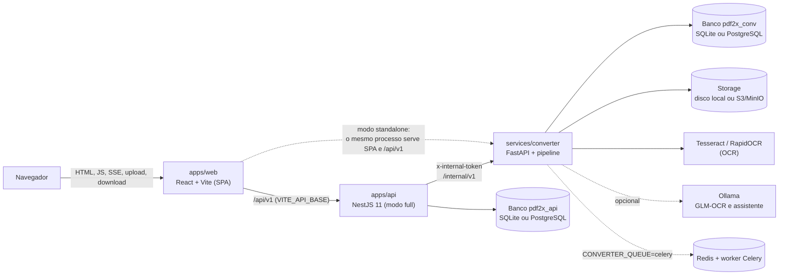

# Conversor Generator

[](https://github.com/OWNER/REPO/actions/workflows/ci.yml)


> Converta PDFs e imagens em planilhas e textos, com a origem de cada célula
> registrada até a página, a região e o motor que a produziu.

**Conversor Generator** é uma plataforma de conversão documental auditável. Ela
transforma o texto recuperável de um documento em artefatos organizados: campos
viram colunas, registros viram linhas, tabelas viram abas e o restante vira
arquivos TXT/CSV. Para cada valor, a auditoria guarda de onde ele veio e para
onde foi.

Regra de saída: o `.xlsx` contém somente texto e dados. Imagens podem ser
rasterizadas temporariamente para OCR, mas nunca são incorporadas à planilha.

---

## Sumário

- [Visão geral](#visão-geral)
- [Arquitetura](#arquitetura)
- [Estrutura do repositório](#estrutura-do-repositório)
- [Requisitos](#requisitos)
- [Início rápido](#início-rápido)
- [Variáveis de ambiente](#variáveis-de-ambiente)
- [Testes](#testes)
- [Deploy](#deploy)
- [Publicando no GitHub](#publicando-no-github)
- [Documentação](#documentação)
- [Licença](#licença)

---

## Visão geral

### Principais recursos

- **Entradas:** PDF nativo, PDF digitalizado, PDF híbrido (texto e imagem) e
  imagens (PNG, JPEG, BMP, WebP, TIFF, GIF, entre outros codecs suportados).
- **Saídas:** XLSX, TXT e CSV, geradas a partir de um mesmo modelo intermediário
  (o OCR roda uma vez por execução).
- **Extração de campos:** pares `Rótulo: valor` viram colunas, sem dicionário
  fixo de rótulos. Valores em várias linhas permanecem em uma única célula.
- **Tabelas:** detecção por bordas (lattice), por alinhamento (stream), híbrida
  e, opcionalmente, via Docling. Tabelas transpostas viram registros e tabelas
  continuadas entre páginas são unificadas quando há evidência suficiente.
- **Normalização:** datas, moedas com `Decimal` (o símbolo do documento é
  preservado), percentuais, identificadores (CPF, CNPJ, CEP etc.) como texto e
  zeros à esquerda preservados. Texto iniciado por `=` nunca vira fórmula.
- **Auditoria:** eventos encadeados por hash, manifesto com SHA-256, cobertura
  por página e proveniência célula a célula. A interface exibe a auditoria em
  12 abas.
- **Publicação com quarentena:** o auditor reabre o XLSX e reprova imagens,
  fórmulas ou divergências em relação ao plano. Falha fatal bloqueia o download
  do artefato; o diagnóstico continua acessível.
- **Progresso em tempo real:** eventos por SSE com retomada por `Last-Event-ID`.
  É possível cancelar e refazer uma conversão.
- **OCR com degradação explícita:** GLM-OCR via Ollama (opcional, local),
  Tesseract e RapidOCR (conforme o extra instalado). Sem motor de OCR, páginas
  digitalizadas falham de forma explícita; nenhum texto é inventado.
- **Assistente local (opcional):** RAG sobre conversões do próprio usuário, com
  respostas que citam fontes, usando Qwen3.5-4B via Ollama. Vem desativado por
  padrão (`ASSISTANT_ENABLED=false`). Conversões funcionam sem ele.
- **Sessão local, sem conta:** cada navegador tem uma identidade própria e vê
  apenas as próprias conversões. Não há cadastro, login nem senha.

### Limitações conhecidas

O projeto declara suas limitações em detalhe em
[docs/CONVERSION.md](docs/CONVERSION.md) e [docs/AUDIT.md](docs/AUDIT.md). Pontos
principais:

- Não há garantia de acerto de 100%. A auditoria mede **cobertura** (texto
  recuperado com destino) e não **precisão**, que só é medida contra um gabarito.
- O estado `REVIEW_REQUIRED` e o endpoint de revisão humana **não existem**. Veja
  [docs/API.md](docs/API.md#fora-do-escopo-atual-lacunas-declaradas).
- O GLM-OCR devolve texto, não coordenadas por palavra. A geometria é
  reconstruída de forma determinística e a confiança é constante; ambas ficam
  registradas na auditoria.
- A execução com Docker Compose **não foi executada** no ambiente em que o
  projeto foi construído. Os modos sem container foram executados e testados.

---

## Arquitetura



Dois modos com o mesmo contrato de API (`/api/v1`):

| Modo | Quem responde `/api/v1` | Banco | Fila | Arquivos |
| --- | --- | --- | --- | --- |
| `standalone` | FastAPI (converter) | SQLite | pool de threads (`inline`) | disco local |
| `full` | NestJS (apps/api) | PostgreSQL ou SQLite | `inline` ou Celery/Redis | disco local ou S3/MinIO |

Cada banco e cada tabela têm um único dono de escrita: o gateway NestJS escreve
aplicação (usuários, conversões, eventos) e o motor Python escreve evidência
(execuções, proveniência, auditoria). Detalhes em
[docs/ARCHITECTURE.md](docs/ARCHITECTURE.md) e [docs/DATABASE.md](docs/DATABASE.md).

---

## Estrutura do repositório

```
.
├── apps/
│   ├── api/                  NestJS 11 + Prisma: identidade, ownership, persistência, SSE, proxy do motor
│   └── web/                  React 19 + Vite 7: upload, progresso, resultado, auditoria (12 abas)
├── packages/
│   └── contracts/            tipos zod e openapi/public-api.yaml (fonte única do contrato)
├── services/
│   └── converter/            motor Python (FastAPI): inspeção, OCR, layout, campos, tabelas, XLSX, auditoria
├── infra/                    docker-compose, nginx, PostgreSQL (init), OpenTelemetry collector
├── docs/                     arquitetura, conversão, auditoria, banco, API, testes, deploy
├── starter-server.cmd        inicializador para Windows (modo standalone)
├── .env.example              modelo de variáveis de ambiente
└── package.json              scripts de raiz (install:all, build, test, test:py)
```

---

## Requisitos

| Ferramenta | Versão | Observação |
| --- | --- | --- |
| Node.js | 22 (recomendado) | `package.json` declara `>=20`; as imagens Docker usam `node:22-alpine` |
| npm | acompanha o Node | os projetos Node usam `package-lock.json` |
| Python | 3.11 ou superior | a imagem Docker do motor usa 3.12 |
| Git | qualquer versão recente | para clonar e publicar |
| Tesseract OCR | opcional | incluído na imagem Docker do motor. Fora do Docker, deve estar no `PATH`; no Windows o motor também procura `C:\Program Files\Tesseract-OCR\tesseract.exe` |
| Ollama | opcional | necessário apenas para GLM-OCR (`glm-ocr:latest`) e para o assistente (`qwen3.5:4b`) |
| Docker | opcional | para o `infra/docker-compose.yml` e para as imagens da API e do motor |

---

## Início rápido

Todos os comandos abaixo são executados a partir da raiz do repositório, salvo
indicação em contrário. Em Windows, use `\` nos caminhos do venv. Em Linux e
macOS, use `/`.

### 1. Configurar o ambiente

```bash
cp .env.example .env          # Windows (cmd): copy .env.example .env
```

O motor Python e a API leem o `.env` da raiz. Em `STORAGE_LOCAL_ROOT`, prefira
um caminho absoluto. Para produção, troque `JWT_SECRET` e
`CONVERTER_INTERNAL_TOKEN` (veja [Variáveis de ambiente](#variáveis-de-ambiente)).

### 2. Modo `standalone` (um processo, sem Docker)

Um único processo FastAPI serve a API pública em `/api/v1` e a interface
compilada. Requer apenas Python 3.11+ e Node 22.

```bash
# (a) motor Python
cd services/converter
python -m venv .venv
.venv\Scripts\pip install -e ".[test]"        # Linux/macOS: .venv/bin/pip install -e ".[test]"

# (b) interface (gera apps/web/dist, servido pelo FastAPI)
cd ../../apps/web
npm install
npm run build

# (c) subir o servidor
cd ../../services/converter
.venv\Scripts\python -m uvicorn api.main:app --host 127.0.0.1 --port 8000   # Linux/macOS: .venv/bin/python ...
```

Abra <http://127.0.0.1:8000>. Endereços úteis:

- `/api/v1`: API pública
- `/docs`: documentação interativa (OpenAPI)
- `/internal/v1`: API interna do motor, protegida por `x-internal-token`
- `/health`: verificação de saúde

**No Windows**, o arquivo `starter-server.cmd` automatiza esses passos: confere
o venv em `services/converter/.venv`, compila a interface se `apps/web/dist` não
existir, sobe o servidor em `127.0.0.1:8000`, aguarda a resposta de `/health` e
abre o navegador. Antes disso, crie o venv (passo a) e instale as dependências.

O OCR local é detectado automaticamente. Com o Ollama ativo e o modelo
`glm-ocr:latest` instalado, o GLM-OCR é o motor preferencial. Caso contrário, o
motor usa RapidOCR ou Tesseract, se instalados, ou falha de forma explícita.

```bash
ollama pull glm-ocr:latest    # opcional, recomendado para páginas digitalizadas
ollama list
```

Detalhes do motor em [docs/CONVERSION.md](docs/CONVERSION.md#motor-glm-ocr).

### 3. Modo `full` (gateway NestJS + motor Python)

```bash
npm run install:all                                   # contracts + api + web
cd services/converter && python -m venv .venv && .venv/Scripts/pip install -e ".[test]" && cd ../..

# terminal 1: motor (porta 8000)
cd services/converter && .venv/Scripts/python -m uvicorn api.main:app --port 8000

# terminal 2: API pública (porta 3000)
cd apps/api
npm run db:generate
npm run db:push
npm run build
npm run start:prod

# terminal 3: interface em modo de desenvolvimento (porta 5173)
cd apps/web && npm run dev
```

Em `full`, o navegador fala com o NestJS (`:3000`). O NestJS valida o upload,
autentica, persiste a tarefa, transmite o SSE e delega a conversão ao FastAPI
por `x-internal-token`. O motor não é exposto ao navegador.

O servidor de desenvolvimento do Vite faz proxy de `/api` para
`http://localhost:3000`. Para usar o modo `standalone` nesse fluxo, aponte o
proxy para a porta 8000:

```bash
# Windows (PowerShell)
$env:VITE_API_PROXY_TARGET="http://localhost:8000"; npm --prefix apps/web run dev
# Linux/macOS
VITE_API_PROXY_TARGET=http://localhost:8000 npm --prefix apps/web run dev
```

### 4. Docker Compose (stack completa, não executada no ambiente de construção)

```bash
cd infra
export CONVERTER_INTERNAL_TOKEN=$(openssl rand -hex 32)   # PowerShell: $env:CONVERTER_INTERNAL_TOKEN = ...
export JWT_SECRET=$(openssl rand -hex 32)
docker compose up --build
# http://localhost:8080
```

Serviços: `postgres`, `redis`, `minio`, `minio-init`, `converter`, `worker`
(Celery), `api` (NestJS) e `web` (nginx + SPA). `CONVERTER_INTERNAL_TOKEN` e
`JWT_SECRET` são obrigatórios: o compose recusa iniciar sem eles. Veja
`infra/docker-compose.yml`. O Compose também lê variáveis de `infra/.env`.

> Nota de transparência: o ambiente em que este projeto foi construído não possui
> Docker. A composição foi escrita e revisada, mas **não foi executada**. Para
> produção, veja [docs/DEPLOY.md](docs/DEPLOY.md).

---

## Variáveis de ambiente

O arquivo [`.env.example`](.env.example) lista todas as variáveis com comentários.
Esta tabela resume as mais importantes.

| Variável | Padrão no código | Função |
| --- | --- | --- |
| `RUNTIME_MODE` | `standalone` (motor) / `full` (API) | `standalone` ou `full`; define quem responde `/api/v1` |
| `JWT_SECRET` | valor de desenvolvimento | segredo HMAC dos tokens; **troque em produção** |
| `CONVERTER_INTERNAL_TOKEN` | valor de desenvolvimento | token de `x-internal-token` entre API e motor; **troque em produção** |
| `ALLOWED_ORIGINS` | `http://localhost:5173,http://localhost:3000` | lista de origens CORS, separadas por vírgula |
| `AUTH_MODE` | `optional` | `optional` cria sessão por dispositivo; `required` exige JWT |
| `API_PORT` | `3000` | porta da API NestJS |
| `API_DATABASE_URL` | `file:./data/api.db` | banco da API (SQLite) |
| `API_POSTGRES_URL` | — | banco da API em PostgreSQL (usado por `schema.postgres.prisma`) |
| `CONVERTER_DATABASE_URL` | `sqlite:///./data/converter.db` | banco do motor (SQLite ou `postgresql+psycopg://...`) |
| `CONVERTER_INTERNAL_URL` | `http://localhost:8000` | URL do motor, vista pela API (modo `full`) |
| `CONVERTER_QUEUE` | `inline` | `inline` (threads) ou `celery` (requer Redis e o worker) |
| `CONVERTER_WORKERS` | `2` | concorrência do pool `inline` |
| `STORAGE_BACKEND` | `local` | `local` ou `s3` |
| `STORAGE_LOCAL_ROOT` | `./data/storage` | raiz do armazenamento local |
| `S3_ENDPOINT`, `S3_BUCKET`, `S3_ACCESS_KEY`, `S3_SECRET_KEY`, `S3_REGION`, `S3_SECURE` | — | credenciais e endpoint do S3/MinIO |
| `UPLOAD_MAX_BYTES` | `52428800` (50 MiB) | limite de tamanho do upload |
| `UPLOAD_MAX_PAGES` | `500` | limite de páginas |
| `GLMOCR_*` | ver `.env.example` | Ollama para GLM-OCR; `GLMOCR_HOST` padrão `127.0.0.1` |
| `ASSISTANT_*`, `EMBEDDING_MODEL` | `ASSISTANT_ENABLED=false` | assistente local (Ollama, Qwen3.5-4B) |
| `RETENTION_PDF_DAYS`, `RETENTION_XLSX_DAYS`, `RETENTION_AUDIT_DAYS` | `7` / `30` / `90` | prazos informados em `/settings` (veja a seção de retenção em [docs/DEPLOY.md](docs/DEPLOY.md)) |
| `VITE_API_BASE` | `/api/v1` | base da API compilada na interface (**em tempo de build**) |
| `VITE_API_PROXY_TARGET` | `http://localhost:3000` | alvo do proxy do Vite em desenvolvimento |

Os valores de desenvolvimento permitem executar sem configuração, mas o motor
registra um aviso ao iniciar quando `CONVERTER_INTERNAL_TOKEN` ou `JWT_SECRET`
continuam com o valor padrão. Gere segredos com `openssl rand -hex 32`.

---

## Testes

Os comandos abaixo são os que o repositório define. A quantidade de testes muda
com o código; a saída de cada comando é a referência.

```bash
# raiz: motor Python + API + interface (requer o venv do motor disponível)
npm run test:py
npm test

# motor Python (com o venv ativo ou usando .venv\Scripts\python)
cd services/converter && python -m pytest tests -q

# API NestJS
npm --prefix apps/api test                 # unitários
npm --prefix apps/api run test:e2e         # HTTP, com dependências em memória

# interface
npm --prefix apps/web test                 # Vitest + Testing Library
npm --prefix apps/web run typecheck
```

- Os PDFs de teste são **gerados** por
  `services/converter/tests/fixtures/generate_pdfs.py`.
- Testes que dependem de Ollama ou do GLM-OCR são pulados automaticamente quando
  o serviço ou o modelo não existem.

Estratégia e corpus em [docs/TESTING.md](docs/TESTING.md).

---

## Deploy

Arquitetura recomendada para produção:

- **Frontend:** Vercel, como SPA estática, configurada pelo `vercel.json` na
  raiz do repositório.
- **API e motor:** plataforma de containers ou VM com Docker, usando as imagens
  `apps/api/Dockerfile` e `services/converter/Dockerfile`, com PostgreSQL e
  armazenamento persistente (disco ou S3).

O motor não roda em funções serverless. Ele mantém threads de trabalho,
depende de binários nativos (Tesseract, pdfium, OpenCV) e grava em disco. O
guia completo, com variáveis, ordem de implantação e checklist pós-deploy, está
em **[docs/DEPLOY.md](docs/DEPLOY.md)**.

---

## Publicando no GitHub

Estes são passos para você executar. Eles não foram executados pelo projeto.

```bash
git status                        # confira o que será enviado
git add .
git commit -m "Versão inicial 1.0.0"
git branch -M main
git remote add origin https://github.com/OWNER/REPO.git
git push -u origin main
```

Antes do primeiro commit, confirme que **não** estão sendo enviados `.env`,
`data/`, bancos SQLite nem `node_modules/`. O `.gitignore` cobre esses itens.

Depois do push, o workflow de integração contínua (`.github/workflows/ci.yml`)
roda nas próximas alterações. Substitua `OWNER/REPO` nos badges acima.

---

## Documentação

| Documento | Conteúdo |
| --- | --- |
| [docs/ARCHITECTURE.md](docs/ARCHITECTURE.md) | componentes, fluxo de uma conversão, decisões |
| [docs/CONVERSION.md](docs/CONVERSION.md) | as 16 fases do motor, OCR, exportadores, limitações |
| [docs/AUDIT.md](docs/AUDIT.md) | eventos, cadeia de hash, proveniência, cobertura |
| [docs/DATABASE.md](docs/DATABASE.md) | tabelas, fronteira de escrita, migrações |
| [docs/API.md](docs/API.md) | contrato REST e SSE, códigos de erro |
| [docs/TESTING.md](docs/TESTING.md) | estratégia e corpus de testes |
| [docs/DEPLOY.md](docs/DEPLOY.md) | publicação do frontend na Vercel e da API e do motor em containers |
| [apps/api/README.md](apps/api/README.md) | API NestJS: configuração, rotas, Docker |
| [apps/web/README.md](apps/web/README.md) | interface: desenvolvimento, build, Vercel |
| [services/converter/README.md](services/converter/README.md) | motor Python: execução, CLI, migrações |
| [CHANGELOG.md](CHANGELOG.md) | histórico de versões |

---

## Licença

Projeto proprietário. Todos os direitos reservados.

Ponto de atenção: o extra opcional `glmocr-sdk` (em `services/converter/pyproject.toml`) depende de PyMuPDF, que é AGPL; o motor não o usa por padrão, então revise a licença antes de habilitá-lo em um produto distribuído.
