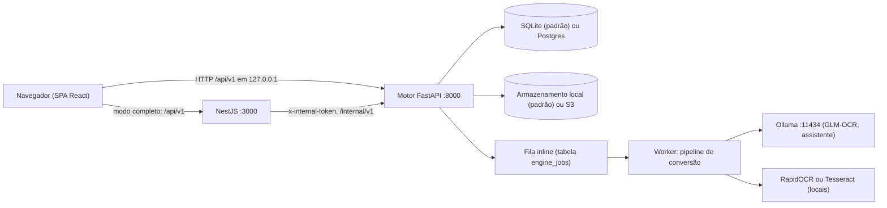
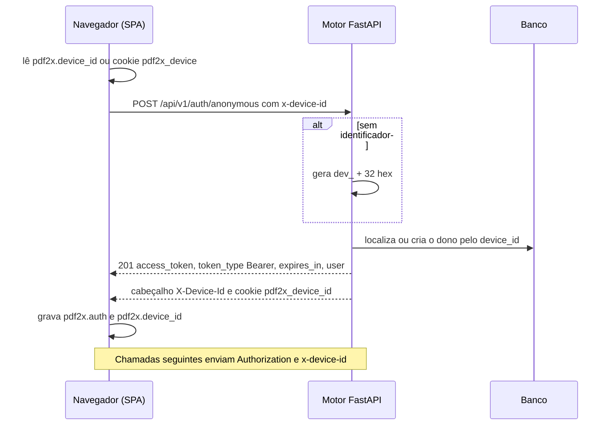
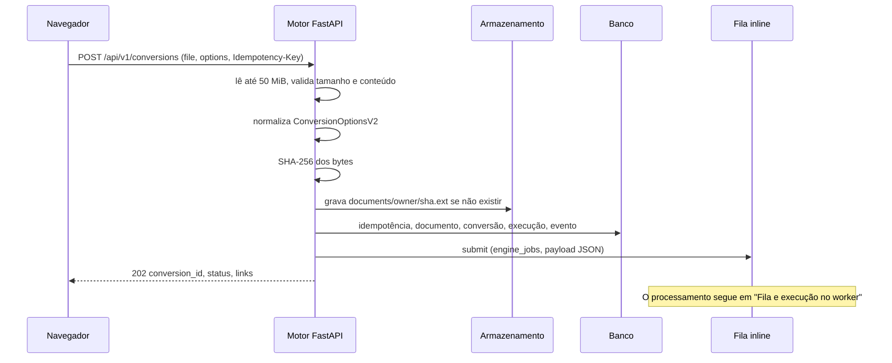
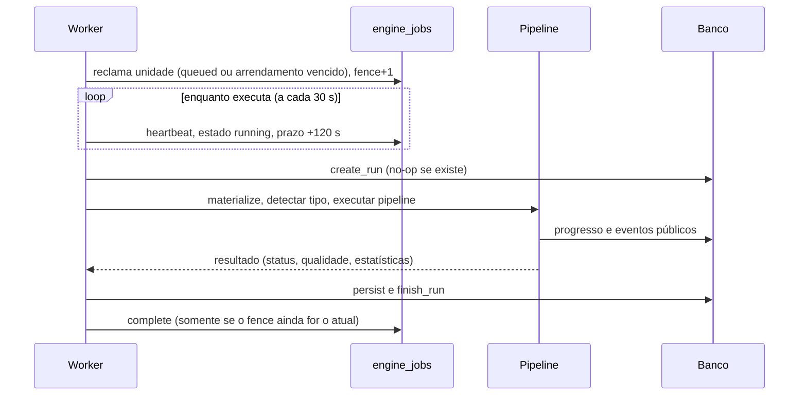
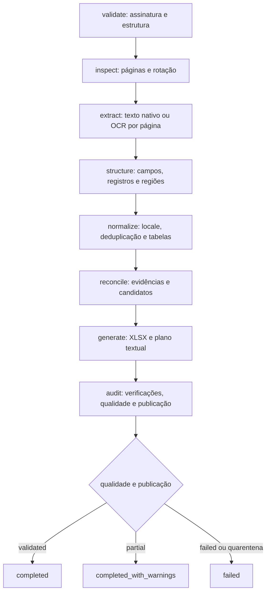
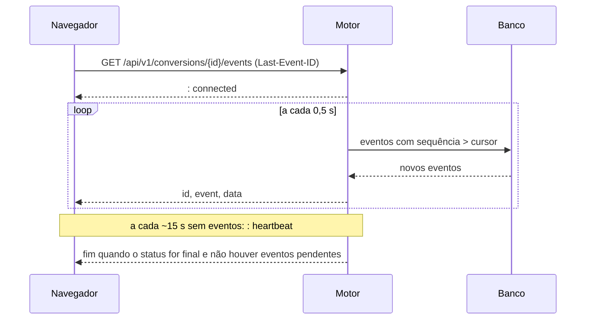
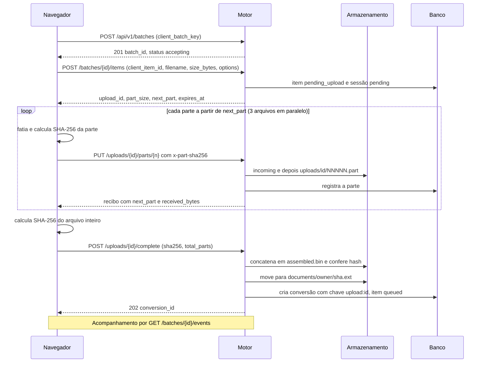
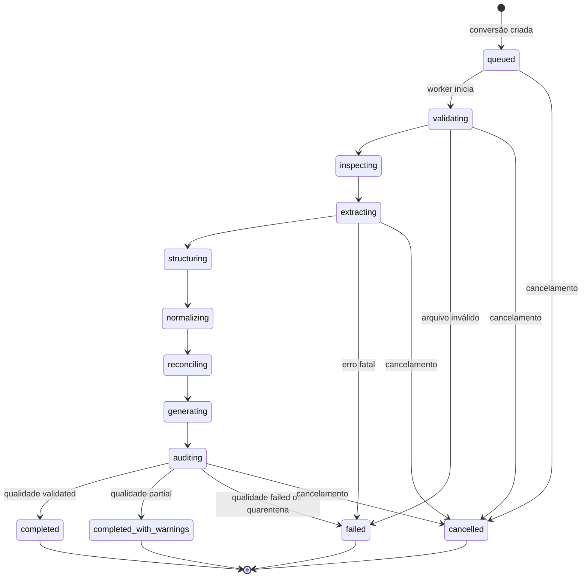

# Fluxo completo da versão local

Este documento descreve, do início ao fim, como o Conversor Generator funciona na versão 100% local: desde abrir a aplicação até baixar o XLSX, o TXT ou o CSV de um documento. Cada afirmação foi conferida no código-fonte. Quando o código diverge de uma descrição anterior, o texto segue o código e a divergência aparece em [Limitações e divergências conhecidas](#limitações-e-divergências-conhecidas).

Para a referência formal de rotas e payloads, consulte [API.md](API.md). Para o modelo de dados, [DATABASE.md](DATABASE.md). Para a regra de conversão e os motores, [CONVERSION.md](CONVERSION.md). Para auditoria, [AUDIT.md](AUDIT.md).

## Sumário

- [O que significa "local"](#o-que-significa-local)
- [Componentes e portas](#componentes-e-portas)
- [Modos de execução](#modos-de-execução)
- [Identidade e sessão](#identidade-e-sessão)
- [Fluxo de um arquivo (envio simples)](#fluxo-de-um-arquivo-envio-simples)
- [Fila e execução no worker](#fila-e-execução-no-worker)
- [Pipeline de conversão](#pipeline-de-conversão)
- [Acompanhamento em tempo real](#acompanhamento-em-tempo-real)
- [Lotes e envio por partes](#lotes-e-envio-por-partes)
- [Máquinas de estado](#máquinas-de-estado)
- [Resultados, prévia e exportações](#resultados-prévia-e-exportações)
- [Repetir, cancelar e excluir](#repetir-cancelar-e-excluir)
- [Assistente e base de conhecimento (opcional)](#assistente-e-base-de-conhecimento-opcional)
- [Rede: o que entra e o que sai](#rede-o-que-entra-e-o-que-sai)
- [Limitações e divergências conhecidas](#limitações-e-divergências-conhecidas)
- [Leia também](#leia-também)

## O que significa "local"

Tudo roda na sua máquina:

- O motor de conversão (Python/FastAPI), a API pública (NestJS, no modo completo) e a interface (React) são processos locais.
- Os documentos, as execuções, os checkpoints e as exportações ficam no seu disco. Onde exatamente, e como fazer backup, está em [STORAGE.md](STORAGE.md) (em preparação).
- Não há conta, cadastro, login ou senha. A "identidade" é um identificador gerado pelo navegador (o *device id*). Cada navegador enxerga apenas o próprio espaço de trabalho.
- Não há nuvem, túnel ou telemetria. Os serviços escutam em `127.0.0.1` por padrão. Mais detalhes em [Rede: o que entra e o que sai](#rede-o-que-entra-e-o-que-sai).



## Componentes e portas

| Componente | Onde está | Porta padrão | Bind padrão | Papel |
|---|---|---|---|---|
| Motor FastAPI | [services/converter/api/main.py](../services/converter/api/main.py) (`api.main:app`) | 8000 | `127.0.0.1` | API pública `/api/v1`, API interna `/internal/v1`, documentação em `/docs`, `/health`. Serve `apps/web/dist` quando o build existe. |
| API NestJS | [apps/api](../apps/api) | 3000 | `API_HOST=127.0.0.1` | Contrato público `/api/v1` no modo completo: donos (owner), idempotência, outbox para o motor. |
| Interface Vite (dev) | [apps/web](../apps/web) | 5173 | padrão do Vite (localhost) | Desenvolvimento. O proxy de `/api` aponta para `VITE_API_PROXY_TARGET`, cujo padrão é `http://localhost:3000`. |
| Interface compilada | `apps/web/dist` | não tem porta própria | depende do modo | Na standalone é servida pelo motor. No Compose, pelo nginx. |
| Fila inline | [services/converter/jobqueue/inline.py](../services/converter/jobqueue/inline.py) | não tem porta | não tem | `ThreadPoolExecutor` com `CONVERTER_WORKERS` (padrão 2) dentro do processo do motor. |
| Worker Celery | [services/converter/worker/celery_app.py](../services/converter/worker/celery_app.py) | não tem porta | não tem | Só no Compose. Fila `pdf-native`. |
| Adaptador MCP | [apps/mcp](../apps/mcp) | stdio (padrão) ou 7801 | `PDF2X_MCP_HOST=127.0.0.1` | Opcional. Expõe a API a clientes MCP. Rota HTTP `/mcp`. |
| Ollama | externo, instalado por você | 11434 | `127.0.0.1` | Opcional. GLM-OCR para páginas digitalizadas e o assistente. |
| Tesseract / RapidOCR | binário ou pacote local | não tem | não tem | Motores de OCR de fallback. |
| PostgreSQL, Redis, MinIO | só no Compose | não publicadas | rede interna `backend` | Banco, broker e armazenamento S3. Não são acessíveis do host. |
| nginx | [apps/web/nginx.conf.template](../apps/web/nginx.conf.template) | 80 no contêiner, publicada em `127.0.0.1:${WEB_PORT:-8080}` | `127.0.0.1` | Serve a SPA e faz proxy de `/api/` para `api:3000`. |

Apenas o serviço `web` do Compose publica porta, e só em `127.0.0.1`. Os demais serviços do Compose ficam na rede interna.

## Modos de execução

Há três formas de subir o sistema e um componente opcional. Escolha uma:

| Modo | Processos | Banco | Armazenamento | Fila | Quando usar |
|---|---|---|---|---|---|
| A. Standalone | 1 processo Python (motor) | SQLite | disco local | inline | Uso pessoal, o caminho mais simples. |
| B. Completo sem Docker | motor + NestJS + Vite | SQLite (Prisma e motor) | disco local | inline no motor | Desenvolvimento da API NestJS. |
| C. Docker Compose | motor, API NestJS, worker Celery, nginx, Postgres, Redis, MinIO | Postgres | MinIO (S3) | Celery | Topologia completa do Compose, na sua máquina. |

O modo é determinado por como você sobe os processos. A variável `RUNTIME_MODE` é informativa: ela aparece em `GET /api/v1/settings` e na configuração do NestJS, mas não escolhe o caminho de execução.

### Modo A: standalone

Neste modo um único processo `uvicorn` expõe `/api/v1` e serve a interface compilada. Não há Docker, Redis, Postgres nem NestJS.

#### Pelo launcher (Windows)

O arquivo [starter-local-server.cmd](../starter-local-server.cmd) na raiz faz, em ordem:

1. Valida `CONVERTER_PORT` (padrão `8000`) e sonda `http://127.0.0.1:<porta>/health`. Se já responder, abre o navegador e encerra, sem subir outro processo.
2. Se a porta estiver ocupada por outro processo, aborta com erro.
3. Verifica o OCR: se o Ollama está instalado, respondendo e com o modelo `glm-ocr`. É apenas um aviso e nunca bloqueia a inicialização.
4. Garante o ambiente `services\converter\.venv` (ou `CG_VENV_DIR`). Se não existir, ou se não funcionar ou usar Python abaixo de 3.11, procura um Python 3.11+ (`py -3.12`, `py -3.13`, ..., `python`) e recria o venv. Se não houver Python, tenta `winget install Python.Python.3.12` no usuário.
5. Instala `pip install -e "services\converter[ocr,migrate]"`. Guarda um carimbo com o SHA256 de `pyproject.toml`: só reinstala quando ele muda ou quando os imports básicos falham. O log fica em `.venv\install.log`.
6. Se `apps\web\dist\index.html` não existir (ou com `--rebuild-web`), compila `packages\contracts` e `apps\web` com `npm ci` e `npm run build`. Exige Node.js 20.19+ ou 22+ (tenta `winget install OpenJS.NodeJS.LTS`). Se o build falhar, a API continua disponível, sem interface.
7. Inicia, em uma janela minimizada, `python -m uvicorn api.main:app --host 127.0.0.1 --port <porta> --log-level info` com diretório de trabalho em `services\converter`.
8. Sonda `/health` por até 90 segundos, uma vez por segundo, e então abre `http://127.0.0.1:<porta>`.

Para executar, dê dois cliques em `starter-local-server.cmd` ou rode no PowerShell, na raiz do repositório:

```powershell
.\starter-local-server.cmd                 # abre o navegador ao final
.\starter-local-server.cmd --no-browser    # não abre o navegador
```

#### Manualmente

Use este roteiro se o launcher não servir (por exemplo, em macOS ou Linux). Uma vez:

```powershell
cd services\converter
python -m venv .venv
.venv\Scripts\pip install -e ".[test]"

cd ..\..\apps\web
npm install
npm run build
```

Sempre que quiser subir o sistema:

```powershell
cd services\converter
.venv\Scripts\python.exe -m uvicorn api.main:app --host 127.0.0.1 --port 8000
```

Equivalente em bash:

```bash
cd services/converter
python -m venv .venv && .venv/bin/pip install -e ".[test]"
(cd ../../apps/web && npm install && npm run build)
.venv/bin/python -m uvicorn api.main:app --host 127.0.0.1 --port 8000
```

O motor lê o arquivo `.env` da raiz do repositório ou de `services\converter\.env`. Copie [.env.example](../.env.example) para um deles antes de personalizar. Variáveis em [CONFIGURATION.md](CONFIGURATION.md) (em preparação).

#### URLs no navegador

| URL | O que é |
|---|---|
| `http://127.0.0.1:8000/` | A interface compilada. Se `apps/web/dist` não existir, a raiz devolve um JSON com `api`, `docs` e a versão. |
| `http://127.0.0.1:8000/docs` | Swagger do motor. |
| `http://127.0.0.1:8000/api/v1/health` | Estado do banco, da fila e do armazenamento. |
| `http://127.0.0.1:8000/health` | Probe simples usado pelo launcher. |

Qualquer caminho que comece com `api/` ou `internal/` e não exista devolve 404 em JSON, nunca a página HTML da interface.

#### Modo de desenvolvimento com Vite

Para editar a interface com recarregamento automático, mantenha o motor rodando e suba o Vite apontando para a porta 8000. O padrão do proxy é a porta 3000 (NestJS), então a variável é obrigatória neste cenário:

```powershell
# terminal 1: motor
cd services\converter
.venv\Scripts\python.exe -m uvicorn api.main:app --host 127.0.0.1 --port 8000

# terminal 2: interface
cd apps\web
$env:VITE_API_PROXY_TARGET = "http://127.0.0.1:8000"
npm run dev
```

Abra `http://localhost:5173`. Use `127.0.0.1` no alvo do proxy: o motor escuta apenas em IPv4, e `localhost` pode resolver para IPv6 no Windows e quebrar o proxy.

### Modo B: completo sem Docker

Neste modo a API pública é o NestJS (porta 3000), que guarda donos, idempotência e o outbox em um banco próprio. O motor (porta 8000) continua executando as conversões e expõe a API interna. A interface (porta 5173) faz proxy de `/api` para o NestJS.

Na raiz do repositório, uma vez:

```powershell
npm run install:all
npm run db:push
```

`install:all` compila `packages/contracts` e instala as dependências de `apps/api` e `apps/web`. `db:push` cria o esquema do Prisma em `apps/api`.

Depois, cada comando em um terminal:

```powershell
# terminal 1: API NestJS (porta 3000)
npm run dev:api

# terminal 2: motor FastAPI (porta 8000)
cd services\converter
.venv\Scripts\python.exe -m uvicorn api.main:app --host 127.0.0.1 --port 8000

# terminal 3: interface (porta 5173, proxy /api para 3000)
npm run dev:web
```

Abra `http://localhost:5173`.

Pontos que exigem atenção:

- `CONVERTER_INTERNAL_TOKEN` precisa ser idêntico no NestJS e no motor. O valor padrão de desenvolvimento é o mesmo nos dois, mas altere-o antes de expor qualquer porta.
- `CONVERTER_INTERNAL_URL` do NestJS aponta para `http://localhost:8000` por padrão.
- `CONVERTER_CALLBACK_URL` é opcional. Sem ele, o NestJS consulta o motor a cada `CONVERTER_POLL_INTERVAL_MS` (padrão 800 ms) para atualizar o status.
- Sem a interface, a API continua respondendo em `http://127.0.0.1:3000/api/v1`.

### Modo C: Docker Compose

O [docker-compose.yml](../infra/docker-compose.yml) em `infra/` sobe a topologia completa:

| Serviço | Função | Publicado no host |
|---|---|---|
| `postgres` | Banco de dados do motor e da API | não |
| `redis` | Broker do Celery | não |
| `minio` e `minio-init` | Armazenamento S3 e criação do bucket | não |
| `converter` | Motor FastAPI, com `CONVERTER_QUEUE=celery` e `RUNTIME_MODE=full` | não |
| `worker` | `celery -A worker.celery_app worker -Q pdf-native -c 2` | não |
| `api` | NestJS na porta 3000, com `API_HOST=0.0.0.0` dentro do contêiner | não |
| `web` | nginx com a SPA e proxy de `/api/` para `api:3000` | `127.0.0.1:${WEB_PORT:-8080}` |

O Compose exige `CONVERTER_INTERNAL_TOKEN` e `JWT_SECRET`. Sem eles, o `docker compose` falha por causa do `:?` nas variáveis. Defina-as no ambiente ou em `infra\.env` (o Compose lê esse arquivo por padrão).

```powershell
cd infra
$env:CONVERTER_INTERNAL_TOKEN = "troque-por-um-valor-longo"
$env:JWT_SECRET = "troque-por-outro-valor-longo"
docker compose up --build
```

Abra `http://127.0.0.1:8080` (ou o valor de `WEB_PORT`). Os dados ficam em volumes nomeados do Docker (`pgdata`, `redisdata`, `miniodata`), não em pastas do repositório. A forma de copiar e restaurar esses volumes está em [OPERATIONS.md](OPERATIONS.md) (em preparação) e a visão de containers locais em [DEPLOY.md](DEPLOY.md).

No Compose o caminho de execução é outro: a API chama `POST /internal/v1/jobs/{runId}/enqueue` no motor, que envia a tarefa ao Celery. Não há tabela `engine_jobs`, não há retomada por checkpoint e o cancelamento é feito por `revoke`. Veja [Fila e execução no worker](#fila-e-execução-no-worker).

### Componente opcional: adaptador MCP

O [apps/mcp](../apps/mcp) expõe a API do conversor como ferramentas MCP, para clientes como assistentes de código. Ele não converte nada sozinho.

```powershell
npm --prefix apps\mcp run build
```

Modo stdio, o padrão. O cliente MCP inicia o processo:

```powershell
$env:PDF2X_API_BASE_URL = "http://127.0.0.1:8000"
npm --prefix apps\mcp start
```

Modo HTTP, em loopback, na rota `/mcp`:

```powershell
$env:PDF2X_MCP_TRANSPORT = "http"
$env:PDF2X_MCP_HOST = "127.0.0.1"
$env:PDF2X_MCP_PORT = "7801"
$env:PDF2X_API_BASE_URL = "http://127.0.0.1:8000"
npm --prefix apps\mcp start
```

`PDF2X_API_BASE_URL` padrão é `http://localhost:8000`. No modo completo, use `http://localhost:3000`. O valor deve ser a raiz do servidor (opcionalmente terminando em `/api/v1`), sem credenciais, sem query string e sem fragmento. O host do modo HTTP só aceita o que você definir em `PDF2X_MCP_HOST`, cujo padrão é `127.0.0.1`.

## Identidade e sessão

### Como o motor identifica o navegador

Não existe login. Cada requisição recebe um dono (`owner_id`) derivado do navegador, nesta ordem em [services/converter/api/deps.py](../services/converter/api/deps.py):

1. Cabeçalho `Authorization: Bearer <token>`, se existir. Token inválido ou expirado devolve 401. Usuário inexistente também.
2. Cabeçalho `x-device-id`, se existir.
3. Cookie `pdf2x_device_id`, se existir.
4. Caso nenhum dos anteriores exista, gera `dev_` seguido de 32 caracteres hexadecimais, cria o dono e define o cookie `pdf2x_device_id` (HttpOnly, `SameSite=Lax`, validade de um ano).

O código de `deps.py` tem um comentário dizendo que o cookie vem primeiro, mas a ordem efetiva é a do cabeçalho `x-device-id` antes do cookie. Veja [divergências](#limitações-e-divergências-conhecidas).

No modo completo, o NestJS faz a mesma lógica em [apps/api/src/auth/guards/optional-jwt.guard.ts](../apps/api/src/auth/guards/optional-jwt.guard.ts). A ordem é: Bearer (também aceito em `?access_token=` nas rotas de SSE), depois `x-device-id`, depois `?device_id=`, e por último o cookie `pdf2x_device_id`. Se nenhum identificador válido existir, gera um novo e o devolve no cabeçalho `x-device-id`.

### Modos de autenticação

`AUTH_MODE` controla o que acontece quando não há token Bearer:

| Valor | Comportamento |
|---|---|
| `optional` (padrão) | Sem token, o navegador é identificado pelo device id. |
| `required` | Sem token, as rotas protegidas devolvem 401. |

No motor standalone, o modo `required` impede também a criação de sessão anônima: `POST /api/v1/auth/anonymous` chama `resolve_user` sem token e, nesse modo, recebe 401. Isso contradiz a intenção descrita no `.env.example`. Veja [divergências](#limitações-e-divergências-conhecidas). No NestJS, o endpoint de sessão anônima não consulta `AUTH_MODE` e funciona nos dois modos.

### Primeiro acesso

O SPA cria a sessão uma única vez, na primeira página carregada, chamando `POST /api/v1/auth/anonymous`:



No navegador, o identificador fica em três lugares: `localStorage["pdf2x.device_id"]`, o cookie `pdf2x_device` (gravado pelo JavaScript, com `path=/`, um ano, `SameSite=Lax`) e o cookie HttpOnly `pdf2x_device_id` do servidor. A sessão completa, com o token, fica em `localStorage["pdf2x.auth"]`. O código do cliente está em [apps/web/src/lib/api.ts](../apps/web/src/lib/api.ts) e [apps/web/src/stores/auth.ts](../apps/web/src/stores/auth.ts).

O token é um JWT HS256 assinado com `JWT_SECRET`. A validade padrão é de 7 dias (`JWT_EXPIRES_IN_SECONDS=604800`). Quando o token expira, o identificador do navegador continua valendo para recuperar o mesmo espaço de trabalho.

### Isolamento e o que acontece ao limpar o navegador

Toda consulta filtra por `owner_id`. Um recurso de outro dono devolve `403 FORBIDDEN`, e um recurso inexistente ou excluído devolve `404`.

Se você limpar os dados do site:

- Se limpar só o `localStorage`, o cookie `pdf2x_device` e o cookie HttpOnly mantêm o mesmo identificador. Você continua vendo o mesmo espaço de trabalho.
- Se limpar tudo, o navegador recebe um novo identificador e um espaço de trabalho vazio. Os documentos antigos continuam no disco e no banco, associados ao identificador antigo. Não há recuperação de conta, porque não há conta. Se o identificador antigo for perdido, os dados ficam inacessíveis pela interface.

## Fluxo de um arquivo (envio simples)

Este é o caminho de um único arquivo enviado em uma requisição multipart: `POST /api/v1/conversions`. Ele existe e é idêntico em conteúdo ao caminho de lote, mas a tela inicial atual envia por lote (veja [Lotes e envio por partes](#lotes-e-envio-por-partes)). O hook `useUploadConversion` em [apps/web/src/hooks/use-conversions.ts](../apps/web/src/hooks/use-conversions.ts) usa este endpoint, mas nenhuma página o chama.

### Passo a passo

1. O cliente envia `multipart/form-data` com o campo `file`, o campo opcional `options` (um objeto JSON em texto) e o cabeçalho opcional `Idempotency-Key`.
2. O motor lê o corpo na memória até `máximo + 1` bytes, onde o máximo é o menor entre `CONVERTER_MAX_PDF_BYTES` e `UPLOAD_MAX_BYTES` (ambos 50 MiB por padrão). Arquivo vazio devolve `400 INVALID_FILE`. Arquivo maior devolve `400 FILE_TOO_LARGE`.
3. Se `options` existir, precisa ser JSON e um objeto. Caso contrário, `400 INVALID_OPTION`.
4. O tipo é detectado pelo conteúdo ([services/converter/ingestion/registry.py](../services/converter/ingestion/registry.py)), nunca pela extensão. Conteúdo desconhecido devolve `400 INVALID_FILE`. Imagem de formato sem codec instalado devolve `415 CODEC_UNAVAILABLE`.
5. As opções são normalizadas pelo esquema `ConversionOptionsV2` em [services/converter/api/service.py](../services/converter/api/service.py). Chaves que limitam páginas (`max_pages`, `maxPages`, `max_pages_per_document`, `page_limit`) são rejeitadas com `400`. Chaves desconhecidas também. Os nomes planos antigos (`target_formats`, `ocr`, `dpi` e outros) continuam aceitos.
6. O motor calcula o SHA-256 dos bytes e grava o objeto em `documents/<owner_id>/<sha256><extensão>`. Se o mesmo conteúdo já existir para o mesmo dono, o objeto não é regravado (deduplicação por dono).
7. O número de páginas é estimado com `pypdf` apenas para exibição. Não há limite.
8. Se houver `Idempotency-Key`, o motor procura a chave do dono. Se a chave já existir com o mesmo hash de conteúdo e opções, devolve a conversão existente, sem criar outra execução. Se o hash for diferente, devolve `409 IDEMPOTENCY_KEY_REUSED`.
9. Cria as linhas: `public_documents`, `public_conversions` (status `queued`, qualidade `pending`), a execução `runs` (tentativa 1, status `queued`), um evento `status` em `public_events` e, se houver chave, a linha em `idempotency_keys`.
10. Chama a fila. No modo inline, `engine_jobs` ganha uma linha idempotente por execução, o payload vai junto como JSON e o agendador é acordado.
11. Devolve `202 Accepted` com `conversion_id`, `status`, `message` e os links `status`, `events`, `result`, `preview`, `download`, `audit`, `pages`, `tables` e `self`.



Erros comuns nesta etapa: `400 INVALID_FILE` (vazio ou formato não reconhecido), `400 FILE_TOO_LARGE`, `400 INVALID_OPTION` (JSON inválido ou chave proibida), `415 CODEC_UNAVAILABLE` e `409 IDEMPOTENCY_KEY_REUSED`.

## Fila e execução no worker

### Fila inline (padrão em standalone e no modo completo)

A fila é uma tabela, `engine_jobs`, acessada por [services/converter/jobqueue/repository.py](../services/converter/jobqueue/repository.py). Cada execução vira uma unidade de trabalho. Uma unidade tem estado (`queued`, `leased`, `running`, `done`, `failed` ou `cancelled`), um `fence` (contador de posse), uma tentativa, um prazo de arrendamento (`lease_until`), o payload em JSON e um pedido de cancelamento (`cancel_requested_at`).

O agendador [services/converter/jobqueue/scheduler.py](../services/converter/jobqueue/scheduler.py) roda em uma thread:

| Parâmetro | Valor | Efeito |
|---|---|---|
| Intervalo de consulta | 0,5 s, ou imediato quando há `wake` | Descobre trabalho novo. |
| Vagas | `CONVERTER_WORKERS`, padrão 2 | No máximo essa quantidade de unidades em execução. |
| Arrendamento (`LEASE_SECONDS`) | 120 s | Prazo de posse. |
| Renovação (`HEARTBEAT_SECONDS`) | 30 s, em thread própria | Renova o arrendamento e muda o estado para `running`. Se o `fence` não bater, a posse foi perdida e a renovação para. |
| Reclamação | arrendamento vencido, ou `queued` | A reclamação incrementa `fence` e `attempt`. |

Quando uma unidade é reclamada pela segunda vez, o motor a trata como redistribuição: a execução é retomada com `resume=True`, e as páginas já extraídas daquela mesma execução são reaproveitadas dos checkpoints (veja [Páginas, OCR e documentos grandes](#páginas-ocr-e-documentos-grandes)).

Se a execução lançar exceção fora do tratamento interno, a unidade é marcada como `failed` com erro `worker_exception`. Não há nova tentativa automática. A execução em si (a linha em `runs`) já terá sido marcada como `failed` pelo próprio pipeline.

O tempo limite global é desligado por padrão (`CONVERTER_TASK_TIMEOUT_SECONDS=0`). Se você definir um valor positivo, o temporizador marca a unidade como expirada e o pipeline para com `TIME_LIMIT`.

### Execução no worker (`execute_run`)

[services/converter/worker/tasks.py](../services/converter/worker/tasks.py) recebe `run_id`, `conversion_id`, `storage_key`, `filename`, opções e o verificador de cancelamento. A sequência é:

1. Cria a linha da execução se ela não existir. Como o serviço já a cria, normalmente nada acontece.
2. Obtém o arquivo em disco com `materialize`. No armazenamento local, o caminho do próprio objeto é devolvido, sem cópia. No S3, o objeto é baixado para `services/converter/data/work/<run_id>.source`.
3. Lê o início do arquivo (1 KiB) e detecta o tipo. Tipo desconhecido termina a execução com `INVALID_FILE`.
4. Ajusta a extensão do arquivo de trabalho ao formato detectado.
5. Calcula o SHA-256 do arquivo.
6. Monta o pipeline (`ConversionPipeline` para PDF, `ImageConversionPipeline` para imagem) e o executa. Veja [Pipeline de conversão](#pipeline-de-conversão).
7. Persiste o resultado (`repo.persist`) e marca a execução como concluída com o status final (`finish_run`).
8. Se `CONVERTER_CALLBACK_URL` estiver definido, envia um `POST` com o status ao NestJS, com o cabeçalho `x-internal-token`. É um aviso de melhor esforço. O estado durável já foi gravado.
9. No `finally`, remove a cópia de trabalho, somente se ela estiver em `data/work`.

### Variante Celery (Compose)

No Compose, `CONVERTER_QUEUE=celery`. [services/converter/jobqueue/celery_queue.py](../services/converter/jobqueue/celery_queue.py) envia a tarefa `converter.execute_run` com `task_id=run_id`. Nesse caminho:

- Não há linha em `engine_jobs`.
- Não há retomada por checkpoint, porque `resume` fica falso.
- O cancelamento usa `revoke(terminate=True, signal="SIGTERM")`, além do pedido gravado no banco.
- A tarefa declara `max_retries=1`, mas o código não chama nova tentativa.

### Caminho completo (NestJS)

No modo completo o NestJS guarda o arquivo em seu próprio armazenamento, com a chave `documents/<owner>/<ab>/<sha256>.<ext>`, onde `<ab>` são os dois primeiros caracteres do hash. A criação grava o documento, a conversão e uma linha de outbox no banco do NestJS, com status `queued`.

Um drenador do NestJS roda a cada 5 s. Ele reivindica linhas do outbox com um arrendamento de 60 s e chama `POST /internal/v1/jobs/{runId}/enqueue` no motor, com o cabeçalho `x-internal-token`. O motor é idempotente por `run_id`. Se a entrega falhar, o outbox tenta de novo com espera exponencial, limitada a 60 s, até 8 tentativas. Depois disso marca a conversão com `QUEUE_DELIVERY_FAILED`.



## Pipeline de conversão

O pipeline ([services/converter/engine/pipeline.py](../services/converter/engine/pipeline.py)) executa oito etapas em ordem fixa. Cada etapa atualiza o status público da conversão e o progresso, e grava eventos de auditoria.

### Etapas

| Etapa | Status exibido | Faixa de progresso | O que faz |
|---|---|---|---|
| `validate` | `validating` | 0% a 5% | Valida assinatura, estrutura e permissões do arquivo. |
| `inspect` | `inspecting` | 5% a 10% | Abre o documento e inspeciona as páginas. Se houver rotação de página, cria uma cópia de trabalho com a rotação aplicada ao conteúdo (`data/work/<run_id>.derotated.pdf`), que é removida ao final. |
| `extract` | `extracting` | 10% a 40% | Extrai o texto de cada página: primeiro a camada de texto nativa, depois OCR quando a página não tem texto confiável. Grava checkpoints por página. |
| `structure` | `structuring` | 40% a 60% | Identifica campos, registros e regiões. |
| `normalize` | `normalizing` | 60% a 70% | Detecta locale, remove duplicidades e unifica tabelas. |
| `reconcile` | `reconciling` | 70% a 78% | Reconcilia as evidências dos candidatos e das validações. |
| `generate` | `generating` | 78% a 92% | Gera a planilha e o plano textual. Ambos são gravados ao final em `runs/<run_id>/output.xlsx` e `runs/<run_id>/text_plan.json.gz`. |
| `audit` | `auditing` | 92% a 100% | Executa as verificações finais, calcula a qualidade e o estado de publicação, e grava `runs/<run_id>/audit.json.gz`. |



### Qualidade e status final

A qualidade vem de [services/converter/engine/validation/candidate_validator.py](../services/converter/engine/validation/candidate_validator.py) (`quality_from_checks`). Depois, o estado de publicação pode bloquear os artefatos.

| Qualidade | Quando | Status final | Download |
|---|---|---|---|
| `validated` | Nenhuma verificação com falha ou aviso | `completed` | liberado |
| `partial` | Pelo menos uma verificação com aviso ou falha, mas há conteúdo | `completed_with_warnings` | liberado |
| `failed` | Nenhum conteúdo recuperado, ou erro que impede a conversão | `failed` | bloqueado (`409 NOT_READY`) |
| publicação `quarantined` | Falha fatal de integridade (`engine/validation/publication.py`) | `failed` | bloqueado (`409 ARTIFACT_QUARANTINED`) |

Ao final, `execute_run` usa `finish_run`, que marca a execução e a conversão com o mesmo status.

### Páginas, OCR e documentos grandes

Não há teto de páginas. Com `LARGE_DOCUMENT_PIPELINE_ENABLED=true` (padrão), `max_pages()` retorna `None` e o documento inteiro é processado. Pontos operacionais:

- O arquivo é trabalhado por caminho em disco, nunca carregado inteiro na memória para iniciar a conversão.
- O pipeline processa uma página por vez e verifica o cancelamento antes de cada uma.
- Cada página extraída gera um checkpoint em `runs/<run_id>/pages/extract/<NNNNNN>.json.gz`, com uma linha em `page_checkpoints`. A linha guarda o hash do documento de origem, a versão do motor e um hash das opções.
- Um checkpoint só é reaproveitado quando as três chaves batem e `CHECKPOINT_REUSE_ENABLED=true`, e somente dentro da mesma execução (`run_id`) quando ela é redistribuída após queda (tentativa 2 ou mais da unidade). Um "Repetir" do usuário cria outra execução e não reaproveita nada. Veja [Repetir, cancelar e excluir](#repetir-cancelar-e-excluir).
- Se uma página falhar com exceção, ela é preservada com status `failed` e o problema `PAGE_FAILED` aparece na auditoria. O processamento continua com as demais páginas, e a qualidade resultante tende a ser `partial`.
- Cada chamada de OCR tem prazo próprio: `GLMOCR_REQUEST_TIMEOUT`, padrão 300 s. Esse prazo vale para uma unidade (uma chamada), não para o documento inteiro.
- A renderização das páginas para OCR usa `CONVERTER_RENDER_DPI`, padrão 300.

### Motores de OCR

A ordem de preferência está em [services/converter/engine/ocr/engines.py](../services/converter/engine/ocr/engines.py). O primeiro motor disponível é usado, e o motor usado é registrado na auditoria, com versão e parâmetros.

| Ordem | Motor | Como é detectado | Observação |
|---|---|---|---|
| 1 | GLM-OCR via Ollama | Ollama respondendo em `GLMOCR_HOST:GLMOCR_PORT` (padrão `127.0.0.1:11434`) e o modelo `GLMOCR_MODEL` (padrão `glm-ocr:latest`) listado em `/api/tags`. A checagem é cacheada por `GLMOCR_PROBE_CACHE_SECONDS` (60 s). | Único caminho com GPU. A GPU é usada pelo próprio Ollama, não pelo motor. Confiança fixa em `GLMOCR_CONFIDENCE` (0,90), porque o modelo não fornece confiança por palavra. |
| 2 | RapidOCR | Pacote `rapidocr_onnxruntime` instalado (extra `ocr`). | Local, sem GPU. |
| 3 | Tesseract | Pacote `pytesseract` e o binário `tesseract` no `PATH`. No Windows, também procura em `C:\Program Files\Tesseract-OCR\` e `C:\Program Files (x86)\Tesseract-OCR\`. | Defina `TESSERACT_CMD` se o binário estiver em outro lugar. |
| - | `NullEngine` | Quando nenhum motor acima está disponível. | Registra `OCR_UNAVAILABLE`, deixa a região sem classificação e nunca inventa texto. |

Para forçar um motor, defina `CONVERTER_OCR_ENGINE` com `glm-ocr`, `rapidocr` ou `tesseract`. O motor escolhido é só uma preferência: se ele não estiver disponível, a ordem normal continua valendo.

Para instalar o GLM-OCR, rode uma vez, com internet:

```powershell
ollama pull glm-ocr:latest
ollama list
```

O launcher verifica isso e apenas avisa se faltar algo. Veja também [CONVERSION.md](CONVERSION.md) para a regra de conversão e a escolha de estratégia por página.

## Acompanhamento em tempo real

Enquanto a conversão roda, a interface recebe eventos por Server-Sent Events (SSE).

### Endpoint de eventos

`GET /api/v1/conversions/{id}/events`, implementado em [services/converter/api/public_routes.py](../services/converter/api/public_routes.py):

| Aspecto | Comportamento |
|---|---|
| Retomada | Aceita `Last-Event-ID` (cabeçalho) ou `last_event_id` (query). Entrega apenas eventos com sequência maior. |
| Filtro por execução | `run_id` na query acompanha só uma execução. Existe no gateway (NestJS). No motor standalone o parâmetro é ignorado. Ver [API.md](API.md#eventos-de-conversão). |
| Autenticação | Cabeçalho `Authorization`, ou `access_token` na query (o `EventSource` não envia cabeçalhos). |
| Formato | Cada evento tem `id:` com a sequência, `event:` com o tipo e `data:` com o JSON. |
| Consulta | Lê o banco a cada 0,5 s. |
| Mantém a conexão | Comentário `: heartbeat` a cada 30 ciclos de consulta, ou seja, cerca de 15 s, mesmo que haja eventos no meio. |
| Encerramento | Quando a conversão chega a um estado final (`completed`, `completed_with_warnings`, `failed` ou `cancelled`) e não há eventos pendentes. |
| Limite | 30 minutos por conexão. Depois disso a conexão é fechada, e o cliente reconecta. |
| Erro | Se a conversão não estiver acessível, envia `event: error`. |

No modo completo, o endpoint equivalente é servido pelo NestJS ([apps/api/src/modules/realtime](../apps/api/src/modules/realtime)). Um tracker do NestJS consulta o motor a cada `CONVERTER_POLL_INTERVAL_MS` e publica as mudanças. Quando o motor chama o callback, a atualização chega antes.

### Como a interface consome

A interface ([apps/web/src/hooks/use-conversion-events.ts](../apps/web/src/hooks/use-conversion-events.ts)) usa `fetch` com leitura do corpo em stream. Se a leitura falhar, troca para `EventSource`. Além disso, [use-conversions.ts](../apps/web/src/hooks/use-conversions.ts) consulta o estado da conversão a cada 5 s enquanto ela estiver ativa. Essa consulta é uma rede de segurança para proxies que cortam conexões longas, e para quando o estado chega a um final.



### Eventos de lote

`GET /api/v1/batches/{id}/events` segue o mesmo padrão, com cursor `Last-Event-ID` (ou `last_event_id` na query) e prazo de 30 minutos. Se o stream falhar, a interface consulta o lote e os itens periodicamente ([use-batch-events.ts](../apps/web/src/hooks/use-batch-events.ts)).

## Lotes e envio por partes

O envio por lote é o caminho da tela inicial. Ele separa três coisas: criar o lote, registrar cada arquivo e transferir o arquivo em partes que podem ser retomadas. O navegador nunca guarda os bytes do arquivo no banco local: apenas metadados (veja [Retomada após recarregar](#retomada-após-recarregar)).

### Constantes de transporte

| Parâmetro | Padrão | Significado |
|---|---|---|
| `UPLOAD_PART_BYTES` | 8 MiB (8.388.608) | Tamanho de cada parte. É parâmetro de transporte, não limite de documento. O servidor informa o valor ao cliente e o cliente usa esse valor, nunca um valor próprio. |
| `UPLOAD_SESSION_TTL_HOURS` | 24 | Validade de uma sessão de upload. Depois disso, escritas recebem `410 UPLOAD_EXPIRED`. |
| `UPLOAD_MAX_BYTES` | 50 MiB | Tamanho máximo de cada arquivo aceito no registro do item (standalone). |
| `MAX_FILES_PER_BATCH` | vazio | Não é aplicado em nenhum lugar do código. Veja [divergências](#limitações-e-divergências-conhecidas). |

### Passo a passo do envio

1. `POST /api/v1/batches` com `client_batch_key`. A chave é idempotente: repetir a mesma chave devolve o lote existente. O lote nasce com status `accepting`.
2. Para cada arquivo, `POST /api/v1/batches/{id}/items` com `client_item_id`, `filename`, `size_bytes` e `options`. O servidor:
   - rejeita nome vazio, tamanho zero ou tamanho acima de `UPLOAD_MAX_BYTES` (`400`);
   - deduz o tipo pela extensão declarada (PDF ou imagem; outras extensões devolvem `400 INVALID_FILE`);
   - normaliza as opções;
   - cria o item com status `pending_upload` e uma sessão de upload (`pending`) com `expected_bytes`, `part_size` (o valor de `UPLOAD_PART_BYTES`) e `expires_at` (agora mais 24 horas);
   - devolve `upload_id`, `part_size`, `next_part` (0 para sessão nova) e `expires_at`.
   Reenviar o mesmo `client_item_id` devolve o item já registrado, e o `next_part` indica de onde retomar.
3. O navegador fatia o arquivo em partes de `part_size`. Para cada parte, calcula o SHA-256 com `crypto.subtle` e envia `PUT /api/v1/uploads/{id}/parts/{n}` com o cabeçalho `x-part-sha256`. Partes são enviadas em sequência dentro de um arquivo, começando por `next_part`.
4. No servidor, cada parte é recebida numa área de espera (`SpooledTemporaryFile` de 1 MiB, que vai para o disco quando passa desse tamanho) e depois gravada em `uploads/<id>/incoming/` com `fsync` e substituição atômica. Só então é movida para `uploads/<id>/<NNNNN>.part`. As verificações são:
   - sessão concluída ou abortada: `409 UPLOAD_STATE_CONFLICT`;
   - sessão expirada: `410 UPLOAD_EXPIRED`;
   - número de parte fora da faixa: `400 UPLOAD_PART_MISMATCH`;
   - corpo maior que `part_size`: `413 FILE_TOO_LARGE`;
   - SHA-256 diferente do declarado: `422 UPLOAD_CHECKSUM_MISMATCH`;
   - a mesma parte, com o mesmo conteúdo, de novo: sem efeito, devolve o recibo com `replayed=true`;
   - a mesma parte, com conteúdo diferente: `409 UPLOAD_PART_MISMATCH`, e a parte confirmada não é alterada.
5. Ao terminar as partes, o navegador calcula o SHA-256 do arquivo inteiro e chama `POST /api/v1/uploads/{id}/complete` com `sha256` e `total_parts`. O servidor:
   - se o item já tiver conversão, devolve o resultado anterior (`replayed=true`);
   - exige que `total_parts` seja igual ao número esperado (`409 UPLOAD_INCOMPLETE` se não for);
   - exige partes contíguas de 0 a n-1 e o total de bytes igual ao esperado (`409 UPLOAD_INCOMPLETE`, com a lista de partes faltantes);
   - concatena as partes em `uploads/<id>/assembled.bin`, calculando o SHA-256 durante a escrita. Se não bater com o declarado, `422 UPLOAD_CHECKSUM_MISMATCH`;
   - detecta o tipo pelo conteúdo do início do arquivo, como no envio simples;
   - move o arquivo para `documents/<owner>/<sha256><extensão>`, ou apaga o temporário se esse objeto já existir;
   - cria a conversão por `ConversionService.create_from_stored` com a chave de idempotência `upload:<upload_id>`. Isso garante que um upload gere exatamente uma conversão, mesmo se a requisição for repetida;
   - marca a sessão como `completed`, o item como `queued` e emite um evento `item` no lote;
   - devolve `202` com `conversion_id`.
6. Daí em diante, o item segue o mesmo caminho de qualquer conversão: fila, pipeline, estados finais.



### Encerrar, cancelar e repetir itens

- `POST /api/v1/batches/{id}/seal` encerra o lote. Ele só aceita isso quando nenhum item está em `pending_upload` ou `uploading`. Um lote lacrado não aceita novos itens. Um lote com envios pendentes devolve `409`.
- `POST /api/v1/batches/{id}/cancel` cancela o lote. Todo item ainda não finalizado vira `cancelled`. Os que já têm conversão recebem o pedido de cancelamento da conversão. Artefatos já publicados não são desfeitos.
- `POST /api/v1/batches/{id}/items/{itemId}/cancel` cancela um item.
- `POST /api/v1/batches/{id}/items/{itemId}/retry` com `scope` igual a `upload` cria uma nova sessão de upload para o item. Com `scope` igual a `conversion`, cria uma nova execução da conversão existente.
- `DELETE /api/v1/uploads/{id}` aborta a sessão: apaga as partes, marca a sessão como `aborted` e o item como `upload_failed` com o código `UPLOAD_ABORTED`. Uma sessão já concluída não pode ser abortada (`409`).

### Retomada após recarregar

A interface guarda os metadados da fila de envio no IndexedDB, no banco `pdf2x-uploads` ([apps/web/src/lib/upload-persistence.ts](../apps/web/src/lib/upload-persistence.ts)). Nada do arquivo em si é guardado. Depois de recarregar a página:

- Os itens chegam sem bytes e recebem o estado `needs_reselection`. Você precisa selecionar o arquivo de novo.
- Ao reenviar o mesmo arquivo, o registro do item é repetido com o mesmo `client_item_id`. O servidor devolve o `next_part`, e o envio continua da parte seguinte, sem reenviar o que já foi confirmado.
- Se o item já tiver conversão, o cliente não envia bytes: o item aparece como convertido.

### Concorrência

- O navegador processa até 3 arquivos ao mesmo tempo (`MAX_PARALLEL_TRANSFERS = 3` em [apps/web/src/services/transfer.ts](../apps/web/src/services/transfer.ts)). Dentro de um arquivo, as partes vão uma de cada vez.
- O motor não limita o número de uploads simultâneos.

### Hash do arquivo inteiro no navegador

O SHA-256 do arquivo inteiro é obrigatório em `complete`. O navegador o calcula com `crypto.subtle`, que exige o buffer inteiro na memória. Não há teto fixo de 64 MiB: a constante `LARGE_FILE_HASH_WARNING_BYTES` (em `apps/web/src/services/transfer.ts`) não é usada. O limite real é a memória do navegador, e a falha aparece quando ele recusa o buffer. Nesse caso, o erro `ARQUIVO_MUITO_GRANDE_PARA_HASH_LOCAL` aparece depois de todas as partes terem sido enviadas, e o item fica como `failed`.

## Máquinas de estado

### Conversão

Os estados públicos estão em [packages/contracts/src/index.ts](../packages/contracts/src/index.ts): `received`, `validating`, `queued`, `inspecting`, `extracting`, `structuring`, `normalizing`, `reconciling`, `generating`, `auditing`, `completed`, `completed_with_warnings`, `failed` e `cancelled`.

Na prática, o estado inicial gravado pelo serviço é `queued`. O estado `received` só aparece se a linha de execução não existir antes do worker começar, o que não acontece no fluxo normal.



Um cancelamento pode ocorrer em qualquer etapa ativa. O diagrama mostra apenas alguns casos para não poluir a figura.

### Execução e unidade de trabalho

| Entidade | Estados | Quem altera |
|---|---|---|
| Unidade (`engine_jobs.state`) | `queued` → `leased` (reclamada) → `running` (primeiro heartbeat) → `done` ou `failed` ou `cancelled` | Agendador e worker |
| Execução (`runs.status`) | `queued` → etapas do pipeline → estado final | Worker, por `update_run_progress` e `finish_run` |

Uma unidade reclamada, mas sem heartbeat por 120 s, volta a ficar disponível para outra reclamação.

### Qualidade e status final

| Qualidade | Status final |
|---|---|
| `validated` | `completed` |
| `partial` | `completed_with_warnings` |
| `failed` ou `pending` sem resultado | `failed` |

Quarentena de publicação força `failed`, qualquer que seja a qualidade.

### Sessão de upload

`pending` (criada com o item) → `uploading` (ao receber a primeira parte) → `completed` (ao concluir) ou `aborted` (ao abortar). Uma sessão expirada não muda de estado sozinha: ela apenas recusa novas escritas com `410`.

### Item de lote

Estados de envio, que valem antes de existir conversão: `pending_upload`, `uploading`, `upload_failed` e `cancelled`. Depois que o upload é concluído, o item reflete a conversão: `queued`, `processing` (qualquer etapa intermediária), e um dos estados finais `completed`, `completed_with_warnings`, `failed` ou `cancelled`.

### Lote

| Estado | Quando |
|---|---|
| `accepting` | Lote criado e ainda não lacrado. |
| `processing` | Lacrado, com itens ainda não finalizados. |
| `completed` | Todos os itens finalizados sem problemas. |
| `completed_with_errors` | Todos finalizados, com ao menos um `failed`, `cancelled` ou `completed_with_warnings`. |
| `cancelled` | Cancelamento solicitado e todos os itens cancelados. |

## Resultados, prévia e exportações

Todas as rotas abaixo ficam em `/api/v1/conversions/{id}` e exigem que a conversão pertença ao dono atual. No modo completo, o NestJS as serve com o mesmo contrato, e as rotas de exportação e texto passam pelo motor interno.

| Rota | Para que serve | Disponível | Limites |
|---|---|---|---|
| `GET /result` | Resumo do resultado. | Somente com execução finalizada. | n/a |
| `GET /result-summary` | Resumo compacto, de tamanho independente do número de células. | Com execução iniciada. | n/a |
| `GET /sheets` | Abas geradas. | Com execução iniciada. | `limit` de 1 a 200 (padrão 50); `q` até 120 caracteres |
| `GET /sheets/{sheetId}/pages` | Páginas de origem de uma aba. | Com execução iniciada. | `limit` de 1 a 1000 (padrão 200) |
| `GET /preview` | Prévia de linhas. | Somente com execução finalizada. | `sheet`, `offset`, `limit` de 1 a 500 (padrão 100) |
| `GET /pages` | Páginas processadas, com classificação, origem do texto e número de regiões. | Com execução iniciada. | n/a |
| `GET /tables` | Tabelas reconstruídas, com cabeçalhos, linhas, estratégia e mesclagens. | Com execução iniciada. | n/a |
| `GET /cells/{cellId}` | Proveniência de uma célula, endereçada como `Aba!C2` ou `C2`. | Com execução iniciada. | n/a |
| `GET /download` | Planilha XLSX. | Somente com execução finalizada e sem quarentena. | n/a |
| `GET /text` | Texto do plano textual, por página ou em trechos. | Somente com execução finalizada e sem quarentena. | `page`, `offset`, `limit` de 1 a 200.000 (padrão 50.000) |
| `GET /exports` | Lista as exportações da execução. | Somente com execução finalizada. | n/a |
| `POST /exports` | Cria exportação TXT ou CSV a partir do plano ou das tabelas já salvos. | Somente com execução finalizada. | `format` aceita apenas `txt` e `csv` |
| `GET /exports/{exportId}/download` | Baixa a exportação. | Somente se aprovada. | O hash SHA-256 é verificado antes de entregar. |
| `GET /audit` | Resumo da auditoria. | Com execução iniciada. | n/a |
| `GET /audit/events` | Eventos filtrados por `stage`, `event_type`, `severity`, `page`, `since_sequence`. | Com execução iniciada. | `limit` de 1 a 500 (padrão 200) |
| `GET /audit/pages/{page}` | Auditoria de uma página. | Com execução iniciada. | n/a |
| `GET /audit/cells` | Auditoria de células, filtrável por `sheet` e `cell`. | Com execução iniciada. | `limit` de 1 a 500 |
| `GET /audit/issues` | Problemas por severidade. | Com execução iniciada. | `severity` opcional |
| `GET /audit/export` | Exporta a auditoria. | Com execução iniciada. | `format` = `json` ou `txt` |

Detalhes que o usuário percebe:

- **XLSX.** O nome do arquivo baixado é o nome original sem a extensão, com `.xlsx`. A resposta usa `Content-Disposition: attachment`, e o download é feito em blocos de 1 MiB a partir do armazenamento.
- **Bloqueios.** Conversões `failed` ou `cancelled` devolvem `409 NOT_READY` no download. Publicação em quarentena devolve `409 ARTIFACT_QUARANTINED`.
- **Exportações TXT e CSV.** Não executam OCR nem o pipeline de novo. Usam o plano textual (`text_plan.json.gz`) ou as tabelas já gravadas. Opções aceitas: `encoding` (padrão `utf-8`), `newline` (padrão `lf`), `page_separator` (padrão `form_feed`), `csv_profile` (padrão `interoperable`), `csv_delimiter`, `formula_policy` (padrão `safe`), `table_ids` e `value_mode` (padrão `original`).
- **Armazenamento das exportações.** Cada exportação vai para `runs/<run_id>/exports/<export_id>.<ext>`. Se o hash gravado não bater com o arquivo, o download devolve `409 ARTIFACT_HASH_MISMATCH`.

### Telas da interface

| Rota | Tela |
|---|---|
| `/` | Envio de arquivos e lotes. |
| `/conversions/:id` | Acompanhamento de uma conversão. |
| `/conversions/:id/result` | Resultado, prévia e exportações. |
| `/conversions/:id/audit` | Auditoria. |
| `/batches/:id` | Acompanhamento de um lote. |
| `/history` | Histórico de conversões. |
| `/assistant` | Assistente (opcional). |
| `/settings` | Configurações e estado do motor. |

Definidas em [apps/web/src/App.tsx](../apps/web/src/App.tsx).

## Repetir, cancelar e excluir

### Repetir

`POST /api/v1/conversions/{id}/retry` (`202`):

- Só funciona quando a conversão está em estado final. Se estiver em andamento, devolve `409 ALREADY_ACTIVE`.
- Reutiliza o documento guardado (`storage_key`) e as opções originais.
- Cria uma nova execução com tentativa igual à anterior mais 1, e um novo item na fila.
- A execução nova vira a execução ativa da conversão. A anterior continua no banco, mas deixa de ser a visão padrão.
- Não reaproveita checkpoints da execução anterior. Eles são indexados pelo `run_id`, e a execução nova tem outro identificador.

### Cancelar

`POST /api/v1/conversions/{id}/cancel` (`202`):

- Conversão já finalizada devolve `409 ALREADY_TERMINAL`.
- O cancelamento é gravado no banco na hora: a execução vira `cancelled` com erro `CANCELLED` e `cancel_requested_at` preenchido, e um evento é emitido. A resposta já informa `status: cancelled`.
- No modo inline, o cancelamento também é marcado na memória do processo. O pipeline verifica o pedido antes de cada página, e a publicação recusa uma execução cancelada. O trabalho em andamento pode levar o tempo de uma página ou de uma chamada de OCR para parar.
- No Celery, além do pedido no banco, a tarefa recebe `SIGTERM`.

### Excluir

`DELETE /api/v1/conversions/{id}` (`204`) é uma exclusão lógica:

- A conversão recebe `deleted_at`. Listagem, consulta e download passam a responder `404`.
- Da execução ativa, o sistema apaga do armazenamento apenas `runs/<run_id>/output.xlsx` e `runs/<run_id>/audit.json.gz`. Erros nessa remoção são ignorados.
- Permanecem no disco e no banco: o documento original em `documents/<owner>/...` (que pode ser compartilhado por outras conversões de mesmo conteúdo), o plano textual, as exportações, os checkpoints por página e as linhas de eventos, execuções e auditoria.

Não existe limpeza automática que remova esses restos. Os prazos `RETENTION_PDF_DAYS`, `RETENTION_XLSX_DAYS` e `RETENTION_AUDIT_DAYS` são informados em `GET /api/v1/settings`, mas nenhum job os aplica. A limpeza é manual, e o procedimento está em [OPERATIONS.md](OPERATIONS.md) (em preparação).

## Assistente e base de conhecimento (opcional)

O assistente é desligado por padrão (`ASSISTANT_ENABLED=false`). Nada do fluxo de conversão depende dele.

### Ativação

1. Instale o Ollama e baixe o modelo, uma vez, com internet:

   ```powershell
   ollama pull qwen3.5:4b
   ```

2. Defina `ASSISTANT_ENABLED=true` no `.env` e reinicie o motor.
3. Confira em `GET /api/v1/models/status` se o Ollama responde e se o modelo está presente. A interface não baixa modelo ao abrir a página.

Parâmetros padrão: host `127.0.0.1`, porta `11434`, contexto de 8192 tokens, até 1024 tokens de saída, tempo limite de 120 s, uma requisição de chat por vez (`ASSISTANT_MAX_CONCURRENT=1`), raciocínio desligado (`ASSISTANT_THINKING=false`) e exigência de fontes (`ASSISTANT_REQUIRE_SOURCES=true`).

### Base de conhecimento

Uma coleção reúne fontes de dois tipos:

- **Conversões.** O plano textual de uma conversão concluída é dividido em trechos (`chunk_text_plan`).
- **Arquivos de estudo.** Arquivos dentro da pasta `study/` na raiz do repositório, com extensões `.md`, `.txt`, `.json` ou `.csv`, de até 4 MiB. O caminho precisa estar dentro de `study/`. Caminhos fora dela são recusados.

A indexação roda como um job (`POST /api/v1/knowledge/index-jobs`), e o estado do job é consultado em `GET /api/v1/knowledge/index-jobs/{jobId}`.

### Recuperação

A busca é lexical. Os trechos são tokenizados, pontuados por frequência e raridade (IDF) e com um bônus para correspondências no título. Os embeddings não são usados: a configuração `EMBEDDING_MODEL` existe, mas nenhum caminho de recuperação a chama. `POST /api/v1/knowledge/search` devolve os trechos mais relevantes com a pontuação.

### Conversa

`POST /api/v1/chat/conversations/{id}/messages` recupera trechos, monta o contexto e transmite a resposta por SSE, com eventos tipados `status`, `delta`, `citation`, `done` e `error`. As citações são associadas à resposta. Se não houver nenhuma fonte relevante e `ASSISTANT_REQUIRE_SOURCES=true`, o assistente não responde a partir do modelo sozinho.

## Rede: o que entra e o que sai

### Portas que ficam abertas

| Serviço | Padrão | Como sobrescrever |
|---|---|---|
| Motor FastAPI | `127.0.0.1:8000` | `--host` e `--port` do uvicorn |
| NestJS | `127.0.0.1:3000` | `API_HOST`, `API_PORT` |
| Vite (dev) | `localhost:5173` | configuração do Vite |
| MCP HTTP | `127.0.0.1:7801` | `PDF2X_MCP_HOST`, `PDF2X_MCP_PORT` |
| nginx (Compose) | `127.0.0.1:8080` | `WEB_PORT` |
| Ollama | `127.0.0.1:11434` | `GLMOCR_HOST`, `GLMOCR_PORT`, `ASSISTANT_HOST`, `ASSISTANT_PORT` |

Os padrões ficam em loopback, então só processos desta máquina conseguem se conectar. Se você mudar `API_HOST` ou `--host` para `0.0.0.0`, qualquer máquina da rede local passa a acessar a API, sem nenhuma autenticação além do device id. Não faça isso sem um proxy e autenticação.

### Conexões de saída

| Destino | Quando acontece | Observação |
|---|---|---|
| Ollama (GLM-OCR e assistente) | Conversão de página digitalizada, e conversas do assistente. | Padrão é local. Se `GLMOCR_HOST` ou `ASSISTANT_HOST` apontar para outra máquina, as imagens das páginas e os textos das conversas saem da sua máquina. |
| Callback do NestJS | Quando `CONVERTER_CALLBACK_URL` está definido (Compose e, se você configurar, modo completo). | Destino local por padrão. |
| S3 ou MinIO | Quando `STORAGE_BACKEND=s3`. | Desligado no modo local. No Compose, o MinIO é local. |
| Internet, na instalação | `pip install`, `npm install`, `ollama pull`, `docker compose build`. | Acontece uma vez, na preparação. |
| Internet, na primeira execução | Modelos do `docling`, se o extra estiver instalado e o módulo for usado. | O comportamento vem da própria biblioteca. Não verifiquei no código o caminho exato do download. |

Não encontrei código de telemetria, analytics ou envio de relatórios de erro em `services/` e `apps/`. O site da interface não carrega fontes ou scripts externos.

## Limitações e divergências conhecidas

Esta seção registra o que foi encontrado ao conferir o código e que não bate com a intenção documentada (comentários, `.env.example` e documentação de arquitetura). Ela deve ser revisada quando o código mudar.

1. **`AUTH_MODE=required` impede a sessão anônima no motor standalone.** `resolve_user` em [deps.py](../services/converter/api/deps.py) rejeita a requisição sem token antes de gerar um identificador, e `POST /api/v1/auth/anonymous` chama essa função sem token. Resultado: `401` nesse modo, e a interface não consegue iniciar sessão. O NestJS não tem o problema, porque seu endpoint de sessão anônima não consulta `AUTH_MODE`. O `.env.example` diz que `required` aceita tokens de emissor confiável, sem prever que a própria emissão fique bloqueada.
2. **Ordem de identificação do motor.** O comentário de `current_user` diz que o cookie vem primeiro, mas o código usa `x-device-id` e depois o cookie. Este documento segue o código.
3. **Reaproveitamento de checkpoints.** O comentário do pipeline diz que um retry do usuário não reaproveita checkpoints, e o código confirma isso. Porém, a regra `attempt > 1` aplica-se à unidade de fila: ela reaproveita checkpoints somente quando a mesma unidade é reclamada de novo (queda do processo ou arrendamento vencido). Repetir uma conversão pelo usuário cria outra execução e não reaproveita nada.
4. **Paralelismo do envio.** O envio ocorre em até 3 arquivos ao mesmo tempo, mas as partes de cada arquivo são enviadas uma por vez. A frase "até 3 transferências paralelas" só vale no nível de arquivo.
5. **Variáveis de upload sem efeito no fluxo que as aparenta controlar.**
   - `UPLOAD_CONCURRENCY` é só lida pela configuração do NestJS e do motor, sem efeito; a interface usa a constante fixa `MAX_PARALLEL_TRANSFERS = 3`.
   - `UPLOAD_PART_MAX_BYTES` só existe na configuração do NestJS. No standalone, `GET /api/v1/settings` informa `max_part_bytes` igual a `UPLOAD_PART_BYTES`, e nenhuma verificação usa o máximo separado.
6. **`MAX_FILES_PER_BATCH` não é aplicado.** Está exposto em `/settings` e `/capabilities`, mas nenhum caminho de criação de item verifica o limite.
7. **Dois limites de tamanho diferentes.** No envio por lote, o registro do item usa só `UPLOAD_MAX_BYTES`. No envio simples, o limite é `min(CONVERTER_MAX_PDF_BYTES, UPLOAD_MAX_BYTES)`. Se você reduzir `CONVERTER_MAX_PDF_BYTES`, o envio simples recusa arquivos que o lote aceitaria.
8. **Retenção não é aplicada.** `RETENTION_PDF_DAYS`, `RETENTION_XLSX_DAYS` e `RETENTION_AUDIT_DAYS` são informados, mas nenhum job apaga nada com base neles. Partes de sessões de upload expiradas também não são removidas por rotina conhecida.
9. **Hash de arquivos grandes no navegador.** O SHA-256 do arquivo inteiro é calculado depois de enviar todas as partes. Não há limite fixo de 64 MiB; se o navegador recusar o buffer, a falha aparece só depois da transferência completa.
10. **Caminho de trabalho no worker (risco latente).** Quando o armazenamento local devolve o caminho do próprio objeto e a extensão do formato detectado é diferente da extensão gravada, `execute_run` move o objeto original para `data/work` e depois o remove no `finally`. Hoje as extensões gravadas e as de trabalho são calculadas do mesmo mapa, então o caso não ocorre no fluxo normal. Vale uma verificação antes de mudar a detecção de formatos.
11. **Celery sem nova tentativa.** `max_retries=1` está declarado na tarefa, mas o código não chama `retry`.
12. **Fila inline sem nova tentativa.** Uma exceção não tratada termina a unidade como `failed` com `worker_exception`. A conversão só volta a rodar se você pedir "Repetir".
13. **Envio simples não é o caminho da interface.** `POST /api/v1/conversions` existe e funciona, mas a tela inicial envia por lote.
14. **`RUNTIME_MODE` é informativo.** Ele é exposto em `GET /api/v1/settings` e lido pela configuração do NestJS, mas não altera o caminho de execução.
15. **Proxy do Vite e `localhost`.** O motor escuta em `127.0.0.1`. Se o proxy do Vite for apontado para `localhost`, ele pode tentar IPv6 e falhar no Windows. Use `127.0.0.1` no alvo.
16. **Segredos de desenvolvimento.** `JWT_SECRET` e `CONVERTER_INTERNAL_TOKEN` têm valores padrão de desenvolvimento, usados como fallback. O motor registra um aviso no log de inicialização quando eles não foram trocados. Troque os dois antes de qualquer exposição, e no Compose eles são obrigatórios.

## Leia também

- [ARCHITECTURE.md](ARCHITECTURE.md): visão de componentes e fronteiras de escrita.
- [CONVERSION.md](CONVERSION.md): regra de conversão, motores e estratégia por página.
- [API.md](API.md): referência formal de rotas e payloads.
- [AUDIT.md](AUDIT.md): trilha de auditoria e eventos.
- [DATABASE.md](DATABASE.md): tabelas e relações.
- [DEPLOY.md](DEPLOY.md): containers locais e Compose.
- [TESTING.md](TESTING.md): como rodar os testes.
- [STORAGE.md](STORAGE.md) (em preparação): onde ficam os dados.
- [OPERATIONS.md](OPERATIONS.md) (em preparação): backup, limpeza, logs e diagnóstico.
- [CONFIGURATION.md](CONFIGURATION.md) (em preparação): referência de variáveis.
