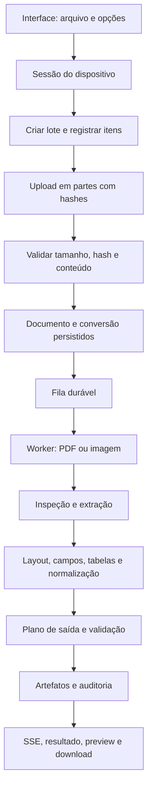

# Diagnóstico do projeto atual

## 1. Produto e funcionamento

O Conversor Generator é uma plataforma local de conversão documental com rastreabilidade. O motor transforma conteúdo de PDFs em XLSX, TXT e CSV; imagens seguem uma rota própria, atualmente limitada a TXT pelas opções compartilhadas. O resultado inclui status, qualidade, avisos, evidência das decisões e artefatos. Não é apenas uma interface de upload para uma biblioteca externa.

O modelo intermediário em `services/converter/models/document.py` separa extração e apresentação. Texto, blocos, campos e tabelas alimentam a estrutura de saída. O writer de Excel recebe um plano estruturado, e a auditoria verifica a publicação. É importante preservar essa fronteira: novos formatos não devem gravar saídas diretamente e contornar validação, evidência e cancelamento.

## 2. Mapa dos subsistemas

| Área existente | Responsabilidade e integração futura |
| --- | --- |
| `apps/web` | React 19, Vite, TypeScript, React Router, React Query, Zustand e componentes Radix; será reutilizado no Electron |
| `apps/api` | Gateway NestJS 11; identidade, ownership, Prisma, uploads, lotes, outbox e SSE no modo full |
| `services/converter/api` | FastAPI; API pública standalone e API interna consumida pelo gateway |
| `services/converter/engine` | Inspeção PDF, extração nativa, OCR, layout, campos, tabelas, normalização, reconciliação, estruturação e validação |
| `services/converter/ingestion` | Detecção PDF/imagens e pipeline de imagens; ponto para leitores de planilhas |
| `services/converter/exports` | TXT, CSV e registro de exportadores; deve receber plano tabular normalizado de XLSX/CSV |
| `services/converter/knowledge` | Coleções, fragmentação, indexação e recuperação lexical de fontes autorizadas |
| `services/converter/assistant` | Geração de respostas pelo Ollama, conversas, streaming e citações |
| `services/converter/jobqueue` | Fila durável de conversões, leasing, fencing e despacho limitado ao pool |
| `services/converter/worker` | Execução da conversão, publicação e integração com inline/Celery |
| `services/converter/repositories` | Persistência de resultados e checkpoints |
| `services/converter/storage` | Objetos locais ou S3; separa os arquivos originais dos artefatos gerados |
| `services/converter/audit` | Eventos, cobertura, manifesto e evidência |
| `services/converter/models/db.py` | Schema SQLAlchemy de runs, evidências, dados públicos standalone, conhecimento, fila e uploads |
| `packages/contracts` | Tipos TypeScript e contrato OpenAPI; opções espelhadas no Python |
| `apps/mcp` | Cliente MCP que já lê arquivos por caminho autorizado, faz hash/upload em partes e acompanha lotes |
| `infra` | Compose local com gateway, motor, worker, PostgreSQL, Redis e MinIO |
| `.github/workflows/ci.yml` | Build/testes web, testes/typecheck API e pytest Python; não é pipeline de distribuição desktop |
| `docs`, READMEs e `.env.example` | Referências operacionais; conferir com o código ao implementar, pois há diferenças pontuais |

## 3. Dois modos já existentes

### Standalone

`api/main.py` registra rotas públicas e internas, inicializa banco e fila e serve `apps/web/dist`. Um processo Uvicorn, SQLite e storage local são suficientes. `starter-server.cmd` procura o Python da `.venv`, verifica OCR/porta, inicia o backend e abre o navegador. Isso é um inicializador de desenvolvimento/local, não um aplicativo empacotado.

Este é o melhor ponto de partida para o desktop: não há razão para exigir PostgreSQL, Redis, MinIO e NestJS em cada instalação Windows.

### Full

O navegador fala com NestJS, que mantém seus próprios dados em Prisma e entrega execução ao motor via API interna. O motor mantém evidências em SQLAlchemy. A outbox resolve entrega de trabalho; hooks e polling reconciliam progresso. Os dois ORMs não devem escrever nas mesmas tabelas.

No Compose atual a porta web é publicada em loopback. `RUNTIME_MODE` não transforma magicamente a topologia: a rota acessada e os serviços iniciados determinam o fluxo. O desktop deve manter `standalone` e acrescentar uma capacidade separada de host desktop.

## 4. Fluxo de upload e conversão

A interface inicial usa lotes, não apenas o endpoint de envio simples. Cada item origina uma conversão; lote não significa juntar documentos. `upload_service.py` verifica partes e conclusão; `batch_service.py` coordena estados e operações. A extensão visual do arquivo não basta para sua aceitação.

`worker/tasks.py` escolhe `ImageConversionPipeline` para imagem e `ConversionPipeline` para PDF. A introdução de planilha exige um terceiro caminho explícito; caso contrário, o novo formato cairia indevidamente no pipeline PDF.

## 5. OCR e assistente

- `engine/ocr/glmocr.py` usa o endpoint Ollama `/api/generate`; não carrega diretamente um diretório de pesos Python.
- `config.py` define `GLMOCR_HOST`, `GLMOCR_PORT`, `GLMOCR_MODEL` (padrão `glm-ocr:latest`) e parâmetros de inferência.
- O assistente usa `ASSISTANT_HOST`, `ASSISTANT_PORT`, `ASSISTANT_MODEL` (padrão `qwen3.5:4b`) e começa desativado por padrão.
- A recuperação em `knowledge/retrieval.py` pontua lexicalmente os chunks filtrados pelo dono. A existência de `EMBEDDING_MODEL` na configuração não significa que busca vetorial já esteja funcionando.
- `KnowledgeIndexer` aceita conversões e alguns arquivos em `study/`; não é um importador geral de diretórios. A indexação roda em um `ThreadPoolExecutor`, portanto não oferece por si só a durabilidade exigida para indexação agendada.
- `settings-page.tsx` é uma tela de consulta das variáveis efetivas, não um formulário que salva configurações.

Uma seleção de “pasta do GLM-OCR” precisa distinguir executável do Ollama, repositório de modelos do Ollama, tag do modelo e pesos avulsos compatíveis. São recursos diferentes.

## 6. Fila existente versus agendador solicitado

`jobqueue/scheduler.py` implementa `DurableScheduler`: ele reclama conversões já enfileiradas e as despacha quando existe capacidade. Não contém calendário diário, formulário de tarefas, cadastro de fontes ou política de horários perdidos.

O novo agendador deverá criar ocorrências e submissões e então utilizar a fila existente. Não substituir o controle de workers nem adicionar um timer React como fonte da verdade.

## 7. Reaproveitamento de caminhos do MCP

`apps/mcp/src/path-policy.ts` já trata raízes permitidas, caminhos reais e rejeição de caminhos especiais/remotos. `transfer-worker.ts` implementa leitura por partes, SHA-256, retomada e registro de estado. `submission-store.ts` guarda submissões do adaptador, não os futuros agendamentos do produto.

Usar seus contratos e testes como referência, mas não iniciar um servidor MCP dentro do Electron só para importar arquivos. O caminho recomendado usa serviços Python para fontes e importação, com as mesmas garantias verificadas por testes comuns. Se futuramente houver extração de pacote TypeScript compartilhado, fazê-la sem regredir o MCP.

## 8. Pontos que merecem tratamento antes das features

| Evidência observada | Consequência para o plano |
| --- | --- |
| `WEB_DIST` depende da árvore do repositório em `api/main.py` | Empacotamento precisa de diretório de recursos configurável |
| `config.py` resolve vários caminhos a partir de `SERVICE_DIR` e mantém singleton em cache | Desktop precisa fornecer diretórios absolutos e reiniciar controladamente ao aplicar perfil |
| `worker/tasks.py` usa área `data/work` relacionada ao serviço | Separar work temporário de recursos instalados e verificar todos os escritores |
| `probe_input` aceita PDF/imagem; contratos restringem formatos por tipo | XLSX/CSV requerem leitores, validação e contratos em todas as camadas |
| `KnowledgeIndexer._index_conversion` consulta `PublicConversionRow` | No full, conversões Prisma não aparecem automaticamente nessa tabela; adicionar resolução autorizada por run |
| Rota interna de indexação repassa `IndexRequest` ao mesmo indexador | Não presumir paridade RAG full só porque existe proxy HTTP |
| Indexação usa executor em memória | Tornar trabalho de indexação recuperável antes de considerá-lo etapa confiável de automação |
| `init_db()` faz `create_all` e alterações aditivas específicas | Novos schemas precisam de migrações versionadas; não confiar apenas em `create_all` |
| Settings UI ainda apresenta texto fixo “PDF” | Publicar capacidades efetivas e atualizar apresentação ao incluir planilhas |
| Retenção é configuração, sem rotina automática demonstrada | Planejar limpeza dos novos snapshots e histórico; não prometer expiração existente |

Os itens acima são achados estáticos relevantes ao desenho. Não foram corrigidos nesta entrega nem confirmados mediante testes de execução.

## 9. Como foi feito: o que o histórico permite afirmar

O histórico disponível começa em `0c03eb3` em 16/11/2026; depois há atualizações gerais e de README. O commit `d21b3c3` registra melhorias de stress test, aba consolidada, OCR, tabelas e normalização. `ca3c08a`, em 18/11/2026, registra a orientação 100% local e documentação do fluxo.

Os arquivos de migração registram evolução de schema inicial, conhecimento/exportações/opções, lotes/uploads e fila/checkpoints. Isso permite descrever evolução técnica, mas não provar a ordem de criação de cada linha, autoria humana/IA ou decisões que não foram registradas. O plano se baseia no estado atual, não em uma reconstrução especulativa do desenvolvimento.

## 10. Bases de verificação existentes

Pytest cobre pipeline, OCR, planilhas geradas, imagens, uploads, fila durável, checkpoints, conhecimento e assistente. Jest cobre gateway e há testes e2e separados. Vitest cobre UI, upload e SSE. O MCP usa testes do Node. A nova matriz precisa acrescentar Windows empacotado, entrada de planilhas, fontes e calendário, preservando essas suítes.
