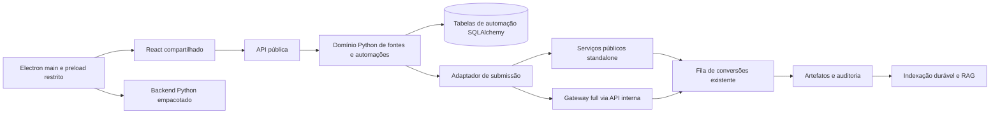

# Arquitetura proposta e contratos comuns

## 1. Alternativas e recomendação

| Alternativa | Ganho | Custo/limite |
| --- | --- | --- |
| Electron + standalone Python empacotado | Reutiliza interface, fila, SQLite e motor; instalação local simples | Exige empacotar dependências nativas e supervisionar processo Python |
| Electron + stack full local | Mesmo arranjo do Compose | Muitos processos e serviços para cada desktop; manutenção e distribuição maiores |
| Electron apontando apenas para servidor remoto | Pacote menor | Não é execução local equivalente; caminhos da máquina exigem conector e há dependência de rede |

**Recomendação deste plano:** primeira alternativa. Manter full suportado no site e acrescentar adaptadores para automação. A escolha é uma proposta técnica, não uma aprovação já obtida.

## 2. Responsabilidades

- React contém formulários, validação de apresentação e histórico, não leitura irrestrita do disco nem execução de tarefas em timer.
- Electron main cuida de seletor nativo, perfil local, backend, bandeja, diagnóstico e encerramento. Preload expõe somente métodos tipados.
- Python é escritor único de fontes, importações, definições e ocorrências de agendamentos, nos dois modos.
- No full, NestJS autentica a identidade já existente e encaminha o `owner_id` verificado ao motor. Não criar tabelas Prisma duplicadas de agendamento.
- Conversões/lotes continuam pertencendo à camada já responsável em cada modo. O scheduler não escreve diretamente nas tabelas Prisma.
- Nenhuma automação aceita shell command, script do usuário ou caminho de executável como ação agendada.

## 3. Ambientes e capacidade de ler caminhos

| Ambiente | Caminho representa | Quem autoriza a raiz | Executa com aba/janela fechada? |
| --- | --- | --- | --- |
| Desktop local | Disco da máquina instalada | Seletor nativo e cadastro explícito no host local | Sim na bandeja; não após sair do processo |
| Navegador + standalone local | Disco da máquina do backend | Configuração local do operador, vinculada à sessão | Sim, enquanto backend continua ligado |
| Site full local | Disco visível ao importador Python | Raízes configuradas pelo operador; no Docker precisam de bind mount | Sim, com serviços ligados |
| Site remoto sem conector | Disco do servidor, nunca automaticamente o PC visitante | Operador do servidor, por dono | Sim, apenas para fontes do servidor |
| Extensão futura com conector | Disco do PC pareado | Pessoa no computador autoriza cada raiz | Só com conector e computador ligados |

Um texto `C:\Planilhas` enviado pelo browser não concede acesso a esse diretório no computador de quem navega. No servidor Linux, também não corresponde ao mesmo caminho. A UI deve mostrar **“Pasta no computador que executa o conversor”**, nome do runtime e disponibilidade.

## 4. Identidade e autorização

Preservar `owner_id` derivado da sessão de dispositivo existente; não introduzir login obrigatório. Browser e desktop começam separados. Recursos são sempre filtrados por dono; IDs alheios respondem 404.

A autorização de disco é mais forte que a simples posse de um caminho: `SourceRoot` representa uma concessão prévia. No site, o browser só cadastra caminhos relativos a raízes que seu dono recebeu. A criação de raízes absolutas é operação de administração local, não uma rota pública livre.

No desktop, Electron autentica operações administrativas locais com credencial privada do host. O backend continua validando dono, raiz e caminho real. Uma página web qualquer, mesmo no mesmo computador, não pode conceder raízes.

Scheduler usa contexto persistido do proprietário da tarefa, não um JWT do browser que pode expirar. No full, um adaptador interno autenticado faz a submissão em nome do dono gravado na ocorrência; o gateway valida tarefa/ocorrência por canal interno e não aceita o dono enviado diretamente pelo cliente público.

Apagar cookies cria outra identidade e não transfere tarefas automaticamente. A UI deve avisar que isso perde o acesso ao histórico da sessão; oferecer pausa/exclusão das tarefas antes de resetar a sessão. Recuperação/exportação de identidade requer um fluxo explícito, não adivinhação pelo caminho da pasta.

## 5. Esquema de dados proposto

Todos os IDs são opacos. Datas persistidas em UTC; regras de calendário preservam timezone IANA. Novas tabelas no banco do motor, com migração Alembic posterior ao head efetivo.

| Tabela proposta | Campos essenciais e regras |
| --- | --- |
| `source_roots` | `id`, `owner_id`, `runtime_id`, `canonical_path`, `granted_by`, `created_at`, `revoked_at`; caminho absoluto não exposto a outros donos |
| `file_sources` | `id`, `owner_id`, `root_id`, `relative_path`, `kind=file/directory`, `recursive`, `include_patterns`, `exclude_patterns`, `enabled`, `version`, timestamps |
| `source_imports` | `id`, `owner_id`, `source_id`, `source_version`, `idempotency_key`, `request_hash`, `schedule_run_id?`, `status`, `batch_id?`, contadores, erro, lease/fence |
| `source_import_items` | `id`, `import_id`, `relative_path`, `size`, `mtime_ns`, `sha256`, `snapshot_key`, `client_item_id`, `upload_id?`, `conversion_id?`, `status`, erro, tentativas |
| `source_file_versions` | `owner_id`, `source_id`, `relative_path`, `sha256`, `options_hash`, `last_success_import_id`, `conversion_id`; unique sobre os cinco primeiros campos |
| `source_knowledge_heads` | `owner_id`, `collection_id`, `source_id`, `relative_path`, `active_document_id`, `active_run_id`, `index_generation`, `source_missing`; unique sobre os quatro primeiros campos; aponta a versão corrente pesquisável |
| `automation_schedules` | `id`, `owner_id`, `name`, `source_id`, `enabled`, `revision`, `rule_json`, `timezone`, `next_run_at`, `options_json`, `index_collection_id?`, `misfire_policy`, `overlap_policy`, timestamps |
| `automation_runs` | `id`, `owner_id`, `schedule_id`, `schedule_revision`, `scheduled_for`, `trigger`, `occurrence_key`, `snapshot_json`, `state`, `phase`, `import_id?`, `index_job_id?`, `attempt`, `lease_until`, `fence`, erro/timestamps |
| `automation_events` | `run_id`, `sequence`, `type`, `payload`, `created_at`; unique `(run_id, sequence)` para timeline/SSE retomável |

Índices: schedules `(enabled,next_run_at)`; runs `(state,lease_until)` e `(owner_id,schedule_id,created_at)`; fontes `(owner_id,enabled)`; importações por estado e dono. `occurrence_key` é única globalmente e inclui schedule/revisão/instante. Todas as referências de domínio devem conferir também o proprietário.

`snapshot_json` congela fonte, opções, coleção e revisão de modelo usados. A definição completa da fonte (`root_id`, caminho relativo, filtros, recursividade e versão) é copiada para o snapshot, não somente seu número de versão. Importações manuais também guardam essa definição em `source_imports.definition_json`. O executor consome essa cópia, nunca relê filtros/caminho mutáveis para decidir arquivos da execução antiga. A concessão da raiz continua sendo consultada ao abrir arquivos: revogação vence o snapshot. Raízes não mudam de caminho em lugar; mudar caminho absoluto cria nova concessão. Não gravar tokens ou segredos nesse snapshot.

`source_knowledge_heads` mantém uma versão vigente por arquivo lógico dentro de cada coleção. Importações históricas e seus artefatos continuam auditáveis; a busca padrão usa somente a geração ativa das fontes gerenciadas. Indexar manualmente documentos independentes mantém o comportamento existente, sem agrupá-los por coincidência de nome.

O perfil da máquina fica em JSON versionado privado do desktop, fora do banco compartilhado: caminho do Ollama, raiz dos modelos, tags OCR/LLM, modo de gerenciamento e diretórios de dados. No site, configurações globais de runtime continuam controladas pelo operador. Preferências de uma sessão não podem alterar o modelo de todas as outras silenciosamente.

## 6. Contratos HTTP propostos

Prefixo público `/api/v1`; JSON em snake_case e envelope de erro já existente. Contratos são novos, não rotas disponíveis hoje.

| Método/rota | Entrada/resultado |
| --- | --- |
| `GET /source-roots` | Lista somente concessões visíveis ao dono: id, rótulo, runtime e disponibilidade |
| `GET /sources` / `POST /sources` | Listar/criar fonte com `root_id`, `relative_path`, `kind`, filtros e recursividade |
| `GET/PATCH/DELETE /sources/{id}` | Consulta, edição com `version`, desativação lógica; conflito se houver agenda ativa |
| `POST /sources/{id}/validate` | Valida acesso e formatos, retorna amostra limitada; não inicia conversão |
| `POST /sources/{id}/imports` | `Idempotency-Key`, opções e `force=false`; 202 com `import_id` e links |
| `GET /imports/{id}` / `GET /imports/{id}/items` | Progresso, paginação por cursor e erros por arquivo |
| `POST /imports/{id}/cancel` | Pedido durável; idempotente |
| `GET/POST /schedules` | Lista/cria regra e ação; dono vem da sessão |
| `GET/PATCH/DELETE /schedules/{id}` | Edição otimista por revisão; delete pausa e arquiva, preservando histórico |
| `POST /schedules/preview` | Valida regra e retorna próximas cinco ocorrências, sem executar |
| `POST /schedules/{id}/pause` / `resume` | Transição idempotente; resume recalcula o futuro |
| `POST /schedules/{id}/run-now` | 202; chave idempotente independente do calendário |
| `GET /schedules/{id}/runs` | Histórico paginado |
| `GET /schedule-runs/{id}` / `GET /schedule-runs/{id}/events` | Detalhes e SSE com `Last-Event-ID` |
| `POST /schedule-runs/{id}/cancel` | Cancelar ocorrência e propagar aos trabalhos filhos |

`POST /sources`: `{ "root_id":"root_1", "relative_path":"financeiro", "kind":"directory", "recursive":false, "include_patterns":["*.xlsx","*.csv"], "exclude_patterns":["~$*","*.tmp"], "name":"Financeiro" }`.

`POST /schedules`: `{ "name":"Importação diária", "source_id":"src_1", "rule":{"kind":"daily","local_time":"08:00"}, "timezone":"America/Sao_Paulo", "misfire_policy":"run_once_latest", "overlap_policy":"skip", "options":{"target_formats":["xlsx","txt","csv"]}, "index_collection_id":null }`.

Para intervalo: `rule={kind:"interval",every_seconds:3600,anchor_at:"2026-11-19T11:00:00Z"}`. Valores iniciais propostos: mínimo 60 segundos, máximo 365 dias; rejeitar zero, negativo, fracionário, infinito e estouro. A UI mostra unidade e duração resultante.

Repetir a mesma chave idempotente com corpo igual devolve o mesmo recurso; corpo diferente devolve 409. Edição com revisão antiga retorna 409, sem sobrescrever silenciosamente.

## 7. Integração full sem dois escritores

Criar controller Nest para fontes/agendas como proxy autenticado dos endpoints internos Python equivalentes. Filtrar campos administrativos e não aceitar `owner_id` público. Chamadas motor→gateway para criar/reconciliar lotes passam por novas rotas `/api/v1/internal/automation/*`, protegidas por token de serviço e validação da ocorrência via API interna do motor.

O adaptador `SubmissionPort` terá duas implementações: standalone chama os serviços Python existentes; full utiliza gateway HTTP para criar lote, registrar/enviar/concluir itens, consultar e cancelar. As operações internas preservam idempotência por `import_id`/`client_item_id`; não geram duplicatas quando a resposta HTTP se perde. Para importação manual, o gateway valida o registro `source_imports` e seu dono por canal interno; para importação agendada, valida também sua ligação com `automation_runs`. Portanto, importar manualmente não exige inventar uma ocorrência de calendário. O mesmo transporte existente de uploads é reaproveitado, sem conceder permissão genérica de executar chamadas arbitrárias ao gateway.

Para RAG full, o gateway resolve `conversion_id → run_id/document_id` com ownership e encaminha referências verificadas ao endpoint interno de indexação. O indexador público standalone continua resolvendo pela tabela local. Um cliente público nunca fornece livremente `run_id` de terceiros.

## 8. Contratos de serviço propostos

Definir DTOs em `automation/types.py` e `sources/types.py`, espelhados em arquivos de `packages/contracts/src`:

- `SourceService.validate(owner_id: str, source_id: str) -> SourceValidation`.
- `ImportService.start(owner_id: str, source_id: str, request: ImportRequest, idempotency_key: str) -> ImportRecord` para uso público/manual; captura a definição vigente em transação.
- `ImportService.start_from_snapshot(owner_id: str, definition: SourceDefinitionSnapshot, request: ImportRequest, idempotency_key: str) -> ImportRecord` para o executor interno; não expor snapshot arbitrário como autoridade no HTTP público.
- `SubmissionPort.ensure_batch(owner_id: str, import_id: str) -> BatchRef`.
- `SubmissionPort.submit_snapshot(owner_id: str, batch: BatchRef, item: ImportItem) -> ConversionRef`.
- `SubmissionPort.reconcile(owner_id: str, batch: BatchRef) -> BatchProgress`.
- `SubmissionPort.cancel(owner_id: str, batch: BatchRef) -> None`.
- `Calendar.next_after(rule: ScheduleRule, timezone: str, after_utc: datetime) -> datetime`.
- `ScheduleService.create(owner_id: str, request: ScheduleCreate) -> ScheduleRecord`.
- `AutomationRepository.claim_due(now_utc: datetime, worker_id: str, limit: int) -> list[RunLease]`.
- `AutomationExecutor.advance(lease: RunLease) -> RunProgress`.

`ImportRequest` contém opções de conversão, `force` e coleção opcional; `BatchRef` contém `batch_id`; `ConversionRef` contém item/upload/conversion IDs; `RunLease` contém run ID, fence e validade; `RunProgress` contém estado, fase e próximas ações. Esses tipos pertencem ao domínio de automação, sem alterar silenciosamente os tipos existentes.
