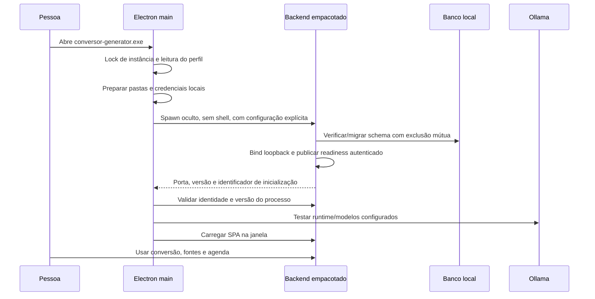

# Desktop Electron e configuração de modelos — plano detalhado

> Para execução futura: usar `superpowers:executing-plans` ou `superpowers:subagent-driven-development` após autorização de implementação. Este documento não autoriza alterações no produto.

**Objetivo:** distribuir o mesmo conversor como aplicativo Windows `conversor-generator.exe`, com configuração visual de IA local.

**Arquitetura:** Electron carrega o React servido por um backend Python empacotado, restrito a loopback. O processo principal supervisiona recursos nativos; os fluxos de produto continuam no backend.

**Stack proposta:** Electron + TypeScript, electron-builder, PyInstaller em modo diretório, Python 3.12 como baseline inicial de build, React/Vite existentes e Ollama local opcional. Fixar versões após teste de compatibilidade.

**Especificação:** [arquitetura comum](02-arquitetura-e-contratos.md).

## 1. Restrições e pontos de revisão

- Executável principal com nome exato `conversor-generator.exe`; nome de produto visível “Conversor Generator”. Instalador pode se chamar `conversor-generator-setup-<versao>.exe`.
- A aplicação pode ter DLLs e diretórios auxiliares: nome `.exe` não significa obrigatoriamente um único arquivo autossuficiente.
- Não gravar banco, logs, modelos ou uploads em `Program Files`, `resources`, ASAR ou diretório temporário de extração do empacotador.
- Não duplicar telas React, pipeline de conversão ou assistente dentro de Electron.
- Não alterar variáveis globais do Windows ou matar um Ollama iniciado por outro programa.
- Casos críticos: caminho Unicode/espaços; backend não inicia; porta ocupada; troca de perfil durante conversão; atualização com dados existentes. A validação de cada caso está no plano de tarefas.

## 2. Estrutura proposta

| Novo arquivo/pasta | Responsabilidade |
| --- | --- |
| `apps/desktop/package.json` | Scripts, dependências e identidade do aplicativo |
| `apps/desktop/electron-builder.yml` | Nome do executável, recursos externos, instalador Windows, ícone e metadados |
| `apps/desktop/src/main.ts` | Ciclo do Electron, janela, instância única, bandeja e encerramento |
| `apps/desktop/src/preload.ts` | Bridge restrita e tipada |
| `apps/desktop/src/backend-supervisor.ts` | Spawn sem shell, readiness, logs, reinício e término dos processos próprios |
| `apps/desktop/src/runtime-profile.ts` | Perfil JSON versionado e gravação atômica |
| `apps/desktop/src/model-manager.ts` | Executável Ollama, listagem/teste/importação de modelos e processo gerenciado |
| `apps/desktop/src/ipc-handlers.ts` | Validação dos argumentos e da origem dos chamadores |
| `apps/desktop/src/local-grants.ts` | Concessão de raízes via credencial administrativa local |
| `apps/desktop/tests/*.test.ts` | Testes unitários de supervisor, perfil e IPC |
| `services/converter/desktop_entry.py` | Entry point congelável: configuração, migração e Uvicorn |
| `services/converter/packaging/converter.spec` | PyInstaller, imports dinâmicos e binários necessários |
| `services/converter/runtime/paths.py` | Diretórios de dados, work, logs e web dist explícitos |
| `apps/web/src/lib/platform.ts` | Detecção de capacidades desktop sem importar Electron no bundle web |
| `apps/web/src/pages/local-models-page.tsx` | Configuração visual de IA local |

Modificar `api/main.py`, `config.py`, escritores de temporários, `App.tsx`, navegação, contratos de settings e scripts da raiz. Acrescentar CI Windows de empacotamento, independente da CI Linux existente.

## 3. Diretórios e persistência

Definir o nome do aplicativo antes de consultar `app.getPath('userData')`. Layout conceitual sob esse diretório:

```text
Conversor Generator/
  profile.json
  identity/                 identidade própria e material secreto protegido
  data/converter.db
  storage/                  documentos, partes e artefatos
  work/                     snapshots e temporários controlados
  logs/                     rotação por tamanho e quantidade
  backups/                  pré-migração, com política explícita
```

Os pesos permanecem na pasta escolhida pelo usuário ou na instalação existente do Ollama. Separar `WEB_DIST_DIR`, `APP_DATA_DIR`, `WORK_DIR` e storage; nomes são propostas novas. O supervisor transmite caminhos absolutos ao entry point antes de importar módulos que materializam `settings`.

Não migrar automaticamente a pasta `services/converter/data` do repositório para o desktop. Oferecer importação de backup como ação explícita, verificando schema, identidade e hashes. Sem essa ação, começar com instalação própria vazia.

## 4. Inicialização completa



1. Segunda abertura apenas foca a janela existente. Não iniciar dois schedulers desktop para o mesmo banco.
2. Backend solicita porta livre ao sistema e comunica a porta efetivamente vinculada pelo canal privado. Não “testar porta livre e depois assumir posse”, nem se conectar a um serviço desconhecido em 8000.
3. Timeout de inicialização proposto de 90 segundos, com fases visíveis: preparando dados, migração, iniciando backend e carregando interface. Após timeout mostrar diagnóstico e botão tentar novamente; não abrir janela aparentemente funcional contra backend ausente.
4. Readiness do produto é separado do diagnóstico OCR. Modelo ausente não deve impedir abrir configurações ou processar formatos que não dependem dele.
5. Recursos estáticos são lidos do pacote, e API usa caminho relativo `/api/v1` na mesma origem; o fallback SPA precisa continuar funcionando em rotas internas.
6. Persistir a identidade de dispositivo fora de `localStorage` dependente da porta. Ao recriar o backend em outra porta, bootstrap autenticado restaura a identidade do desktop e cria cookie/token nessa origem. Não expor a credencial administrativa ao renderer.
7. Backend faz recuperação de leases e ocorrências em aberto antes de iniciar novos disparos.

## 5. Proteção da interface e do backend local

Criar janela com `nodeIntegration:false`, `contextIsolation:true`, `sandbox:true`, preload restrito e CSP. Validar o frame/origem em IPC e bloquear navegação externa dentro da janela privilegiada. Esses limites seguem as recomendações de [segurança do Electron](https://www.electronjs.org/docs/latest/tutorial/security) e [isolamento de contexto](https://www.electronjs.org/docs/latest/tutorial/context-isolation/).

Bridge proposta:

- `desktop.pickSource({kind:'file'|'directory'}) -> {grant_id, display_path}|null`.
- `desktop.pickModelResource({kind:'ollama_executable'|'models_directory'|'gguf'}) -> Selection|null`.
- `desktop.readRuntimeProfile() -> RedactedProfile`.
- `desktop.testModelProfile(draft) -> Diagnostics`.
- `desktop.applyRuntimeProfile(draft, expectedVersion) -> ApplyResult`.
- `desktop.getRuntimeStatus() -> RuntimeStatus`.

Não expor `fs`, `exec`, `spawn`, canal IPC arbitrário ou leitura de qualquer caminho. Cancelar um diálogo retorna `null`, não salva campo vazio sobre configuração válida.

Loopback sozinho não autentica chamadas. O backend desktop exige um segredo de bootstrap por inicialização em todas as superfícies sensíveis, incluindo rotas públicas e internas. Electron acrescenta a credencial de sessão de host somente a requisições para a origem exata de seu próprio backend, sem colocá-la em URL ou logs. Validar Host/Origin para evitar acesso de páginas externas; não liberar CORS com wildcard. A identidade do usuário permanece separada dessa credencial do processo.

## 6. Tela “Configurações → IA local”

### Campos

| Grupo | Campo e significado |
| --- | --- |
| Runtime | Modo “usar Ollama já ativo” ou “iniciar Ollama pelo aplicativo” |
| Executável | Caminho de `ollama.exe`, com botão Procurar; necessário no modo gerenciado/importação |
| Armazenamento | Pasta de modelos Ollama; aplicar `OLLAMA_MODELS` somente no processo gerenciado |
| GLM-OCR | Ativar OCR, endpoint local, tag registrada, teste com imagem de exemplo |
| Assistente | Ativar assistente, endpoint local, tag do LLM, contexto, limite de saída e teste |
| Importação de modelo | Selecionar GGUF compatível, definir tag local e importar; não tratar qualquer pasta como modelo executável |
| Diagnóstico | Runtime detectado, modelo disponível, latência, falha de memória/timeout e revisão aplicada |

O endpoint no modo desktop inicial deve ser loopback. Uso de modelos remotos exige uma futura opção explícita que explique envio de dados; não é fallback automático quando o modelo local falhar.

`OLLAMA_MODELS` seleciona o repositório usado pelo processo Ollama; alterar essa variável no conversor não reconfigura um serviço Ollama já aberto. Consultar [configuração local do Ollama](https://docs.ollama.com/faq). Se o serviço for externo, mostrar instrução para reconfigurá-lo fora do aplicativo, sem reiniciá-lo silenciosamente.

### Fluxo de configuração

1. Ler perfil atual e sua revisão.
2. Selecionar `ollama.exe` e pasta de modelos, ou conectar ao serviço já existente.
3. Validar que o executável existe, é arquivo regular e responde como Ollama; executar com argumentos fixos, sem shell.
4. No modo gerenciado, iniciar com host loopback próprio e pasta escolhida. Conflito de porta mostra erro; não assumir propriedade do processo ocupante.
5. Listar modelos via API do runtime; selecionar tag OCR e tag do assistente separadamente.
6. Se houver GGUF, criar Modelfile temporário gerado pelo aplicativo, importar com nome controlado, acompanhar progresso e verificar a tag. Não aceitar Modelfile arbitrário fornecido pelo usuário como script de configuração irrestrito.
7. Testar GLM-OCR com imagem pequena e LLM com resposta curta. Listar modelos não prova compatibilidade com visão ou funcionamento da geração.
8. Se um arquivo/pasta de pesos não for compatível, explicar formato e runtime necessários. Não prometer suporte direto universal a checkpoints GLM-OCR/Safetensors. O mecanismo de importação suportado depende do modelo e da versão do runtime, conforme [documentação oficial de importação](https://docs.ollama.com/import).
9. “Aplicar” grava versão candidata atomicamente e espera ponto seguro: suspender novos disparos, imports e chats; drenar todas as ocorrências/importações/conversões não terminais, inclusive `queued`, `waiting_children` e recuperáveis após falha de processo. A pessoa pode cancelá-las explicitamente para antecipar a troca. A UI lista o que impede a aplicação; uma versão candidata não substitui a versão efetiva antes desse ponto.
10. Reiniciar apenas os processos gerenciados necessários; verificar health; efetivar revisão. Se falhar, restaurar perfil anterior e informar o rollback.

Não baixar modelos grandes automaticamente. Um fluxo futuro de download precisa mostrar tamanho, destino e ação explícita. Instalar o programa não implica redistribuir os pesos de terceiros.

O perfil efetivo anterior permanece disponível durante a drenagem. Ocorrências guardam revisão, tag e digest do modelo quando disponível; acrescentar esses identificadores ao fingerprint de extração/checkpoints. Após crash, o supervisor usa o perfil efetivo, não o candidato. Se alguém substituir a tag/modelo externamente e o digest divergir, interromper retomada com `MODEL_REVISION_UNAVAILABLE`, oferecendo nova execução explícita; não misturar páginas de modelos distintos na mesma execução. Essa regra vale também para configuração administrada no site. A primeira versão não executa perfis globais diferentes simultaneamente.

## 7. RAG: integração real

Fluxo: fonte importada → conversão publicada → plano textual/tabular → chunks com dono e referência → coleção → recuperação → contexto com citações → LLM selecionado → resposta por streaming.

Nesta entrega proposta, manter recuperação lexical existente. A troca do LLM gerador não exige reconstruir os chunks. Persistir tag/revisão do modelo no histórico da resposta para diagnóstico. Somente uma futura troca do modelo de embeddings exigiria versionamento/reindexação vetorial; não adicionar embeddings apenas para preencher um campo da tela.

Se assistente estiver desligado, conversões e indexação não devem depender dele. Se não houver trechos relevantes, manter comportamento de ausência de fontes, sem inventar respostas. Fonte documental é dado, não instrução para executar comandos ou autorizar novas pastas.

## 8. Vida em segundo plano e encerramento

- Primeira vez que fechar a janela, explicar as opções “Manter na bandeja” e “Sair”; lembrar a preferência. Com tarefas habilitadas, recomendar bandeja.
- Bandeja: abrir aplicativo, status, pausar novos agendamentos e sair.
- “Sair”: bloquear novos disparos, persistir estado, aguardar encerramento gracioso por prazo definido e terminar somente a árvore de processos criada pelo app. Queda forçada é recuperada por leases/checkpoints.
- Não finalizar Ollama externo. Para processo próprio, encerrar depois dos trabalhos que o usam.
- Inicialização junto ao login Windows deve ser opção desligada inicialmente. Registrar somente uma inicialização por instalação; remover ao desinstalar.
- Não prometer execução com máquina desligada, suspensa, usuário deslogado ou aplicativo completamente fechado. Um serviço Windows ou tarefa do sistema é extensão separada descrita no plano do agendador.

## 9. Empacotamento, distribuição e atualização

1. Compilar contratos e SPA com base/API relativas apropriadas.
2. Criar ambiente Python de build fixado, com apenas dependências suportadas. Produzir motor PyInstaller em modo diretório e coletar DLLs, PDFium, assets e imports dinâmicos. PyInstaller recomenda validar primeiro o modo diretório, e builds dependem do sistema alvo: [modo de operação](https://www.pyinstaller.org/en/stable/operating-mode.html).
3. Colocar motor e web dist como recursos externos ao ASAR. Não executar o binário Python de dentro do arquivo ASAR.
4. Configurar `productName` e `win.executableName` para produzir `conversor-generator.exe`; gerar instalador por usuário. Referência: [opções Windows do electron-builder](https://www.electron.build/win/).
5. Não incluir `.env`, `.venv` de desenvolvimento, banco real, uploads, chaves ou modelos privados no pacote. Incluir avisos/licenças das dependências redistribuídas.
6. Primeiro release exige máquina Windows limpa: sem Node, sem Python, sem repositório e sem Docker; testar PDF nativo, XLSX/CSV, configurações e fechamento/retomada.
7. Validar separadamente OCR com Ollama/modelo já instalados e cenário sem Ollama. GPU/VRAM não têm garantia universal: registrar hardware medido, latências e limitações.
8. Release deve ter versão, hash, assinatura de código quando houver infraestrutura de assinatura e instrução de instalação. Não descrever pacote não assinado como livre de avisos Windows.
9. Primeira estratégia de atualização: instalador manual que preserva `userData`. Parar backend, fazer backup consistente, migrar, verificar e abrir. Falha bloqueia abertura com diagnóstico; rollback de binário só é permitido com schema compatível ou restauração coordenada do backup.
10. Auto-update fica separado; quando adotado deverá validar assinatura/origem e não trocar arquivos durante migração/conversão.

## 10. Critérios de aceite

- [ ] Instalar e abrir o executável com nome exato em Windows limpo.
- [ ] Acessar todas as telas existentes e novas pelo mesmo React.
- [ ] Reiniciar com porta diferente sem perder a identidade/histórico do desktop.
- [ ] Selecionar caminhos com espaços e acentos; cancelar diálogo sem alterar perfil.
- [ ] Configurar/testar OCR e LLM separadamente; mostrar erro útil para modelo incompatível.
- [ ] Continuar conversão nativa sem Ollama; OCR indisponível aparece como tal.
- [ ] Salvar perfil, reiniciar e observar valores efetivos; falha de aplicação restaura versão anterior.
- [ ] Fechar para bandeja mantém agenda; sair encerra processos próprios e preserva trabalhos para retomada.
- [ ] Origem externa não consegue acessar IPC, API administrativa ou arquivos locais.
- [ ] Atualizar instalação com dados preservados e migração testada.
