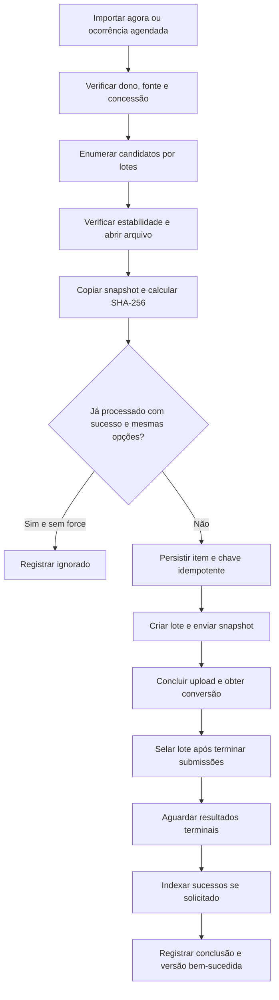

# Importação por caminhos e entrada de planilhas — plano detalhado

> Para execução futura: aplicar `superpowers:executing-plans` ou `superpowers:subagent-driven-development` após autorização. Todos os nomes novos abaixo são propostas.

**Objetivo:** cadastrar caminhos de arquivos/pastas e importar planilhas de forma manual ou agendada, com o mesmo pipeline de produto e rastreabilidade.

**Arquitetura:** backend lê fontes previamente autorizadas, cria snapshots imutáveis e submete lotes pelo adaptador do modo ativo. Leitores tabulares alimentam planos de saída e conhecimento sem passar por OCR.

**Stack:** pathlib/streaming Python, SQLAlchemy, openpyxl já instalado, biblioteca padrão CSV, serviços de lote/upload existentes e UI React compartilhada.

**Especificação:** [arquitetura comum](02-arquitetura-e-contratos.md).

## 1. Escopo de formatos

| Entrada | Hoje | Proposta inicial |
| --- | --- | --- |
| PDF | Conversão documental | Preservar comportamento atual e permitir fonte por caminho |
| Imagens reconhecidas | TXT | Preservar limites/opções atuais; não habilitar XLSX por acidente |
| XLSX | Não reconhecido como entrada | Ler abas e valores, exportar XLSX normalizado/TXT/CSV e permitir RAG |
| CSV | Não reconhecido como entrada geral | Ler tabela com encoding/delimitador explícitos ou detecção controlada |
| XLS, XLSB, XLSM, ODS | Sem entrada dedicada | Rejeitar com mensagem específica nesta etapa; suporte posterior requer leitor/testes/licenças próprios |

Aceitar XLSX é funcionalidade adicional real, não apenas permitir a extensão no seletor. O objetivo é importar dados, não reproduzir fielmente gráficos, estilos, macros, fórmulas executáveis e recursos completos do Excel.

## 2. Experiência de uso

Nova rota `/sources`, acessível em **Fontes**:

1. Clicar “Adicionar fonte”.
2. Escolher arquivo único ou pasta; informar nome.
3. Desktop: usar seletor nativo ou digitar um caminho dentro de raiz concedida. Site: escolher raiz autorizada e caminho relativo. Mostrar em qual máquina ele será lido.
4. Escolher subpastas (desativado por padrão), extensões e exclusões. Excluir `~$*`, temporários e diretórios de saída por padrão.
5. Validar: listar amostra de até 100 arquivos, estimativa de quantidade/bytes e avisos. Amostra não representa garantia de estabilidade futura.
6. Salvar fonte; nenhuma conversão é iniciada apenas ao salvar.
7. “Importar agora”: escolher saídas compatíveis e coleção opcional; mostrar resumo e iniciar.
8. Mostrar preparação, transferências, conversões e indexação como fases distintas; encaminhar ao lote existente e permitir erros por arquivo.
9. “Agendar esta fonte” abre o formulário do agendador preenchido com o `source_id`.

Uma pasta sem arquivos elegíveis é válida e produz execução `no_changes`, não erro. Uma pasta inexistente ou sem acesso é indisponível, não vazia.

## 3. Autorização e normalização de caminhos

- Resolver raiz e caminho com caminho real; conferir relação de descendência por componentes, nunca por prefixo textual (`C:\Dados2` não está dentro de `C:\Dados`).
- Rejeitar NUL, namespaces de dispositivo, ADS Windows, travessia `..`, arquivos especiais e links/junctions que saem da raiz. Não expandir variáveis de ambiente ou comandos recebidos do formulário.
- Padrão inicial: disco local. Rejeitar UNC/compartilhamentos remotos explicitamente; unidades de rede mapeadas também precisam ser identificadas e rejeitadas até suporte dedicado. Uma futura opção de rede deve tratar credenciais, desconexões e permissões do runtime.
- Não permitir fonte que englobe diretório interno de storage/work, segredos ou banco do próprio aplicativo. Evitar que uma pasta de saída se torne entrada recursiva.
- Revalidar concessão e caminho ao salvar, escanear e abrir. Revogação bloqueia futuras leituras e cancela importações ainda não capturadas; não apaga artefatos já criados.
- No Windows, detectar reparse points durante travessia e conferir destino final do handle aberto. Revalidar somente antes de `open` deixa janela de troca de link (TOCTOU); o teste deve simular isso.
- Não seguir links por padrão. Varredura recursiva deve ser paginada/streaming, com proteção contra ciclos, cancelamento e pressão de memória.
- No Docker, raiz concedida deve apontar para caminho montado dentro do contêiner. Preferir mount de origem somente leitura e storage/work separados.

## 4. Importação completa

### Snapshot e arquivo em edição

Observar tamanho e mtime em duas leituras separadas por 2 segundos antes da captura. Isso reduz casos comuns de gravação, mas não prova imutabilidade. Abrir handle, verificar caminho final e copiar em streaming para staging privado, calculando hash. Comparar metadados do handle antes/depois e, quando necessário, hash da origem em segunda leitura. Se mudar, descartar snapshot, marcar `SOURCE_CHANGED` e tentar novamente no próximo scan; no máximo três tentativas transitórias por execução.

Arquivos bloqueados pelo Excel geram erro individual `SOURCE_BUSY`; outros arquivos continuam. No snapshot, parser valida consistência do XLSX/CSV. Nunca mover, renomear ou apagar o original para satisfazer o pipeline. A fonte pode mudar depois da captura: esta execução usa a versão capturada, e a próxima detecta a alteração.

### Deduplicação e idempotência

- Chave de versão: `(owner_id, source_id, relative_path, sha256, options_hash)`. `options_hash` inclui formatos, leitor/versão, opções CSV/XLSX e política de indexação relevante.
- Uma mudança somente de mtime não cria nova conversão se o hash for igual.
- Mesmo caminho com conteúdo diferente cria nova versão; outro caminho com bytes iguais continua sendo outra origem auditável nesta primeira versão.
- Repetir `start` com mesma chave retorna a mesma importação. Itens usam `client_item_id` derivado de `import_id` e ID persistido do item.
- Dois importadores concorrentes da mesma fonte usam lock/lease de fonte. A unicidade de versão bem-sucedida é proteção adicional, não substituto do lock.
- Marcar versão como processada somente após resultado aceito. Estado `partial` é guardado como parcial e não tratado como sucesso completo silencioso.
- Falha de conversão é elegível novamente conforme política da tarefa; `force=true` permite reprocessar sucesso, mantendo nova trilha.
- Indexação falha após conversão bem-sucedida: retomar somente a indexação; não reconverter arquivos sem necessidade. Guardar estado separado por etapa.

### Backpressure

Não carregar toda a árvore nem todos os arquivos em memória. Persistir páginas de candidatos, manter no máximo dois snapshots simultâneos inicialmente e reutilizar limite de partes da API. Espaço livre mínimo e orçamento de staging são configurações operacionais; se excedidos, pausar com `DISK_FULL` e preservar estado recuperável. Nenhum teto deve causar truncamento silencioso da pasta.

### Versões no RAG

Para fontes gerenciadas, a identidade lógica é `(owner_id, collection_id, source_id, relative_path)`. A busca padrão consulta somente a versão vigente. A conversão nova cria seus chunks em geração candidata; após indexação completa e validação de publicação, promover `source_knowledge_heads` atomicamente para document/run/generation novos. A consulta filtra a geração ativa antes de pontuar, evitando retornar conteúdos antigos e novos como se fossem simultaneamente atuais.

Falha de conversão ou indexação, incluindo resultado parcial nesta política inicial, mantém a versão anterior vigente e mostra “atualização pendente/falhou”. Não remover primeiro os chunks antigos. Registrar geração e ponteiro na mesma transação de promoção e testar concorrência com consultas. Retry da mesma indexação não cria outra geração ativa.

Se o arquivo sumir da pasta, conservar a última versão indexada e marcar `source_missing=true`; citações mostram que se trata da última captura disponível. Arquivar a fonte interrompe futuras importações, mas preserva conhecimento existente. Remover documento/coleção explicitamente desativa o ponteiro e remove seu conteúdo conforme as regras de exclusão. Não interpretar exclusão acidental da origem como autorização para apagar resultados históricos. Renomear caminho cria outra identidade lógica nesta primeira versão; a UI permite remover a entrada antiga da coleção.

## 5. Leitor XLSX

Criar `ingestion/spreadsheet_input.py` e `ingestion/spreadsheet_pipeline.py`.

1. Inspecionar ZIP/OOXML por conteúdo: `[Content_Types].xml` e workbook esperado. Um ZIP qualquer ou arquivo renomeado não é XLSX.
2. Aplicar orçamento de descompactação (bytes totais, por entrada e razão de expansão), quantidade de entradas e tempo de leitura; rejeitar arquivo protegido/corrompido com código específico. Valores operacionais iniciais devem constar de config e de testes, sem cortar linhas para aparentar sucesso.
3. Abrir com openpyxl em leitura apropriada; não executar macros, acessar links externos ou calcular fórmulas.
4. Ler abas visíveis e ocultas, preservando nome/estado e informando isso na prévia. Permitir seleção explícita de abas; padrão é todas, com aviso sobre ocultas.
5. Preservar ordem de colunas/linhas, células vazias e identificadores com zeros à esquerda. Não inferir cabeçalho obrigatório: permitir “primeira linha é cabeçalho” ou cabeçalhos técnicos, registrando a decisão.
6. Guardar origem por `sheet_name`, `row`, `column`, `cell_address`, tipo e valor original. Célula mesclada tem referência à âncora; não duplicar seu valor em todas as células sem opção explícita.
7. Fórmula tem texto e valor em cache separados. Sem cache, manter fórmula como texto e emitir aviso; não inventar resultado. Saída padrão usa texto/valores seguros, sem fórmula executável proveniente da entrada.
8. Dates/decimais/booleanos conservam tipo e representação original; registrar sistema de datas do workbook. Testar cabeçalhos repetidos, aba vazia e nomes inválidos para exportação.
9. Gerar plano tabular e textual sem OCR. No primeiro adapter, uma aba pode corresponder a unidade lógica de processamento, mas a UI deve dizer **aba**, não “página PDF”. Evidência real é endereço de célula, nunca bbox fabricado apresentado como medição.
10. Reusar publicação e exportadores: XLSX normalizado, TXT por aba e CSV por tabela/aba, ZIP quando houver vários CSVs. Registrar perda de layout/estilos como limite de importação, não erro de conteúdo.

## 6. Leitor CSV

- Começar por UTF-8/UTF-8 BOM; se decodificação falhar, pedir encoding explícito em importação interativa ou falhar com `CSV_ENCODING_REQUIRED` na agenda. Não usar substituição silenciosa de caracteres.
- Permitir delimitadores vírgula, ponto e vírgula, tab e pipe. Detecção automática usa amostra e valida linhas subsequentes; ambiguidade gera `CSV_DIALECT_REQUIRED`.
- Persistir dialeto escolhido na fonte/opções para tornar o próximo agendamento determinístico.
- Respeitar aspas, escapes, quebras dentro de campo e linhas vazias. Linhas com número irregular de colunas geram aviso/erro conforme política explícita; nunca deslocar valores silenciosamente.
- Preservar campos como texto inicialmente; tipagem é opção, não conversão automática de CPF, CEP ou códigos.
- Aplicar política segura de fórmulas em XLSX e CSV exportados. Conteúdo iniciado por `=`, `+`, `-` ou `@` não deve ser executado como fórmula pela exportação sem política explícita; números negativos tipados precisam continuar números.
- Proveniência registra número de registro lógico e intervalo de linhas físicas quando houver campos multilinha.

## 7. Mudanças necessárias na cadeia atual

| Arquivos atuais | Alteração planejada |
| --- | --- |
| `packages/contracts/src/options.ts`, `index.ts` e OpenAPI | Tipo de entrada spreadsheet, opções tabulares versionadas e compatibilidade de formatos |
| `services/converter/api/service.py` | Espelhar normalização e extensão correta da nova entrada |
| `api/batch_service.py`, `api/upload_service.py` | Registro/validação/conclusão de planilhas; preservar idempotência |
| `ingestion/registry.py` | Detecção de XLSX e CSV; CSV precisa declaração/dialeto validado porque não possui magic bytes inequívocos |
| `worker/tasks.py` | Dispatch explícito spreadsheet e extensão de arquivo correta |
| `models/document.py`, `models/db.py` | Proveniência tabular e unidade lógica, com migração aditiva |
| `repositories/conversion_repository.py` | Persistir e consultar novas evidências sem exigir página/bbox reais |
| `exports/text_plan.py`, `knowledge/chunker.py`, `knowledge/retrieval.py` | Texto com cabeçalhos e coordenadas; citações por aba/célula |
| `apps/api/src/upload/file-validation.service.ts` | Paridade da inspeção e limite de recursos; sem aceitar ZIP genérico |
| `apps/api/src/modules/uploads/uploads.service.ts` e `conversions/*` | Metadados/tipos/opções de entrada, sem depender de `is_pdf=true` |
| `apps/web/src/lib/validate-file.ts`, home/upload queue/settings | Seleção e mensagens baseadas em capabilities |
| `apps/web/src/components/provenance-drawer.tsx` e componentes de auditoria | Exibir evidência tabular sem supor imagem/página |

A mudança deve preservar os contratos anteriores. Como o normalizador atual rejeita seções desconhecidas, este plano adota schema v3 com seção `spreadsheet`, mantendo leitura v2 e defaults equivalentes para PDF/imagem. Uma opção tabular nova não pode alterar comportamento dos documentos anteriores; incluir fixtures de paridade Python/TypeScript. A T1 do plano integrado define a forma exata dessa seção.

## 8. Arquivos novos do domínio de fontes

`services/converter/sources/{types,models,repository,path_policy,scanner,snapshot,service,importer,submission}.py`; `api/source_routes.py`; contratos `sources.ts`; UI `sources-page.tsx`, `source-detail-page.tsx`, service/hook de fontes. Incluir os novos pacotes no `pyproject.toml` e no bundle congelado.

O scanner retorna candidatos, o snapshot captura conteúdo, e o importer coordena persistência/submissão. Não concentrar filesystem, SQL, HTTP e parsing de XLSX no mesmo controller.

## 9. Casos de teste e aceite

- [ ] Fonte manual e agendada produzem lotes equivalentes para as mesmas opções.
- [ ] Arquivos não mudados são ignorados; conteúdo alterado no mesmo nome é importado.
- [ ] Queda após upload concluído e antes de salvar resposta não duplica conversão.
- [ ] Mudança durante cópia, arquivo bloqueado e disco cheio deixam estado diagnosticável.
- [ ] Outro dono não lista, valida, importa ou consulta fonte/artefato alheio.
- [ ] Junction trocada durante abertura, travessia e caminhos especiais são recusados.
- [ ] XLSX com abas ocultas, fórmulas sem cache, mesclas e zeros à esquerda preserva fatos e avisos.
- [ ] XLSX corrompido, ZIP bomb e arquivo renomeado são rejeitados sem consumo ilimitado.
- [ ] CSV pt-BR, BOM, multilinha, encoding/dialeto ambíguos e fórmulas são tratados explicitamente.
- [ ] PDF/imagem continuam com as mesmas opções e saídas anteriores.
- [ ] Citação RAG aponta para aba/célula ou registro real e respeita dono da fonte.
