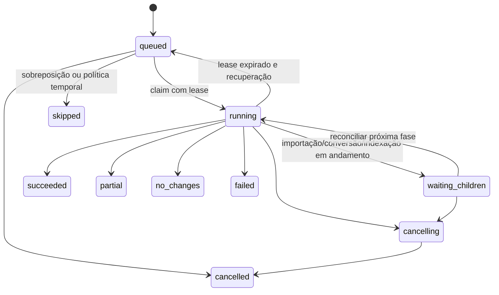
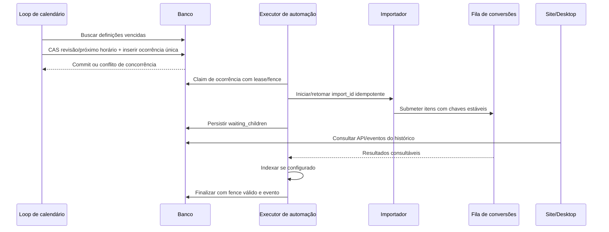

# Agendador no site e no desktop — plano detalhado

> Para execução futura: usar `superpowers:executing-plans` ou `superpowers:subagent-driven-development` após autorização. Nenhum serviço é iniciado por este plano.

**Objetivo:** executar importações/conversões diariamente ou em intervalos definidos, com administração e histórico nas duas interfaces.

**Arquitetura:** calendário e ocorrências persistidos no motor Python, despacho transacional com leases e executor retomável. Conversões continuam na fila atual; interface observa eventos.

**Stack proposta:** SQLAlchemy, datetime/zoneinfo e tzdata empacotado para Windows, thread de controle standalone e comando dedicado em full. Não é necessário adicionar Redis apenas para executar calendário local.

**Especificação:** [arquitetura comum](02-arquitetura-e-contratos.md).

## 1. O que uma tarefa faz

Uma tarefa vincula uma fonte, uma regra de tempo e uma receita:

1. Examinar arquivos elegíveis da fonte.
2. Capturar versões novas/alteradas e criar importação.
3. Submeter e acompanhar conversões.
4. Gerar formatos configurados.
5. Opcionalmente indexar conversões publicáveis numa coleção autorizada, promovendo atomicamente a versão corrente de cada arquivo lógico conforme o documento de fontes.
6. Registrar resultado, erros e links para artefatos.

Salvar em diretório de saída externo não é obrigatório: os artefatos já ficam no storage e podem ser baixados. Se acrescentado, destino precisa de concessão própria, escrita atômica e política “não sobrescrever”; jamais escrever na mesma árvore observada sem exclusões explícitas.

Não usar agendador para executar comandos livres, macros, consultas a toda a máquina ou prompts que decidam autonomamente novas ações.

## 2. Formulário compartilhado

Rotas propostas: `/schedules`, `/schedules/new`, `/schedules/:id`, `/schedule-runs/:id`.

Campos: nome, fonte cadastrada, formatos, coleção opcional, habilitado, frequência, timezone, início, tratamento de atraso e sobreposição. Para frequência diária, escolher horário local. Para intervalo, escolher valor e unidade; mostrar duração normalizada. Mostrar próximas cinco ocorrências e texto “Executado no computador/servidor X”.

Tela de lista: habilitado/pausado, fonte, próxima ocorrência, última execução, resumo do resultado e runtime disponível. Ações: editar, pausar, retomar, executar agora e arquivar. Não usar status “sucesso” só porque o lote foi criado.

Detalhe de ocorrência: horário previsto/real, duração, revisão usada, fases, arquivos ignorados/importados, conversões, erros, indexação, eventos e botão cancelar. Um arquivo que falhou não desaparece do resumo.

## 3. Regras temporais determinísticas

### Diário

- Persistir `local_time=HH:mm`, timezone IANA e `next_run_at` em UTC.
- Valor inicial da UI pode ser `America/Sao_Paulo`, mostrado e editável; não inferir permanentemente do timezone do servidor.
- “Todo dia às 08:00” é calendário local, não intervalo de 86.400 segundos.
- Mudança de horário de verão: se horário não existir, disparar no primeiro instante local válido depois dele; se repetido, executar somente a primeira ocorrência. Implementar cálculo que valide a conversão por round-trip UTC; anexar `tzinfo` sozinho não detecta todo horário inexistente.
- Preview e scheduler devem usar exatamente a mesma função de calendário.

### Intervalo

- `every_seconds` inteiro entre 60 e 31.536.000, com âncora UTC persistida.
- Calcular `anchor + n * interval`, sem derivar o próximo horário do término da tarefa. Assim, duração da conversão não desloca continuamente o calendário.
- Clock UTC decide vencimento; relógio monotônico mede timeouts e durações. Recuo do relógio não pode reexecutar ocorrência já registrada.

### Edição e pausa

- Editar regra/opções incrementa revisão e recalcula futuro a partir do momento da edição. Toda ocorrência já criada, mesmo ainda `queued`, usa snapshot antigo completo. Editar a fonte só afeta ocorrências criadas posteriormente; o executor chama `start_from_snapshot`. Revogar a concessão continua bloqueando qualquer leitura pendente.
- Pausar impede novas ocorrências; não cancela uma execução ativa. Cancelamento é ação distinta.
- Retomar uma agenda pausada começa do próximo horário futuro. Tempo em pausa não gera backlog.
- “Executar agora” cria ocorrência manual com chave de requisição, sem deslocar próximo disparo do calendário; aplica a mesma política de concorrência.

## 4. Horários perdidos e sobreposição

Políticas iniciais:

| Política | Regra |
| --- | --- |
| `misfire=run_once_latest` (padrão) | Ao recuperar várias ocorrências vencidas, executar somente a última elegível e registrar quantas anteriores foram condensadas |
| `misfire=skip` | Registrar resumo dos horários perdidos e seguir para o próximo futuro |
| `overlap=skip` (padrão) | Havendo ocorrência ativa da mesma tarefa, registrar nova ocorrência como ignorada por sobreposição |
| `overlap=queue_one` | Manter no máximo uma pendência adicional; condensar horários seguintes enquanto a tarefa estiver ocupada |

Tolerância normal proposta: 30 segundos para atraso de polling/inicialização. Acima disso, aplicar misfire. Não criar milhões de linhas ao retomar intervalo de um minuto depois de meses desligado; gravar evento resumido com intervalo e quantidade, preservando a última ocorrência elegível.

Política não significa executar enquanto desligado. Exemplo: tarefa diária às 08:00, computador desligado por três dias, aberto às 10:00 do quarto dia → uma ocorrência de recuperação do último horário, mais evento informando horários condensados; próximo horário será 08:00 do dia seguinte.

## 5. Estados

Estado da definição: `enabled`, `paused`, `archived` (representados pelos campos habilitado/arquivado). Estado da ocorrência:

`phase` identifica `scan`, `snapshot`, `submit`, `convert`, `index`, `finalize`; a fase não substitui o estado. `waiting_children` libera thread enquanto filhos processam, mas continua contando como ocorrência ativa para impedir sobreposição.

- `succeeded`: todos os arquivos elegíveis exigidos chegaram ao resultado aceito e, se solicitada, indexação terminou.
- `partial`: pelo menos um item/etapa teve falha ou resultado parcial e pelo menos um produziu resultado útil.
- `failed`: nenhum resultado útil quando havia trabalho, ou falha estrutural de acesso/configuração.
- `no_changes`: fonte acessível sem novos conteúdos elegíveis.
- `skipped`: ocorrência não executada por regra explícita, com motivo auditado.

## 6. Disparo e execução

### Transação do calendário

1. Selecionar lote limitado de schedules vencidas.
2. Em transação curta, verificar `enabled`, revisão e `next_run_at` ainda iguais ao observado.
3. Aplicar misfire/overlap e construir `occurrence_key = schedule_id:revision:scheduled_for_utc`. Manual usa identificador idempotente próprio.
4. Inserir ocorrência com unique constraint e snapshot; avançar `next_run_at` na mesma transação.
5. Commit. Nenhum I/O de disco, modelo ou upload ocorre dentro da transação.
6. Em conflito, reler estado e não tentar “compensar” criando outra ocorrência.

SQLite: transação curta e compare-and-set com retentativa limitada de lock; um worker de calendário por perfil como configuração normal. PostgreSQL: usar locks/skip locked quando apropriado, mantendo constraints e CAS para correção. A instância única Electron é conveniência, não a única barreira contra duplicata.

### Claim e fencing

Lease proposto: 120 segundos; heartbeat a cada 30 segundos, usando relógio do banco para coordenação quando houver múltiplos hosts. Toda atualização posterior inclui fence atual. Ao recuperar lease expirado, incrementar fence; worker antigo não finaliza resultado.

Efeitos externos continuam idempotentes: fence protege o estado SQL, mas não impede sozinho duplicação de upload enviado antes da perda do lease. O executor reutiliza `import_id`, lote e `client_item_id`; efeito “pelo menos uma entrega” com criação idempotente, sem alegar exactly-once universal.

Ao reiniciar, reconciliar ocorrências `running`, `waiting_children` e `cancelling`. Consultar filhos já criados antes de reenviar; nunca concluir que ausência de resposta significa ausência de conversão.

## 7. Relação com a fila atual

Não reutilizar `engine_jobs` como tabela de calendário: seu payload/worker pressupõe conversão documental. Criar domínio `automation` próprio e manter `DurableScheduler` atual para runs de conversão.

Loop de calendário tem polling inicial de 5 segundos. Executor de automação processa fases pequenas, limitado a duas importações ativas por runtime inicialmente, uma por fonte e uma por schedule salvo política definida. O trabalho pesado vai à fila existente. Registrar duração do scan, tamanho de backlog e lag, sem manter uma thread bloqueada horas aguardando OCR.

Indexação agendada também deve ser durável: ampliar `knowledge_index_jobs` com lease/tentativa/fence e um dispatcher próprio, ou serviço recuperável equivalente. A tarefa de implementação deste plano escolhe a primeira opção, preservando a API existente. Não enfileirar indexação no executor em memória e considerar o fluxo encerrado.

## 8. Erros, retries e cancelamento

| Condição | Comportamento |
| --- | --- |
| Arquivo em edição/bloqueado | Até três tentativas transitórias por item; falha individual e continuidade dos demais |
| Fonte removida ou permissão revogada | Falhar ocorrência com diagnóstico; próxima data continua calculada, sem alterar permissão |
| Upload/API temporariamente indisponível | Retry de etapa com a mesma chave após 30, 120 e 300 segundos, com jitter pequeno e registro de tentativa |
| Formato/opção inválidos | Não repetir automaticamente; mostrar ação necessária |
| OCR/modelo indisponível | Respeitar regras do pipeline; registrar falha/parcial, nunca declarar extração completa |
| Conversão terminou, indexação caiu | Repetir só indexação por job persistido |
| Banco indisponível | Não executar ações novas sem conseguir persistir claim; retomar após recuperação |
| Disco cheio | Interromper novas capturas e uploads, manter referências recuperáveis e mostrar espaço necessário |
| Cancelar | Persistir intenção, parar novas leituras, abortar uploads pendentes e chamar cancelamento dos filhos |

Após esgotar retry, a ocorrência fica terminal com erro. O agendamento continua habilitado para a próxima data, com falhas consecutivas visíveis. Pausa automática por muitas falhas pode ser uma opção futura, não comportamento implícito.

Cancelamento é cooperativo: arquivo/artefato já publicado permanece histórico. Reconciliar cancelamento de todos os filhos antes de marcar `cancelled`; se um filho terminou simultaneamente, registrar o resultado real. Repetir cancelamento não gera erro nem apaga resultados.

## 9. Site, desktop e processos

### Standalone local e desktop

Iniciar calendário/executor no lifespan somente quando `AUTOMATION_EXECUTOR_ENABLED=true` (nova configuração). Desktop liga isso no perfil gerenciado. Encerrar graciosamente junto ao backend. Fechar aba não afeta backend; fechar para bandeja preserva processo; sair completamente para execução.

### Full

Comando proposto `python -m automation.cli` em serviço próprio usa o banco SQLAlchemy do motor. API expõe administração, mas fica com executor desabilitado. Atualizar Compose com um serviço de automação e mount somente leitura das fontes, mais acesso ao storage/work e rede do gateway. O worker Celery continua executando conversões; não criar também um segundo calendário Celery Beat.

O processo dedicado exige contexto de execução explícito do modo full para selecionar `GatewaySubmissionPort`; não depender de um `runtime_mode` meramente informativo sem ligação real com o código.

### Aplicativo totalmente fechado

A primeira entrega funciona com backend ativo/bandeja. Para execução sem Electron, extensão possível: serviço Windows de runtime com diretório e identidade próprios, ou tarefa do Agendador do Windows que inicia um runner headless. Exige desenho separado de credenciais, permissões, lock do banco e comunicação com a UI. Não iniciar serviço e backend Electron concorrentes sobre o mesmo perfil. Não incluir essa extensão como capacidade já entregue.

## 10. Site remoto e conector: extensão delimitada

Não necessário para o site local atual. Se o produto for hospedado e precisar importar caminhos do visitante:

1. Desktop/conector estabelece conexão de saída ao servidor; não abrir uma porta na máquina visitante.
2. Site cria código temporário de pareamento; pessoa confirma no desktop, que exibe servidor e pastas solicitadas.
3. Servidor emite credencial revogável vinculada ao dispositivo/dono; segredo fica protegido no host, sem depender do cookie da aba.
4. Raízes são concedidas no computador e identificadas por ID opaco no servidor; servidor nunca envia caminho arbitrário para o conector abrir.
5. Servidor é autoridade do calendário, conector reclama apenas ocorrências de suas fontes com lease/fence, faz snapshot/upload e reporta recibos idempotentes.
6. Se conector estiver offline, ocorrência aguarda até a política de atraso; não mudar automaticamente a execução para filesystem do servidor.
7. Revogar pareamento interrompe futuras leituras, invalida token e preserva histórico já enviado. Navegadores distintos continuam isolados.

Essa extensão precisa de tarefas próprias de pareamento, token/rotação, heartbeat, entrega e testes de desconexão antes de ser anunciada no site remoto.

## 11. Observabilidade, limpeza e aceite

Eventos: `SCHEDULE_CREATED`, `SCHEDULE_PAUSED`, `OCCURRENCE_DUE`, `MISFIRE_COALESCED`, `RUN_CLAIMED`, `SOURCE_SCAN_COMPLETED`, `IMPORT_STARTED`, `CONVERSIONS_COMPLETED`, `INDEX_COMPLETED`, `RUN_FINISHED`, `RUN_CANCEL_REQUESTED`, `LEASE_RECOVERED`. Payloads não incluem conteúdo integral dos arquivos, tokens ou caminhos privados de outros donos.

Logs correlacionam `schedule_id`, `schedule_run_id`, `import_id`, `batch_id`, `conversion_id`, `owner_id` opaco e runtime. Métricas: lag, duração por fase, falhas, backlog e snapshots pendentes. UI usa SSE com replay e polling de fallback, reaproveitando o padrão do projeto.

Proposta de retenção nova: apagar snapshots somente depois de upload confirmado e fora de qualquer lease ativo; manter falhas por 7 dias e histórico detalhado de automação por 90 dias, configuráveis. Um job explícito realiza a limpeza, com teste de idempotência. Não apagar originais nem artefatos de conversão com base nesses prazos; esses seguem política própria.

- [ ] Diário e intervalo disparam nos horários calculados no preview.
- [ ] Dois schedulers concorrentes criam uma ocorrência por chave.
- [ ] Aba fechada não impede execução no servidor ativo; bandeja mantém execução desktop.
- [ ] Queda em cada fronteira de submissão retoma sem duplicar lote/conversão.
- [ ] Misfire, horário inexistente/repetido e relógio recuado têm resultados determinísticos.
- [ ] Pause/resume/run-now/edição concorrente preservam regras documentadas.
- [ ] Sucesso depende das etapas finais, não do mero início da conversão.
- [ ] Cancelamento e revogação são duráveis e não apagam resultado já publicado.
- [ ] Outra identidade não consulta nem dispara tarefas do dono original.
- [ ] Limpeza preserva dados ativos e nunca toca o arquivo original.
