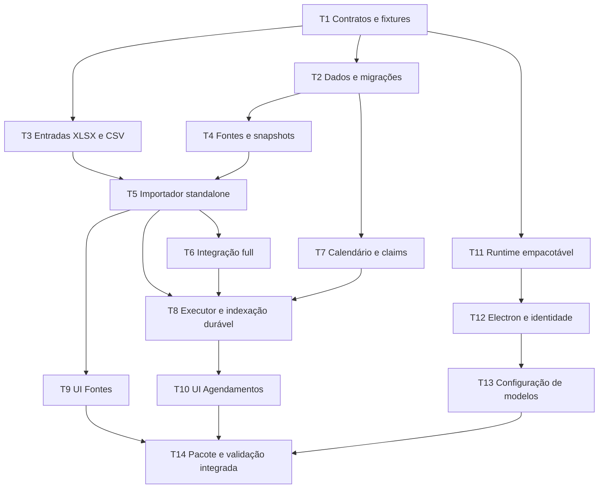

# Plano de implementação integrado

> **Para execução futura:** usar `superpowers:executing-plans` ou `superpowers:subagent-driven-development` para executar as tarefas após autorização. Checkboxes representam trabalho futuro, não concluído nesta entrega.

**Objetivo:** entregar desktop Electron, configuração de modelos locais, fontes por caminho com XLSX/CSV e agendador compartilhado com o site.

**Arquitetura:** React único; Python standalone no desktop; domínio Python de automação com adaptadores standalone/full; upload/conversão e ownership existentes preservados.

**Stack:** TypeScript/React/NestJS, Python/FastAPI/SQLAlchemy/openpyxl, SQLite/PostgreSQL, Electron/electron-builder/PyInstaller, Ollama já utilizado pelo projeto.

**Especificação:** [arquitetura](02-arquitetura-e-contratos.md), [desktop](03-desktop-electron-e-modelos.md), [fontes](04-importacao-por-caminhos-e-planilhas.md) e [agendador](05-agendador-site-e-desktop.md). Ler os quatro antes de executar tarefas.

## 1. Restrições globais

- Nome do executável: `conversor-generator.exe`.
- Preservar identidade por dispositivo/sessão e separação entre donos; não criar login obrigatório.
- Não escrever em originais nem mover dados para dentro de recursos instalados.
- Não executar calendário no browser; não substituir a fila durável existente.
- Todas as funcionalidades novas devem ter capacidades explícitas e falhar de forma clara quando indisponíveis.
- Windows x64 primeiro; site standalone e full mantidos; suporte remoto a pastas pessoais depende do conector separado.
- Manter PDF/imagens e schema v2 compatíveis; novo contrato de opções tabulares será v3, com normalização legada preservada.
- Configurações de perfil de máquina não podem ser alteradas por qualquer sessão do site.
- Testes reais de modelo e pacote Windows são distintos de testes com mocks; relatar os dois separadamente.
- Não estimar desempenho/hardware ou declarar equivalência de empacotamento sem medir.

## 2. Ordem e dependências



Tarefas podem ser implementadas em branches separadas quando realmente independentes, mas contratos, migrations e arquivos compartilhados precisam de um responsável por integração. Não é necessário implementar o desktop antes de validar fontes/agendas pelo browser.

## 3. Convenções de execução e comandos

Cada tarefa: escrever casos de falha, executar e verificar que falham pelo motivo esperado, implementar o contrato, executar testes-alvo e revisar diff. Um commit revisável por entrega; commits só durante implementação futura.

Comandos existentes, a usar quando os ambientes estiverem preparados:

```powershell
# Na raiz
npm --prefix packages/contracts run build
npm --prefix apps/web run build
npm --prefix apps/web test
npm --prefix apps/api run db:generate
npm --prefix apps/api run typecheck
npm --prefix apps/api test
npm --prefix apps/api run test:e2e
npm run test:mcp

# A partir de services/converter, com o Python da venv ativa
python -m pytest tests -q
```

No Windows, se não ativar a venv, usar caminho absoluto do Python correspondente. Não presumir que `python` global tenha as dependências corretas. Comandos `npm --prefix apps/desktop ...` abaixo são scripts a criar, ainda inexistentes.

## 4. Tarefas

### T1 — Fixar contratos e compatibilidade de opções

**Criar:** `packages/contracts/src/sources.ts`, `schedules.ts`, `runtime.ts`; `services/converter/sources/types.py`, `automation/types.py`; `services/converter/tests/test_upgrade_contracts.py`.

**Modificar:** `packages/contracts/src/{index,options}.ts`, `packages/contracts/openapi/public-api.yaml`, `services/converter/api/{schemas,service,capabilities}.py`, `apps/api/src/modules/conversions/options.spec.ts`.

**Produz:** DTOs de fonte/agenda/importação, `ScheduleRule`, `RunLease`, `SourceValidation`, `ConversionOptionsV3`. V3 acrescenta `spreadsheet={sheet_names?,header_row?,csv_encoding?,csv_delimiter?,formula_mode:'cached_or_text'}`; PDF/imagem mantêm defaults legados. V2 continua aceita e normalizada sem alteração de comportamento.

- [ ] Criar fixtures: `v2_pdf_unchanged`, `v2_image_txt_only`, `v3_xlsx_defaults`, `v3_csv_explicit_dialect`, `foreign_owner_ignored`, `invalid_interval_rejected`.
- [ ] Verificar que tipos/normalizadores atuais não aceitam a nova entrada; testes devem acusar suporte ausente, não falha de ambiente.
- [ ] Implementar normalização v3 nos dois lados e validar saídas compatíveis: PDF xlsx/txt/csv, imagem txt, planilha xlsx/txt/csv. Fixar versão de leitor no fingerprint.
- [ ] Atualizar OpenAPI com rotas, estados e erros propostos; incluir exemplos de idempotência e conflito de revisão.
- [ ] Executar build dos contratos, pytest `test_upgrade_contracts.py`/`test_options_parity.py` e Jest de opções. Aceite: fixtures equivalentes em Python/TS e todos os casos legados preservados.

### T2 — Persistência e migrações dos novos domínios

**Criar:** `services/converter/sources/{models,repository}.py`, `automation/{models,repository}.py`, migração `migrations/versions/<revision>_sources_and_automation.py`, `tests/test_automation_migrations.py`.

**Modificar:** registro de metadata em `models/db.py` e configuração de descoberta de pacotes no `pyproject.toml`.

**Consome:** DTOs T1. **Produz:** tabelas/constraints do documento 02 e operações transacionais de fonte/importação/agenda, sem acesso HTTP ainda.

- [ ] Testar upgrade de banco anterior com conversões existentes e criação de banco vazio; verificar contagem/hash das linhas antigas preservados.
- [ ] Criar models e índices, relações com owner, unicidade de ocorrência e versão de arquivo, `definition_json` imutável por importação e ponteiro `source_knowledge_heads` por coleção/arquivo lógico.
- [ ] Implementar migração versionada e import explícito de metadata; não acrescentar DDL improvisado por endpoint.
- [ ] Testar SQLite e PostgreSQL: conflito de ocorrência, revisão otimista, rollback e exclusão lógica.
- [ ] Executar `python -m pytest tests/test_automation_migrations.py -q`. Aceite: banco existente abre e recursos novos permanecem vazios até uso. Cenário PostgreSQL deve rodar em banco descartável, nunca no banco real.

### T3 — Entrada XLSX/CSV e evidência tabular

**Criar:** `ingestion/{spreadsheet_input,spreadsheet_pipeline}.py`, `tests/test_spreadsheet_input.py`, `tests/test_spreadsheet_pipeline.py` no serviço Python.

**Modificar:** `ingestion/registry.py`, `worker/tasks.py`, `models/document.py`, persistência em `repositories/conversion_repository.py`, `exports/text_plan.py`, `knowledge/{chunker,retrieval}.py`, validação/upload API Python e NestJS, componentes de evidência web. Se campos persistidos exigirem schema, criar migração aditiva específica.

**Interfaces:** `probe_spreadsheet(path: Path, declared_format: str, options: SpreadsheetOptions) -> SpreadsheetProbe`; `SpreadsheetConversionPipeline(...).run() -> PipelineResult`, compatível com publicação atual. `SpreadsheetOptions` corresponde à seção v3 definida em T1.

- [ ] Gerar fixtures em teste: duas abas, uma oculta, mescla, fórmula sem cache, CPF `00123456789`, data e aba vazia; CSV UTF-8 BOM com `;` e campo multilinha.
- [ ] Verificar falha por formato não suportado no estado anterior.
- [ ] Implementar leitura e plano tabular, preservando valor original e endereço; fórmula sem cache vira texto acompanhado de aviso.
- [ ] Atualizar dispatch/extensões/capabilities nas duas APIs e UI. Testar upload simples e multipart, não apenas chamada direta do leitor.
- [ ] Adicionar rejeição de ZIP genérico/corrompido, orçamento de expansão, dialeto ambíguo e `.xls/.xlsm` com erro explícito.
- [ ] Rodar pytest dos leitores/pipeline e paridade, Jest de `file-validation.service.spec.ts`, testes e2e de upload. Aceite: artefatos/auditoria/RAG referenciam células reais e regressões PDF/imagem permanecem verdes.

### T4 — Fontes autorizadas, scanner e snapshots

**Criar:** `sources/{path_policy,scanner,snapshot,service}.py`, `api/source_routes.py`, `tests/test_source_paths.py`, `tests/test_source_snapshots.py`.

**Modificar:** registro de rotas em `api/main.py`, capabilities/config.

**Interfaces:** `resolve_source_path(root: SourceRoot, relative_path: str) -> Path`; `scan_source(source: SourceRecord) -> Iterator[SourceCandidate]`; `capture_snapshot(candidate: SourceCandidate, grant: SourceRoot) -> SnapshotRef`. DTOs concretos ficam em `sources/types.py`; `SnapshotRef` contém key, sha256, tamanho e metadados.

- [ ] Testar raízes com prefixos parecidos, travessia, Unicode, junction escapando/trocada, UNC, arquivo removido e acesso negado.
- [ ] Implementar concessão administrativa local separada de criação pública de fonte. No site, owner só pode usar roots já concedidos.
- [ ] Implementar enumeração incremental e captura com estabilidade/handle conforme documento 04; não ler toda árvore em lista.
- [ ] Testar fonte vazia versus indisponível, Excel bloqueando arquivo, alteração durante captura e cancelamento no meio do scan.
- [ ] Rodar `python -m pytest tests/test_source_paths.py tests/test_source_snapshots.py -q`, com testes Windows reais de reparse points. Aceite: zero bytes lidos fora da raiz autorizada e originais inalterados.

### T5 — Importação manual standalone durável

**Criar:** `sources/{importer,submission}.py`, `tests/test_source_imports.py`.

**Modificar:** `api/source_routes.py`, serviços de lote/upload apenas para expor funções reutilizáveis sem mudar contrato legado.

**Consome:** snapshots T4, formatos T3 e tabelas T2. **Produz:** `ImportService.start(...)` e `StandaloneSubmissionPort`, com `ensure_batch`, `submit_snapshot`, `reconcile`, `cancel` definidos no documento 02.

- [ ] Testar duas chamadas com a mesma chave e corpo, mesma chave com outro corpo, reinício após upload concluído e arquivos inalterados.
- [ ] Implementar lock por fonte, deduplicação por versão/opções, IDs de item persistidos e reconciliador de importações.
- [ ] Reusar fluxo de upload validado; selar lote quando submissões terminarem, acompanhar conversões separadamente.
- [ ] Testar dois importadores, fonte alterada, falha parcial, falta de espaço e `force=true` sem destruir histórico.
- [ ] Rodar `python -m pytest tests/test_source_imports.py tests/test_batches_api.py -q`. Aceite: uma conversão por item de importação, inclusive em reentrega.

### T6 — Paridade full e correção da resolução de fontes RAG

**Criar:** `sources/gateway_submission.py`, `apps/api/src/modules/automation/{automation.module,automation.controller,automation-internal.controller,automation.service}.ts`, `apps/api/test/e2e/automation.e2e-spec.ts`.

**Modificar:** `apps/api/src/app.module.ts`, `services/converter/api/internal_routes.py`, `knowledge/indexer.py`, controller de engine-proxy e contratos internos.

**Interfaces:** `GatewaySubmissionPort` implementa o mesmo contrato T5; referência RAG interna `AuthorizedConversionSource={owner_id,conversion_id,document_id,run_id,filename}` é resolvida no gateway após ownership e enviada somente por rota interna autenticada.

- [ ] Criar teste com conversão presente apenas no Prisma: indexação atual não pode presumir `PublicConversionRow` no motor.
- [ ] Implementar resolução interna por run verificado sem dar acesso público a run IDs livres.
- [ ] Implementar proxy de fontes/agendas e submissão interna com validação de importação persistida, dono e token; quando houver `schedule_run_id`, validar também a ocorrência vinculada. Testar importação manual sem ocorrência. Proibir redirecionamento para URL arbitrária.
- [ ] Simular timeout depois de criação do lote e depois de complete-upload; repetição deve recuperar IDs existentes.
- [ ] Rodar e2e API e testes Python de conhecimento; conferir que nenhuma tabela Prisma é escrita pelo Python. Aceite: importação/RAG funcionam em full e outro owner recebe 404.

### T7 — Calendário e claim transacional

**Criar:** `automation/{calendar,scheduler,service}.py`, `tests/test_automation_calendar.py`, `tests/test_automation_claims.py`.

**Interfaces:** `Calendar.next_after(...)`, `ScheduleService.create(...)`, `AutomationRepository.claim_due(...)` conforme documento 02; relógio injetável em testes.

- [ ] Escrever casos diários 08:00 São Paulo, DST com hora inexistente/repetida em timezone que o possui, intervalo ancorado e relógio recuado.
- [ ] Implementar cálculo e preview de cinco ocorrências; incluir `tzdata` para Windows.
- [ ] Implementar transação ocorrência+avanço, unique key, CAS e lease/fence 120/30 segundos.
- [ ] Testar dois processos disputando ocorrência, edição concorrente, pause/resume, atraso longo condensado e `queue_one` limitado a uma pendência.
- [ ] Rodar `python -m pytest tests/test_automation_calendar.py tests/test_automation_claims.py -q` em SQLite e PostgreSQL. Aceite: nenhuma duplicação e nenhuma fila ilimitada após downtime.

### T8 — Executor de automação e indexação recuperável

**Criar:** `automation/{executor,cli,events,cleanup}.py`, `knowledge/job_runner.py`, `api/schedule_routes.py`, `tests/test_automation_executor.py`, `tests/test_knowledge_recovery.py`.

**Modificar:** lifespan, config, indexer/repository de conhecimento, schema/migração para leases de indexação e `infra/docker-compose.yml`.

**Consome:** T5/T6/T7. **Produz:** `AutomationExecutor.advance(lease) -> RunProgress`; dispatcher de indexação com claim/fence; API de histórico/cancelamento.

- [ ] Criar testes que interrompem processo após scan, snapshot, envio, conversão e indexação; comparar IDs antes/depois da recuperação.
- [ ] Implementar fases curtas e `waiting_children`, retries de 30/120/300 segundos, terminalização correta e cancelamento cooperativo.
- [ ] Tornar `knowledge_index_jobs` recuperáveis, eliminando dependência exclusiva do executor em memória para esse fluxo. Implementar promoção atômica de geração em `source_knowledge_heads`; testar duas versões contraditórias, falha da atualização e origem desaparecida: busca deve usar só a geração vigente com diagnóstico correto.
- [ ] Testar edição de caminho/filtros após criação da ocorrência: executor usa `SourceDefinitionSnapshot` persistido; revogar raiz bloqueia a leitura mesmo com snapshot válido.
- [ ] Integrar executor inline standalone e comando dedicado full, evitando dois calendários habilitados por padrão.
- [ ] Implementar eventos/SSE e limpeza explícita de snapshots; falhas retidas 7 dias e histórico 90, configuráveis.
- [ ] Rodar testes de executor, conhecimento, fila durável e checkpoints. Aceite: nenhuma execução é marcada sucesso antes de filhos terminais, e limpeza nunca remove fonte ou trabalho ativo.

### T9 — Telas compartilhadas de fontes

**Criar:** `apps/web/src/pages/{sources-page,source-detail-page}.tsx`, `services/sources.ts`, `hooks/use-sources.ts`, `pages/SourcesPage.test.tsx`.

**Modificar:** `App.tsx`, `components/layout/app-shell.tsx`, query keys, mensagens de erro/capabilities.

**Consome:** T4/T5 e bridge opcional T12. **Produz:** cadastro/validação/importação com feedback e links do lote.

- [ ] Testar disponibilidade sem Electron, raiz não concedida, cancelar seletor, pasta vazia e falha parcial.
- [ ] Implementar formulário e preview; caminhos digitados devem ser relativos à concessão no browser.
- [ ] Mostrar runtime, estado real, itens paginados e botão criar agendamento desta fonte.
- [ ] Executar Vitest dessa tela e build web. Aceite: bundle web não importa Electron/Node e funciona sem bridge.

### T10 — Telas compartilhadas de agendamento

**Criar:** `apps/web/src/pages/{schedules-page,schedule-detail-page,schedule-run-page}.tsx`, `services/schedules.ts`, `hooks/use-schedules.ts`, `pages/SchedulesPage.test.tsx`.

**Modificar:** rotas, navegação e query keys; reaproveitar padrões SSE existentes.

- [ ] Testar horário diário, intervalo inválido, timezone explícito, preview, conflito de revisão e fonte indisponível.
- [ ] Implementar criação/edição, pause/resume/run-now, timeline, contadores e cancelamento.
- [ ] Reconectar eventos com sequência e polling de fallback; não criar setInterval que execute a tarefa no cliente.
- [ ] Testar `partial`, `no_changes`, `failed`, `skipped` e recuperação com aba recarregada.
- [ ] Rodar Vitest e build. Aceite: abrir várias abas não duplica ocorrências; fechar todas não cancela tarefa no backend ativo.

### T11 — Backend empacotável e diretórios explícitos

**Criar:** `services/converter/desktop_entry.py`, `runtime/{__init__,paths}.py`, `packaging/converter.spec`, `tests/test_packaged_paths.py`.

**Modificar:** `config.py`, `api/main.py`, `worker/tasks.py`, demais escritores encontrados por busca de `SERVICE_DIR`, `data/work`, `tempfile`, `Path` e `WEB_DIST`.

**Interfaces:** `RuntimePaths.from_environment() -> RuntimePaths`; `desktop_entry.main() -> int`; readiness privado informa porta, versão e boot ID após bind real.

- [ ] Testar resources somente leitura, userData com espaços/acentos e cwd fora do repositório.
- [ ] Implementar configuração antes de imports com singleton, porta vinculada pelo sistema e handshake autenticado.
- [ ] Incorporar migrações ao startup com lock e backup consistente; recusar schema mais novo incompatível.
- [ ] Construir PyInstaller onedir em Windows e iniciar em diretório limpo, sem `.venv` do desenvolvedor.
- [ ] Aceite: PDF nativo/XLSX/CSV funcionam, tudo mutável fica em userData/work e readiness não depende de OCR disponível.

### T12 — Shell Electron, isolamento e identidade persistente

**Criar:** `apps/desktop` com arquivos listados no documento 03, exceto gerenciamento completo de modelos (T13); `apps/web/src/lib/platform.ts` e declaração tipada da bridge.

**Modificar:** scripts da raiz, bootstrap de sessão desktop e capabilities.

**Interfaces:** bridge de seleção/status/perfil e supervisor `start(): Promise<RuntimeEndpoint>`, `stop(): Promise<void>`; métodos restritos ao contexto local válido.

- [ ] Criar testes de segunda instância, crash do backend, startup timeout, troca de porta e restauração da identidade.
- [ ] Implementar main/preload com sandbox/context isolation, janela, origem controlada e token de host injetado só para o backend próprio.
- [ ] Implementar seletor de fonte e concessão administrativa autenticada; testar chamada IPC de frame inválido.
- [ ] Implementar bandeja e saída, sem matar processos externos; não usar shell para spawn.
- [ ] Criar scripts `npm --prefix apps/desktop test` e `npm --prefix apps/desktop run build`; executar. Aceite: SPA funciona com identidade estável e páginas externas não acessam privilégios.

### T13 — Seleção de GLM-OCR e LLM local

**Criar:** `apps/desktop/src/model-manager.ts`, `apps/web/src/pages/local-models-page.tsx`, testes correspondentes.

**Modificar:** profile, IPC, supervisor, parâmetros de OCR/assistente e metadados das respostas.

**Interfaces:** `testModelProfile(draft: ModelProfile) -> ModelDiagnostics`; `applyRuntimeProfile(draft,expectedVersion) -> ApplyResult` com estados `applied|deferred|rolled_back`.

- [ ] Testar cancelamento de seletor, executável ausente, pasta sem permissão, tag inexistente, modelo sem visão e timeout.
- [ ] Implementar modos externo/gerenciado, seleção separada OCR/LLM e importação GGUF compatível com argumentos fixos.
- [ ] Aplicar perfil com gravação atômica, espera de ponto seguro, health e rollback; não alterar ambiente global do Windows.
- [ ] Testar troca durante conversão/chat e com ocorrência ainda queued: drenar/cancelar todos os trabalhos não terminais antes de efetivar perfil. Incluir revisão/tag/digest no fingerprint de checkpoints; mudança externa de digest bloqueia retomada com `MODEL_REVISION_UNAVAILABLE`, sem mistura de modelos.
- [ ] Rodar testes de UI/supervisor e integração real com GLM-OCR/LLM disponíveis. Aceite: OCR e assistente usam tags selecionadas após reinício, sem depender de editar `.env` manualmente.

### T14 — Distribuição, operação e validação final

**Criar:** workflow Windows de build, roteiro de smoke desktop e pacote de fixtures de release; configurar electron-builder conforme documento 03.

**Modificar:** `README.md`, `CHANGELOG.md`, `docs/{ARCHITECTURE,FLOW,API,DATABASE,CONFIGURATION,STORAGE,OPERATIONS,TESTING,DEPLOY}.md`, READMEs de app/serviço e `.env.example` somente quando a implementação correspondente existir.

- [ ] Gerar instalador e conferir nome real do executável instalado, recursos necessários e ausência de dados privados no pacote.
- [ ] Executar matriz abaixo em Windows limpo, standalone browser e full; registrar versão, SO, hardware, comandos e resultados.
- [ ] Validar atualização sobre perfil com histórico, tarefas e fontes; backup/rollback deve restaurar conjunto coerente de banco e objetos.
- [ ] Validar dois donos, perda de cookie, banco antigo, root revogada e reinício durante execução.
- [ ] Medir tamanho do instalador, tempo de startup, memória de scan, importação grande e concorrência OCR/LLM. Definir limites suportados a partir dos resultados, sem prometer qualquer GPU.
- [ ] Rodar as suítes afetadas e regressão geral; revisar dependências/licenças e notas de distribuição.
- [ ] Aceite: todos os critérios dos documentos 03–05 cumpridos ou limitações explicitamente removidas do escopo anunciado; documentação final descreve comportamento testado.

## 5. Matriz de validação final

| Cenário | Standalone web | Full web | Desktop empacotado |
| --- | --- | --- | --- |
| PDF/imagem legados | Obrigatório | Obrigatório | Obrigatório |
| XLSX/CSV via upload manual | Obrigatório | Obrigatório | Obrigatório |
| Fonte autorizada e importação repetida | Obrigatório | Obrigatório, mount se Docker | Obrigatório, diálogo nativo |
| Agendamento diário/intervalo com UI fechada | Backend ligado | Serviços ligados | Bandeja ligada |
| Recuperação após queda durante upload | Obrigatório | Inclui perda de resposta gateway | Inclui restart de processo |
| Isolamento de dono e concessão de disco | Obrigatório | Obrigatório, token interno | Inclui ataque à origem/IPC |
| RAG com referência de conversão correta | Tabelas standalone | Resolução Prisma → run | Igual ao standalone |
| Perfil OCR/LLM por caminhos | Operador configura runtime | Operador configura runtime | Formulário e seletor |
| Migração e preservação de dados | SQLite | PostgreSQL + gateway separado | Perfil de versão anterior |

Não é necessário um teste real de GPU em cada pull request. Separar CI determinística com mocks/fixtures, integração opcional de modelos e validação obrigatória de release em Windows. Um skip de teste de OCR real não conta como OCR validado.

## 6. Entregas graduais e reversão

1. **Base tabular:** uploads manuais de planilhas funcionando, sem automação habilitada.
2. **Fontes:** importação por caminho com autorização, deduplicação e paridade full.
3. **Agendamento:** calendário e execução persistentes com telas e histórico.
4. **Desktop:** aplicativo equivalente com configuração local e empacotamento.
5. **Release integrado:** instalação limpa, atualização e documentação comprovadas.

Flags propostas: `SOURCE_IMPORTS_ENABLED`, `SPREADSHEET_INPUT_ENABLED`, `AUTOMATION_EXECUTOR_ENABLED`, `DESKTOP_HOST_ENABLED`; publicar capacidades efetivas, não só a existência da variável. Ao desabilitar imports, rejeitar novas importações e pausar novas capturas; tarefas em curso entram em estado operacional explicado. Desabilitar executor para novos disparos não deve apagar definições ou resultados.

Rollback de feature: interromper novos disparos, drenar/cancelar trabalhos com controle e voltar para binário compatível com schema. Não executar downgrade destrutivo automático. Para schema incompatível, restaurar backup consistente após preservar dados novos conforme procedimento operacional.

## 7. Decisões que podem ajustar o plano antes da implementação

As propostas estão completas para começar a revisão sem exigir respostas agora. Antes de executar, confirmar somente mudanças de escopo que a pessoa desejar:

- Se “planilhas” significava PDFs de origem, retirar leitor XLSX/CSV e manter fontes/agendas.
- Se precisam de XLS/XLSB/XLSM/ODS, adicionar etapa própria; esses formatos não estão implicitamente cobertos por XLSX.
- Se as tarefas precisam executar com usuário Windows deslogado e aplicativo encerrado, acrescentar serviço headless; bandeja não atende esse requisito.
- Se o site for hospedado e precisar acessar o PC visitante, incluir conector/pareamento completo; o site local atual não exige isso.
- Se houver checkpoints avulsos GLM-OCR fora do Ollama, validar formato/runtime específico antes de prometer carregamento direto.

Não implementar essas extensões por suposição, nem omitir os três recursos principais enquanto se discute extensões.
